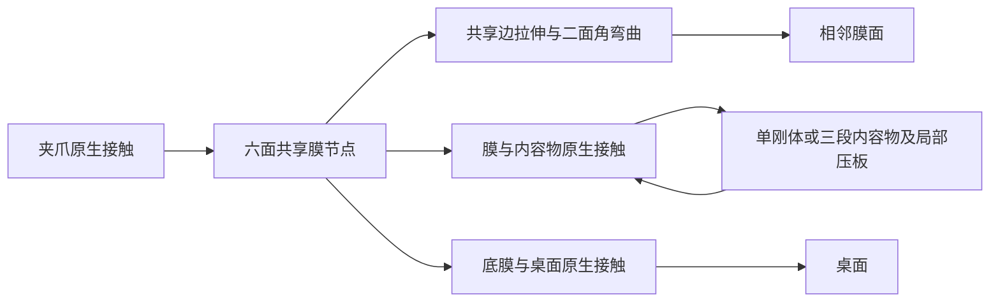

# 随机袋装包裹候选模型

默认模型为六面封闭物理膜、降阶内容物及原生接触。`model.py` 维护批量运行接口，`kernels.py` 维护内容物，`film.py` 维护薄膜，`film_contacts.py` 维护材料坐标接触记录。测试及共享YAM适配器位于 `test/content_model/parcel/`。单位采用SI，材料范围采用工程设定，实物标定待完成。

## 实际拓扑与力传递

每面4×4结构节点，边界复用同一个物理节点。总计56节点、108三角形、162边，其中36条边连接不同面。每条边恰有两个相邻三角形。六面依次为TOP(+z)、BOTTOM(−z)、LEFT(−x)、RIGHT(+x)、FRONT(−y)、BACK(+y)。各面4个内部节点集中到40mm宽的中央区域，小尺寸方向保持原间距，边界位置保持共享。该细化保留闭合外表面积，并按实际参考三角面积重新分配质量。



膜节点通过原生MuJoCo dim=2 flex三角面参与双侧接触、自接触与积分，每个节点有三个平移自由度和正质量。自定义Warp能量提供膜弹性与阻尼，原生flex弹性关闭。编译时关于flex缺少原生passive forces的警告对应这一实现选择。

碰撞掩码分别为桌面1/2、膜2/15、内容物8/10、夹具手指4/3（contype/conaffinity）。正常支撑路径经过底膜。原型0/1采用单刚体，2/3采用易弯三段，4/5采用易压三段。每段核心/压板质量合计为该段内容物质量，膜质量另按面积计算。三段仍使用原有柔性关节，压板保留非线性压缩力。显式膜模式关闭核心碰撞单元间原有2%人为缝隙。

膜与内容物通过接触传力，内容物自由运动受闭合膜包覆。显式膜模式关闭原三路径虚拟绳和聚拢法向接触代理。夹爪抓住实际膜面后，通过原生法向力与库仑摩擦承载。所有反作用由原生接触求解传给内容物、机器人或桌面。

## 膜能量、耗散和失效

对边h定义当前长度l、参考长度L，二面角差使用周期连续的atan2(sinθ,cosθ)。参考边长和二面角来自每个环境的实际参考几何。

\[
E_s=\sum_h\tfrac12 k_h(l_h-L_h)^2,\qquad
E_b=\sum_h\tfrac12 k_b(\theta_h-\theta_{0h})^2,
\qquad F_e=-\nabla_x(E_s+E_b).
\]

拉伸项在拉伸和压缩时均有效，网格通过低弯曲刚度允许折叠。接缝边的拉伸系数和破坏力共同乘以seam_ratio。阻尼包含沿边相对速度和二面角速度两个模态。

\[
R=\sum_h\tfrac12 c_h\dot l_h^2+\tfrac12 c_{bh}\dot\theta_h^2,
\quad F_d=-\nabla_vR,\quad F_d\cdot v=-2R\le0.
\]

其中 `c_h=2 ζ_s sqrt(k_h m_reduced)`，`c_bh=2 ζ_b sqrt(k_b I_eff)`，其中 `1/I_eff=Σ_i |∂θ_h/∂x_i|²/m_i`，使用相邻四节点的实际模态惯量。Warp Tape分别对位置能量和速度耗散求导。弯曲耗散使用独立的无梯度位置副本，避免污染弹性梯度。平移与刚体转动不产生材料耗散，净内力和净内力矩在数值精度内相消。

拉伸力超过有限阈值时，该边的拉伸和弯曲项失效，失去的储能累计到fracture_loss。原生网格连接及碰撞仍保留，当前损伤模型描述局部承载失效，裂口拓扑和撕裂传播待实现。

## 参数与几何松弛

`config.json` 保存内容物范围、几何slack和桌面摩擦，`film_config.json` 保存膜范围。六面共享一组膜材参数，接缝具有相关修正。每个环境独立采样。参考几何尺寸为 `L(1+slack_x)`、`W(1+slack_y)`、`H(1+0.5(slack_x+slack_y))+4mm`，内容物初态位于其中。满/松成对原型消耗同样的随机数，保持相同内容物响应，仅改变几何slack。

| 参数 | 当前范围或定义 | 单位 |
|---|---|---|
| bag length/width/height | 从内容物尺寸与slack推导 | m |
| thickness | 50–150 | μm |
| density | 900–1100 | kg/m³ |
| film mass per area | thickness × density | kg/m² |
| node mass | 各相邻参考三角面积的1/3 × mass per area | kg |
| stretch_stiffness | 60–150，每条普通边 | N/m |
| bending_stiffness | 1–4 × 10⁻⁶ | J/rad² |
| damping_ratio | 0.4–0.6，边长模式 | 1 |
| bending_damping_ratio | 0.7–1.0，折叠模式 | 1 |
| finger/payload friction | 0.5–0.9 / 0.25–0.5 | 1 |
| table friction | 0.3–0.7 | 1 |
| seam stiffness ratio | 0.8–1.0 | 1 |
| breaking_force | 10–20，接缝乘seam_ratio | N |
| contact_radius | 1mm数值接触皮层 | m |
| contact_time / impedance | 1ms / 0.99，有限接触柔度 | s / 1 |

物理厚度决定膜质量，接触皮层用于粗分辨率下的接触鲁棒性。节点armature为零。材料可用量来自实际参考三角面积相对内容物包络的剩余面积，除以局部特征长度并分配到共享节点，单位为m。该账本与几何共同确定，区域聚拢扣减同一共享账本，切换face_id不会重置。当前局部松弛分布由参考几何决定，独立随机的局部褶皱分布仍待加入。

## 任意面接触与材料状态

六面使用同一个Observer。记录包括face_id、实际三角形编号、重心坐标、参考材料位置、当前世界系法向和两条切向，以及共享节点材料状态。字段中的local_contact_position使用参考材料坐标，local_surface_normal/tangents使用捕获时的世界坐标。

双指真实接触且闭合沿膜面切向运动时，按实际闭合量聚拢有限材料。局部对向法向接触建立后保存材料坐标，状态1为夹持、2为接触迁移、3为脱离、4为邻域膜失效。纯原生接触也允许没有额外聚拢预算的已解析夹持，grasp_class区分这两种记录。Observer只读接触并记账，承载完全由原生接触和膜力决定。native库仑摩擦容量有限，失夹与滑动由动力学自然产生。

slip_distance记录当前接触点相对初始参考材料位置的距离。接触点排序变化会影响该诊断，精确连续的材料滑移测量待完善。实际力学滑移持续由原生接触求解。释放不会重新创建材料预算，reset开始新包裹时清空账本。

## GPU运行机制

初始化仅构造单刚体/三段两种固定拓扑。reset在GPU采样并更新逐环境body_pos、质量、内容物惯量、geom_size、关节参数和摩擦，再通过MJWarp set_const刷新派生量。膜节点位置、参考边长/角、质量、损伤及状态均为逐环境数组。尺寸变化通过这些字段更新，拓扑和编译模型复用。

安装的MuJoCo/MJWarp为3.17.0、Warp为1.19.0。原生flex stiffness/rest/bending/friction不支持逐环境批量，因此弹性采用自定义Warp核，geom优先级设为1以使用各环境的内容物、手指和桌面摩擦。膜自接触当前采用无摩擦近似。每环境候选接触容量1024，CCD/EPA容量256，约束容量1024，测试检查overflow位图。

物理步内没有逐环境Python循环及CPU读回。`step1`更新当前变换后施加膜能量/耗散力，`step2`执行原生接触与积分，最后更新接触状态。默认GPU步长62.5μs，CUDA Graph包含全部力核、接触和状态更新。graph构建执行warmup及capture两步，精确初态需在capture后reset。

```python
from contents.parcel import Batch
import warp as wp

batch = Batch(64, rigid=False, prototype=-1, seed=7)
graph = batch.graph(close=1, face_id=-1)
batch.reset()
for _ in range(1000):
    wp.capture_launch(graph)
wp.synchronize()
```

`face_id=-1`允许任意面，0–5指定一次捕获面。`level`、`region`、`bind`为历史接口，显式膜承载始终采用上述物理路径。`envelope=False`运行历史三路径机制，历史精确轨迹与采样序列使用各运行保存的源码快照。历史结果保留在同一主题报告中。

## 验证与YAM入口

正式运行在仓库根目录，使用 `/home/ubuntu/Dev/Envs/mjwarp/bin/python` 并持 `flock /tmp/claude-gpu.lock`。输出目录须为新路径。膜检查入口分别为 `test_film.py`、`six_face_contact.py`、`film_checks.py`、`film_benchmark.py`、`film_relaxation.py`。拓扑及响应绘图使用 `plot_film.py`。完整命令、结果及未通过项见 [测试报告](../../test/content_model/parcel/REPORT.md)。

```sh
PYTHONPATH=.:test/content_model flock /tmp/claude-gpu.lock \
  /home/ubuntu/Dev/Envs/mjwarp/bin/python -m experience.yam_platform.angles \
  --backend parcel.yam_adapter --model-options '{"prototype":3,"seed":7}' \
  --pinch-coeff 0 --contact-time .001 --dt .000125 \
  --output test/runs/2026-11-14/bag/parcel-film-yam-new
```

共享YAM入口显式传入pinch-coeff/contact-time/dt，因为其CLI默认值覆盖适配器默认值。适配器复用原机械臂动作、10N夹紧目标、原判定与视频渲染，CPU执行同一Warp膜力核。侧面参数为 `grasp_face=side, side_pitch_deg=30`，边角为 `grasp_face=corner`。GPU批次当前包含包裹与物理手指夹具，整台YAM的GPU异构批次待接入。

当前六面版本仍未得到成功提起的YAM记录。粗网格的局部折叠、机器人跟踪和夹持接触均限制了实测效果。自由回弹修订已有隔离对照，塑性永久褶皱、真实膜应力应变标定、疲劳、温度相关行为、多件独立内容物及裂纹传播仍未覆盖。有限工况的数值检查结果不能推及这些行为。
