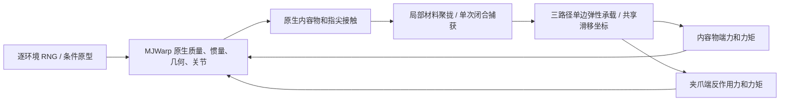

# 随机袋装包裹候选模型

模型由 `model.py` 和 `kernels.py` 维护，参数范围集中在 `config.json`。测试和 YAM 接口在 `test/content_model/parcel/`。单位采用 SI。候选模型采用工程范围，实物标定仍待开展。



## 结构与物理假设

- 原型 0/1 为刚性满装/松装，采用单刚体；2/3 为易弯满装/松装；4/5 为易压满装/松装。柔性批次为三个刚体、两组三轴 hinge。铰链保持端点平移约束。单刚体和三段批次分别初始化，逐步执行期间保持拓扑。
- 每段分为 90% 质量的核心和 10% 质量的顶面压板，质量相加为总质量。惯量按对应长方体尺寸计算。三段质量权重与共同惯性偏置同时决定质心。密度不均匀用惯性中心相对碰撞包络的偏移近似。
- 柔性压板沿局部 z 滑动。原生隐式线性弹簧和阻尼承担线性项，自定义广义力增加正压缩量的二次项。压力经实际接触传到有质量压板，反力传到核心。回弹由已储存的弹性能驱动。核心保留较大固定厚度，最大有效压缩受到核心碰撞和压板行程限制。
- 弯曲目标是两关节小角度链在端力 mg 下的目标挠度，使用 `k=mg*5*(L/3)^2/sag`。扭转刚度是弯曲刚度的条件比例。该解析响应定义不同于旧多轴分段模型的校准表。自重下垂和大转角须由数值测量给出。
- `slack/slack_y` 定义长宽几何余量，包络为 `(L*(1+slack), W*(1+slack_y), H)`。区域预算为剩余周长的 5%/30%/25%/40%，对应顶面、长边、短边、封口。紧袋硬物的顶面预算为零，其余区域重新分配。局部预算、聚拢长度、捕获长度和提起松弛分别保存。
- 袋体以内容物的接触包络与三条承载路径近似。三段固定连接保持内容物连续性。独立多件内容物、袋内相对滑动和完整膜包络约束属于后续物理扩展。
- 承载锚点位于各段中心，刚性批次则沿单刚体长轴取三点。捕获时取当前路径长度加提起松弛作为静长。单边张力为 `k*max(length-rest-slip,0)`，无绳阻尼。两端力矩均用实际作用点相对 COM 的叉积，写入世界系 `xfrc_applied`。
- 捕获前需要双指真实接触，正闭合速度才能聚拢。每次闭合上升沿采样一次。失败码 1 为预算不足，2 为未聚拢，3 为接触/可达性不成立，4 为随机捕获失败。新闭合事件通过打开后再次关闭触发。
- 捕获后的膜夹持使用 宽度为 `min(4 mm + 2*聚拢/捕获长度, 24 mm)` 的聚拢层和每指 10000 N/m、2 N·s/m 单边接触弹簧代理，实际手指关节受反力。有效法向载荷取两侧较小值的两倍。该接触代理仍需独立实验标定。
- 滑移采用隐式粘性正则化和 24 次二分求解，动态摩擦容量随剩余捕获长度降低。耗尽进入 DETACHMENT，单路径张力超过材料限值进入 RUPTURE。两种失效均清空张力。释放后可开始新事件。
- 桌面直接接触核心/压板，摩擦系数代表袋—桌面接触。几何预算表示材料可用性，具体膜褶皱与细节应力仍属于假设。

## 参数与单位

| 参数 | 含义 | 单位 |
|---|---|---|
| length/width/height | 内容物包络尺寸 | m |
| mass/weights/com | 总质量、段质量比例、目标惯性偏置 | kg / 1 / m |
| bend_sag/soft_sag | mg 端力下的小角度目标挠度 | m |
| bend/twist | 弯曲和扭转弹簧刚度 | N·m/rad |
| damping_ratio | 关节临界阻尼比例 | 1 |
| compression_depth/soft_compression_depth | 压板 20 N 响应目标 | m |
| compression/quadratic | 压缩一次、二次项系数 | N/m、N/m² |
| slack/slack_y | 长宽方向几何余量 | 1 |
| budget/gathered/captured/slip | 区域预算、聚拢、捕获、滑移长度 | m |
| lift_slack | 捕获时增加的承载路径静长 | m |
| rope_k | 单路径弹性刚度 | N/m |
| table_mu/mu_s/mu_d | 桌面、静、动摩擦系数 | 1 |
| strength | 单路径破坏张力 | N |
| gather/escape/efficiency | 聚拢、逃逸和接触效率系数 | 1 |
| threshold | 聚拢长度捕获阈值 | m |
| slip_damping | 滑移粘性正则系数 | N·s/m |
| State.rest/tension/anchor | 路径静长、张力、夹爪局部捕获点 | m / N / m |

## GPU 接口

```python
from contents.parcel import Batch
import warp as wp
b = Batch(512, rigid=False, seed=7, level=2)
b.reset(episode=3)
graph = b.graph(close=1, region=1)
for _ in range(1000):
    wp.capture_launch(graph)
wp.synchronize()
```

`reset` 在 GPU 上按 seed、环境编号和 episode 采样，再写入原生字段，调用 MJWarp 3.17 `set_const` 更新派生惯量与碰撞边界。所有支持批量的模型字段均分配逐环境存储。步进与 reset 均无逐环境 Python 循环，步进无主机读回。接触法向反馈取上一个已完成约束求解的载荷，当前弹性力在 `step1` 刷新当前位姿后计算，`step2` 积分。反馈离散有一步延迟，步长对照记录在报告。初始化阶段构造两个固定拓扑。`graph` 首先执行 warmup，再 capture，会推进状态，调用方需要精确初态时在 capture 后 reset。

`level=0` 为内容物，1 为可显式 bind 的理想袋体材料夹具，2 为捕获和滑移模型。`action` 是 GPU 材料测试夹具选项。机器人行为通过下面的共享 YAM 入口执行。

## 可复现入口

使用 `/home/ubuntu/Dev/Envs/mjwarp/bin/python`，正式 GPU 运行持 `/tmp/claude-gpu.lock`。输出目录必须为新路径。

```sh
flock /tmp/claude-gpu.lock /home/ubuntu/Dev/Envs/mjwarp/bin/python test/content_model/parcel/test_physics.py
flock /tmp/claude-gpu.lock /home/ubuntu/Dev/Envs/mjwarp/bin/python test/content_model/parcel/material_checks.py --output test/runs/2026-11-14/bag/material-new
flock /tmp/claude-gpu.lock /home/ubuntu/Dev/Envs/mjwarp/bin/python test/content_model/parcel/validate.py --output test/runs/2026-11-14/bag/fixtures-new
flock /tmp/claude-gpu.lock /home/ubuntu/Dev/Envs/mjwarp/bin/python test/content_model/parcel/validate.py --mode benchmark --output test/runs/2026-11-14/bag/speed-new
flock /tmp/claude-gpu.lock /home/ubuntu/Dev/Envs/mjwarp/bin/python test/content_model/parcel/yam_suite.py --output test/runs/2026-11-14/bag/yam-new
PYTHONPATH=.:test/content_model /home/ubuntu/Dev/Envs/mjwarp/bin/python -m experience.yam_platform.angles --backend parcel.yam_adapter --model-options '{"prototype":3}' --dt .0005 --output test/runs/2026-11-14/bag/yam-single-new
```

六原型编号可用于 `--model-options` 的 `prototype`。YAM 适配器在 CPU 上执行同一 Warp 材料力核，沿用共享 v2.2 机械臂动作、闭合判据、事件判定、轨迹保存和 CPU 视频回放。当前 GPU 批次验证对象是包裹与夹持代理，整台 YAM 的异构 GPU 批次仍待接入。

本轮结果和未通过项目见 [报告](../../test/content_model/parcel/REPORT.md)。完整实物薄膜、疲劳、塑性、撕裂传播、温度相关材料和多件滑动仍待支持。

侧面抓取可通过YAM入口的 `--model-options '{"prototype":3,"seed":7,"grasp_face":"side","region":1,"side_pitch_deg":30}'` 调用。该姿态从长边前侧面中央沿+y、向下倾斜指定角度接近，沿-x闭合。纯水平接近在当前安装位置初始化不可达；30°斜向首轮尚未捕获成功，实际回放与失败记录见主题报告。
