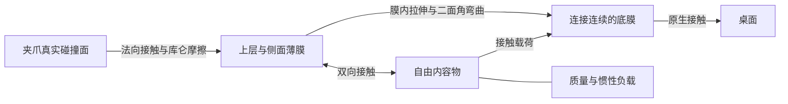

# 既有双膜片袋的纯接触包裹模型

最近整理时间为2026-11-15 17:01（Asia/Taipei）。用户要求停止测试并交付报告，本轮结束。已建立MuJoCo/MJWarp 4.0.1原型，整体物理验收尚未通过。

最大实际完成短窗口检查的规模为8192环境，9216环境在CUDA Graph执行实例创建阶段显存不足。原生接触捕获与完整机械臂抓取尚未验证成功，默认25 μs步长的角动量检查超出本轮1%标准。

## Phase 0 审计与本轮计划

2026-11-15，机器 ubun。环境为 MuJoCo 3.17.0、MJWarp 3.17.0、Warp 1.19.0，RTX 5090 32 GB。

### 现有结构

- `bag_sim/geometry/kraft.npz` 保存 vertices、faces、panel_ids、masses_kg 和 uv。原网格为 413 顶点、792 三角形，袋口有 32 条边界边。
- 已存的 `kraft_coarse_35.npz` 为 200 顶点、396 三角形、594 条边。每边相邻两面，无边界或非流形边。上下膜、两侧折边和端封复用物理顶点。原文件 SHA-256 为 `ce77e774d7a01061815c207202613e420e1985da3382fb96a91ce2464de93604`。
- 本轮直接加载上述封闭网格，保持顶点编号、三角形和 panel_ids。几何尺寸变化只缩放这份参考材料坐标。初始化复用 `wrap.wrap_generic`，包裹后的坐标写入状态，材料参考边长和参考面积独立保留。
- 历史 `mj_loose._flex_xml` 使用 dim=2、elastic2d=both、discrete。其输入为包裹后的点，编译器因而把包裹构型当作参考态。历史选定版本为 Et=1000 N/m、D=0.00135 N·m、半径5 mm、刚体步长0.8 ms。
- 历史 `pinch=True` 会预建上层膜 connect，F7 在条件满足时激活。新入口采用纯原生接触，袋与夹爪、袋与内容物之间均没有 attachment、weld 或虚拟张力绳。
- 原碰撞掩码已禁止内容物直接接触桌面及指尖。保留这一力传递结构。新模型的内容物单刚体或三段关节均独立于膜运动。
- 旧 GPU 数据中 1024 环境达到0.59355抓取/s，但穿透17.47 mm，未通过历史验收。不能沿用这项速度作为新模型结果。

### 安装版本功能核对

已读取实际安装的 `mujoco_warp/_src/io.py`、`types.py`、`passive.py`、`forward.py`。`put_model(batch_sizes=...)` 仅接受声明为批量字段的参数。`flex_vert0`、`flexedge_length0`、`flex_stiffness`、`flex_bending`、`flex_damping`、`flex_friction` 为共享字段。

本轮使用原生2D膜弹性与接触，膜尺寸、膜材料和内容物结构按配置分组编译并缓存。组内reset仅更新状态及实际支持批量的质量、惯量、刚度、阻尼、摩擦。不会声称膜参考几何可逐环境修改。CPU材料回调不会自动在GPU执行，压缩律在原生slide关节广义力上分别以NumPy和Warp实现。关节上的反力通过同一多体动力学系统传回父体。

原生Flex仍标为实验性功能，实际能力以本轮最小实验为准。[上游功能说明](https://github.com/google-deepmind/mujoco_warp) · [功能跟踪](https://github.com/google-deepmind/mujoco_warp/issues/1362)。3.17曲参考弯曲修复复用项目已归档的同一实现，并保留其上游来源。[上游修复](https://github.com/google-deepmind/mujoco/commit/afa16414ca62075676e24a3003a8825cc4da0d26)

### 执行顺序与通过标准

先完成单刚体CPU入口和支撑，再加三段与压缩，接入共享YAM抓取，最后做GPU批量与随机化。所有进入结论的运行持 `flock /tmp/claude-gpu.lock`，结果写 `test/runs/2026-11-15/bag/physical-parcel-<run-id>/`，保留源码和配置。

| 检查 | 配置与重复数 | 本轮标准 |
| --- | --- | --- |
| 1 拓扑与参考态 | 默认存档网格，1次 | 封闭定向、正面积、正质量、原拓扑不变，参考边长与初始化坐标分开 |
| 2 六向接触 | box/capsule/sphere，六方向各1次 | 原生Flex接触、接触端反力非零，记录穿透与膜邻域响应 |
| 3 底膜支撑 | 单刚体，1次 | 无裸物桌面接触，稳态支持力与总重误差≤5%，接触穿透≤1 mm |
| 4 提拉诊断 | 实际膜节点区域加载，1次 | 记录膜张紧、载荷与支撑变化。理想锚点明确记诊断，真实捕获另验 |
| 5 松紧对照 | 相同内容物，参考材料尺寸两组各1次 | 记录参考面积、边长、质量、初始应力、张紧与载荷，禁止只改状态冒充松弛 |
| 6 柔性与压缩 | 三档K各1次，压缩加载卸载1次 | 质量惯量一致，记录下垂、频率、耗散，压缩律与实际关节力一致 |
| 7 捕获滑移 | 共享YAM平台纯接触试次 | 逐项记录空抓、捕获、承重、滑移、脱落，未出现的状态明确未验证 |
| 8 收支 | 无外部接触自由运动与耗散各1次 | 记录线/角动量与机械能，纯内力情形相对漂移≤1%，无非有限值 |
| 9 GPU | 1/32/128/512环境，各3次计时 | 报告物理步耗时、环境步/s、接触、迭代、显存、独立参数及原始overflow。失败批次不计有效吞吐 |

CPU入口不通过时先保留最小复现并修复。GPU功能不支持时提供实际异常和源码证据，保留CPU可运行实现。标准变化需在此说明理由并告知用户。

## 本轮结果

### 3.17 入口与失败诊断

`physical-parcel-entry-r1` 的100次有效惯性求解预算触顶，原始warning计数11。增加到300次后，`entry-r2` 的0.3秒原生膜运行warning为0，末态桌面支持3.1520 N、预期总重3.1950 N、接触穿透0.3812 mm，内容物与桌面直接接触0。

在无重力、无接触的参考构型上，修正曲参考系数后的原生弯曲仍有最大0.6490 N被动力，包裹初态最大273.99 N。原始证据为 `physical-parcel-entry-r2/native_bending_diagnostic.json`。改用现有 `bag_model.dihedrals` 的能量梯度后参考态内力为0，但其显式积分在0.4 ms失败，0.3秒支撑为0、峰值穿透482.79 mm。最高单铰链线性频率约82061 rad/s，原步长未解析这一模态。失败数据保留 `physical-parcel-cpu-r1/`，不作为通过结果。六向探针入口还暴露了固定法向筛选没有候选三角形的实现问题，后续检查因此中止。

### MuJoCo 4 迁移计划

用户在实施中询问迁移MuJoCo 4。本轮转向隔离的MuJoCo/MJWarp 4.0.1入口，固定现有网格与力传递结构。4.0修正2D弹性常数，4.0.1进一步修复稀疏Newton因子分解问题。新环境使用 `.venv-physical-parcel`，依赖记录在 `envs/physical-parcel-requirements.txt`，安装范围限于本项目。

先在相同参考网格上核对4.0.1原生膜的无载参考力，再决定保留原生隐式弯曲或使用已验证的替代。材料目标按SI参数重新核对，旧ν=0.3不满足官方旧行为精确换算的ν<0.25条件，禁止声称简单换版本即可保持原响应。随后沿用上表标准完成最小物理原型和批量检查。[4.0迁移说明](https://mujoco.readthedocs.io/en/4.0.0/changelog.html) · [4.0.1修复](https://github.com/google-deepmind/mujoco/releases/tag/4.0.1)

### 用户追加的容量测试计划

用户要求测试最多可开多少环境。在1/32/128/512基础上增加1024、2048、4096，依据实际显存占用继续逼近容量边界。各档使用已静置CPU状态、独立质量/惯量/摩擦参数，50物理步、3次重复，保留原始overflow及非有限值。显存不足或不满足数值检查的档位记失败，并在相邻成功档位之间缩小间隔。报告最大实际通过数量和测试分辨率，吞吐与长期物理验收分别列出。

8192环境已完成三次，峰值采样显存29400 MiB，9032.73环境步/s，原始overflow为0、全有限，实际质量/摩擦联合参数逐环境唯一且与GPU采样值一致。下一档9216，随后按256环境间隔逼近显存边界。

早期1024/4096记录中的独立性失败是检查实现错误。独立随机采样允许float32质量偶然重复，原检查要求所有质量值互异。现改为验证实际质量、内容物摩擦及桌面摩擦的联合参数与逐环境采样对应，并核对联合参数互异。8192档通过修正检查，旧误判记录保留。

## 实际实现与参数

### 模型入口

| 文件 | 职责 |
| --- | --- |
| [physical_parcel.py](../../bag_sim/physical_parcel.py) | 现有几何加载、参考态与当前态、三类内容物、CPU材料力、接触观测 |
| [physical_parcel_gpu.py](../../bag_sim/physical_parcel_gpu.py) | 固定参考材料组的GPU批量、逐环境参数、CUDA Graph与数值诊断 |
| [physical_parcel_checks.py](physical_parcel_checks.py) | 拓扑、六向接触、支撑、提拉、松紧、柔性、收支与材料夹具 |
| [physical_parcel_benchmark.py](physical_parcel_benchmark.py) | GPU规模、独立参数、显存、计时和逐核profiling |
| [physical_parcel_yam.py](physical_parcel_yam.py) | 统一YAM平台适配，原生接触，辅助连接与聚拢弹簧均为零 |
| [test_physical_parcel.py](test_physical_parcel.py) | 7项静态与力学回归检查 |

环境依赖在 [physical-parcel-requirements.txt](../../envs/physical-parcel-requirements.txt)，项目内解释器为 `.venv-physical-parcel/bin/python`。

### 力学路径



模型没有袋—内容物连接，也没有夹爪—袋膜承载连接。内容物与桌面、指尖的碰撞掩码不相容，载荷经膜传递。所有膜顶点具有正质量，膜面和接缝沿用存档拓扑。CPU与GPU都采用原生膜内弹性及接触，面外弯曲采用已有 `bag_model.dihedrals` 的解析梯度，GPU实现同一公式。

### 方程与单位

各向同性材料入口 `material_parameters(E,t,rho,nu)` 同时计算

\[
S=Et,\qquad D=\frac{Et^3}{12(1-\nu^2)},\qquad \rho_A=\rho t.
\]

S的单位为N/m，D为N·m，面密度为kg/m²。按参考三角形面积的三分之一分配节点质量。参考几何缩放后重新计算边长、面积、质量及铰链几何权重，再独立生成包裹初态。仅修改初始节点位置不会改变材料参考面积。

\[
U_b=\sum_h\frac12 K_h\Delta\theta_h^2,\qquad
K_h=D\frac{3l_h^2}{A_{h,1}+A_{h,2}}s_h,
\]
\[
F_b=-\nabla_x U_b-c_h\dot\theta_h\nabla_x\theta_h,\qquad
c_h=2\zeta\sqrt{K_h I_h},\quad I_h^{-1}=\sum_i\frac{|\nabla_i\theta_h|^2}{m_i}.
\]

铰链角差用周期atan2计算。跨panel边采用原折边比例 `s_h=0.01`。弯曲力与耗散由内部广义力进入动力学，成对反作用沿同一膜面传播。

内容物B1为单自由刚体，可设置质量、主惯量和局部质心。B2为三个刚体及两处绕局部y轴的弹簧阻尼铰链，`tau=-K theta-D theta_dot`，角度范围±π/4。B3在每段下部核心与顶面接触压板之间增加局部−z向slide自由度，核心和压板质量按90%/10%分配。

\[
F_c=\max(0,k_1\delta+k_2\delta^2+c\dot\delta),\qquad \delta\ge0.
\]

压缩律施加在真实压板与其父体的slide广义力上。k1为N/m，k2为N/m²，c为N·s/m。当前压缩只覆盖局部厚度方向，三轴泡沫压缩与体积本构尚未实现。

### 本轮薄膜预设

| 参数 | 数值 |
| --- | --- |
| 存档几何 | 牛皮纸袋封闭网格，200顶点/396面/594边 |
| 参考平面尺寸 | 350×250 mm |
| 面密度与膜总质量 | 0.12 kg/m²，25.6854 g |
| 参考面积 | 0.214045 m² |
| E、t、ν | 6.6667 MPa、0.15 mm、0.3 |
| Et与D | 1000 N/m，2.06044×10⁻⁶ N·m |
| Rayleigh与铰链阻尼比 | 10⁻⁴ s，0.1 |
| 数值接触半径、摩擦 | 0.5 mm，0.45 |
| 默认步长 | 25 μs |
| Newton预算、容差、线搜索预算 | 300、10⁻⁸、50 |
| 默认内容物 | 120×80×30 mm，0.3 kg |

本轮采用与E、厚度自洽的薄膜材料预设，参数未经实物标定。历史牛皮纸D=0.00135 N·m的材料响应对照仍待完成。高D配合原0.4 ms显式弯曲曾失败，新入口增加了弯曲模态步长校验。

## 物理检查结果

| 项目 | 已完成结果 | 状态 |
| --- | --- | --- |
| 拓扑与参考态 | 原faces保持，正节点质量，neq=0，参考态最大材料内力0 | 通过 |
| 六向接触 | 18组中16组记录到反力，box左/右为0；部分前/后探针峰值穿透1.43–2.15 mm | 部分失败，布置与接触原因待定位 |
| 底膜支撑 | 支持3.197492 N，预期3.194974 N，误差0.0788%；稳定段峰值穿透0.01674 mm；裸物—桌面接触0；warning 0 | 本工况通过 |
| 膜节点提拉 | 四个真实膜节点受3.8 N渐增外力，内容物升高68.858 mm，桌面支持降至0，峰值穿透0.3039 mm | 承载诊断通过，外力夹具模式 |
| 松紧对照 | 松袋/紧袋升高68.858/72.420 mm，峰值穿透0.3039/0.4137 mm | 外力承载两组通过，夹持差异未建立 |
| 三段柔性 | K=0.8/0.08/0.008 N·m/rad，各段质量合计0.3 kg；高K记录23.256 Hz，中/低K在窗口内未解析出频率 | 质量与恢复响应通过，频率覆盖不完整 |
| 非线性压缩 | δ=4 mm时实测3.52 N，与公式一致 | 力律检查通过，后续限位参数修订未动态复验 |
| 材料捕获 | 空抓例无承载；目标例仍只有empty状态，指尖反力记录为0，未抬升 | 捕获未通过，滑移/承重/脱落未验证 |
| 线动量与耗散 | 40 ms无外接触，线动量相对漂移约1.22×10⁻¹⁵，能量2.803→0.372 mJ | 本窗口通过 |
| 角动量 | 25 μs相对漂移4.281%，6.25 μs复核为0.7301% | 默认步长未过1%标准，细步长本窗口通过 |
| 统一YAM入口 | 2 ms smoke完成，跟踪峰值0.001159 mm，辅助承载连接0 | 入口通过，完整抓取未运行 |
| 单元检查 | 7/7通过 | 覆盖拓扑、参考态、弯曲净力/力矩、质量、关节力、压缩律与材料缩放 |

松紧两组使用同一内容物、同一外力协议和同一原始拓扑。紧袋参考尺寸200×140 mm，面积0.0696642 m²、膜质量8.3597 g；松袋面积0.214045 m²、膜质量25.6854 g。按相同面密度计算质量。初始最大边应变分别2.196%和0.2985%。当前张紧起点算法在两组均于首采样25 μs触发，其区分能力尚未建立。

材料夹具采用共享平台的20×40 mm圆角指尖几何，移动边界提供外部功。当前两例都没有记录到指尖—膜反力，尚未区分夹具布置、测量问题与真实捕获失败。材料坐标迁移读数属于接触诊断，连续真实摩擦滑移尚未验证。

YAM早期两次入口失败分别来自角度单位冲突和4.0的Flex命名访问接口，已在适配器修正，第三次短入口通过。完整机械臂动作与原平台阈值保持其共享实现。

## GPU吞吐与容量

RTX 5090，机器ubun，原200顶点膜网格＋单刚体，已静置状态，25 μs步长。每档3次，每次50步，即每次仅1.25 ms仿真。计时包含原生碰撞、求解、解析弯曲力及数值诊断，编译、模型上传、reset与Graph捕获单列。

总环境步/s取三次墙钟时间的中位数计算。每批物理步耗时取三次均值。显存为若干里程点采样的整卡占用，含桌面，瞬时峰值未连续监测。

| 环境数 | 每批step平均ms | 总环境步/s | 采样显存MiB | 状态 |
| --- | --- | --- | --- | --- |
| 1 | 40.776 | 24.444 | 1748 | 短窗通过 |
| 32 | 63.637 | 500.430 | 1876 | 短窗通过 |
| 128 | 76.050 | 1698.941 | 2197 | 短窗通过 |
| 512 | 118.176 | 4308.970 | 3478 | 短窗通过 |
| 1024 | 167.994 | 6092.322 | 5237 | 数值通过，旧独立性检查误判，速度列作诊断 |
| 2048 | 296.325 | 6910.452 | 8736 | 短窗通过 |
| 4096 | 492.019 | 8323.739 | 15543 | 数值通过，旧独立性检查误判，速度列作诊断 |
| 8192 | 907.904 | 9032.730 | 29400 | 修正后的实际联合参数检查通过 |
| 9216 | — | — | — | Graph执行实例创建时显存不足 |

8192档实际内容物质量0.240012–0.359939 kg，各环境的质量与摩擦联合参数独立。末步接触数56–64/环境，Newton迭代峰值33/300，原始overflow全0，全部状态有限，接触峰值穿透0.003539 mm。

因此最大**已完成测试**规模为8192。8192与9216之间的精确容量边界尚未测定，用户已要求停止。此容量结论仅覆盖短窗单刚体批次，长时抓取、三段B2/B3、其他材料组及更大接触数的容量仍待验证。

独立性检查核对GPU实际模型数组中的质量、内容物摩擦、桌面摩擦与该环境采样的对应关系。批量reset更新质量与惯量时调用MJWarp `set_const` 刷新派生量。膜参考几何与膜材料按组共享，尺寸或材料换组时编译一次，组内reset复用模型。

### 性能瓶颈

512环境单次额外、非捕获step的逐核计时总计90.768 ms。其中稀疏分块Cholesky核72.181 ms，占79.52%；稀疏结构检测5.177 ms，符号Cholesky3.904 ms，稀疏Hessian初始化2.252 ms，有效度量稠密项装配1.541 ms。自定义弯曲核约0.0295 ms。

该次profiling定位的主要成本是约束Newton矩阵分解。捕获图的正式三次50步数据沿用上表，额外单step profiler用于定位。当前没有进行降低求解精度、关闭接触或更换网格的性能优化。[逐核数据](../runs/2026-11-15/bag/physical-parcel-mj4-gpu-profile-r1/worlds-512/profile.json)

## 实际功能覆盖与限制

| 能力 | 当前证据 |
| --- | --- |
| 2D Flex与膜内弹性 | CPU及GPU实际运行 |
| Flex与box | 内容物支撑实际运行，六向探针中的两例无反力待定位 |
| Flex与sphere/capsule | CPU六向探针已运行；GPU安装源码存在对应分支，独立GPU探针尚未运行 |
| Flex自碰撞 | CPU有实际自接触记录，GPU使用原生auto路径 |
| Flex与另一独立Flex | 安装源码有多Flex路径，独立最小实验未运行 |
| 关节弹簧和阻尼 | B2 CPU实际运行；GPU更新代码已有，B2批次未运行 |
| 非线性压缩 | CPU力律实际核对；GPU专用核已有，B3批次未运行 |
| Spatial Tendon | 安装源码存在，本模型未使用 |
| 自定义被动力 | CPU在step1/step2之间施加，GPU为批量Warp核 |
| CUDA Graph | 1至8192环境实际执行，9216创建执行实例时OOM |
| 模型参数随机化 | 质量/惯量、内容物和桌面摩擦实际验证；关节参数仅有实现 |
| 参考几何随机化 | 固定拓扑按材料/尺寸分组；逐环境膜参考字段不支持 |

原生接触与摩擦负责实际承载。永久塑性折痕、SLS记忆、撕裂拓扑、真实材料标定、多件内容物和三轴可压缩连续体尚未实现。显式弯曲的稳定性与准确性限制步长，高刚度材料需要单独验证。默认25 μs仍有已测角动量误差，6.25 μs结果只覆盖40 ms无外接触窗口。GPU有效惯性线性方程的独立残差及长期轨迹一致性尚未检查。

## 复现入口与原始数据

以下为已有执行入口，输出路径需另选新目录。用户要求停止后，本轮没有追加运行。

```sh
flock /tmp/claude-gpu.lock .venv-physical-parcel/bin/python -B \
  test/bag_model/physical_parcel_checks.py --case support --output <新目录>

flock /tmp/claude-gpu.lock .venv-physical-parcel/bin/python -B \
  test/bag_model/physical_parcel_benchmark.py --worlds 1 32 128 512 --steps 50 --repeats 3 \
  --initial-state test/runs/2026-11-15/bag/physical-parcel-mj4-support-r1/support/final_state.npz \
  --output <新目录>

flock /tmp/claude-gpu.lock .venv-physical-parcel/bin/python -B \
  -m unittest discover -s test/bag_model -p test_physical_parcel.py -v

PYTHONPATH=test/bag_model:experience:. flock /tmp/claude-gpu.lock \
  .venv-physical-parcel/bin/python -B -m yam_platform.angles \
  --backend physical_parcel_yam --dt .000025 --pinch-coeff 0 --contact-time .001 \
  --smoke-seconds .002 --output <新目录>
```

数据均在 [当日bag目录](../runs/2026-11-15/bag/)，每个 `physical-parcel-*` 目录保存该轮配置、哈希、结果或失败原因。主要证据如下。

- [支撑](../runs/2026-11-15/bag/physical-parcel-mj4-support-r1/support.json)
- [六向接触](../runs/2026-11-15/bag/physical-parcel-mj4-contacts-r2/contacts.json)
- [提拉](../runs/2026-11-15/bag/physical-parcel-mj4-pull-r1/pull.json)与[松紧对照](../runs/2026-11-15/bag/physical-parcel-mj4-slack-r1/slack.json)
- [柔性及压缩](../runs/2026-11-15/bag/physical-parcel-mj4-compliance-r1/compliance.json)
- [25 μs收支](../runs/2026-11-15/bag/physical-parcel-mj4-conservation-r1/conservation.json)与[6.25 μs复核](../runs/2026-11-15/bag/physical-parcel-mj4-conservation-refinement-r1/dt6_25us/conservation.json)
- [捕获夹具](../runs/2026-11-15/bag/physical-parcel-mj4-capture-r1/fixture/capture.json)与[YAM短入口](../runs/2026-11-15/bag/physical-parcel-mj4-yam-entry-r3/result.json)
- [1至512测速](../runs/2026-11-15/bag/physical-parcel-mj4-gpu-batch-r1/summary.json)、[1024至4096](../runs/2026-11-15/bag/physical-parcel-mj4-gpu-capacity-r1/summary.json)、[8192](../runs/2026-11-15/bag/physical-parcel-mj4-gpu-capacity-r2/summary.json)、[9216 OOM](../runs/2026-11-15/bag/physical-parcel-mj4-gpu-capacity-r3/failure.json)

早期部分运行只记录源码哈希，后续运行同时保存source快照；YAM入口另保存共享平台源码和机器人资产指纹。各轮结论仅对应该轮记录的配置与源码。
