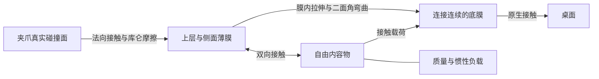

# 既有双膜片袋的纯接触包裹模型

最近更新时间为2026-11-17（Asia/Shanghai），机器ubun。当前用户确认基线为142节点/280面最外缘封口双膜片，MuJoCo/MJWarp4.0.1。最新随机内容物完整YAM轮次18组中15组通过准备、167次袋面采样接受39次、9次抓取成功0/9；未取得有载保持。纸袋胶囊真实闭合接触的短窗口最大已测有效8192环境、32716.5环境步/s，10240分配失败；模型、材料、阶段与缓冲配置见文末。整体物理验收尚未通过。

首轮历史结果（以下为旧初始化工作负载，不能替代文末当前完整YAM轮次）：最大实际完成短窗口检查的规模为8192环境，9216环境在CUDA Graph执行实例创建阶段显存不足。原生接触捕获与完整机械臂抓取尚未验证成功，默认25 μs步长的角动量检查超出首轮1%标准。修复后YAM已实际执行到lift，因双侧指尖接触丢失超过50 ms而grasp_fail。

**后续几何复核（用户指出录像画面穿透）**发现此前接触距离没有覆盖全部膜面几何相交。初始膜面采样切入盒子1.2539 mm，40个三角形相交，8个盒角均在包络外；旧0.3秒静置状态采样相交深度达4.1559 mm。原支撑力数值仅保留为力读数记录，几何防穿透通过结论撤回。8192环境速度对应旧初始化工作负载。旧录像已停止。后续已修复初态、反力刷新及box专用碰撞漏检，当前YAM结果与视频见文末。

## Phase 0 审计与本轮计划

2026-11-15，机器 ubun。环境为 MuJoCo 3.17.0、MJWarp 3.17.0、Warp 1.19.0，RTX 5090 32 GB。

### 现有结构

- `bag_sim/geometry/kraft.npz` 保存 vertices、faces、panel_ids、masses_kg 和 uv。原网格为 413 顶点、792 三角形，袋口有 32 条边界边。
- 已存的 `kraft_coarse_35.npz` 为 200 顶点、396 三角形、594 条边。每边相邻两面，无边界或非流形边。上下膜、两侧折边和端封复用物理顶点。原文件 SHA-256 为 `ce77e774d7a01061815c207202613e420e1985da3382fb96a91ce2464de93604`。
- 本轮直接加载上述封闭网格，保持顶点编号、三角形和 panel_ids。几何尺寸变化只缩放这份参考材料坐标。初始化复用 `wrap.wrap_generic`，包裹后的坐标写入状态，材料参考边长和参考面积独立保留。
- 历史 `mj_loose._flex_xml` 使用 dim=2、elastic2d=both、discrete。其输入为包裹后的点，编译器因而把包裹构型当作参考态。历史选定版本为 Et=1000 N/m、D=0.00135 N·m、半径5 mm、刚体步长0.8 ms。
- 历史 `pinch=True` 会预建上层膜 connect，F7 在条件满足时激活。新入口采用纯原生接触，袋与夹爪、袋与内容物之间均没有 attachment、weld 或虚拟张力绳。
- 原碰撞掩码已禁止内容物直接接触桌面及指尖。保留这一力传递结构。新模型的内容物单刚体或三段关节均独立于膜运动。
- 旧 GPU 数据中 1024 环境达到0.59355抓取/s，但穿透17.47 mm，未通过历史验收。不能沿用这项速度作为新模型结果。

### 安装版本功能核对

已读取实际安装的 `mujoco_warp/_src/io.py`、`types.py`、`passive.py`、`forward.py`。`put_model(batch_sizes=...)` 仅接受声明为批量字段的参数。`flex_vert0`、`flexedge_length0`、`flex_stiffness`、`flex_bending`、`flex_damping`、`flex_friction` 为共享字段。

本轮使用原生2D膜弹性与接触，膜尺寸、膜材料和内容物结构按配置分组编译并缓存。组内reset仅更新状态及实际支持批量的质量、惯量、刚度、阻尼、摩擦。不会声称膜参考几何可逐环境修改。CPU材料回调不会自动在GPU执行，压缩律在原生slide关节广义力上分别以NumPy和Warp实现。关节上的反力通过同一多体动力学系统传回父体。

原生Flex仍标为实验性功能，实际能力以本轮最小实验为准。[上游功能说明](https://github.com/google-deepmind/mujoco_warp) · [功能跟踪](https://github.com/google-deepmind/mujoco_warp/issues/1362)。3.17曲参考弯曲修复复用项目已归档的同一实现，并保留其上游来源。[上游修复](https://github.com/google-deepmind/mujoco/commit/afa16414ca62075676e24a3003a8825cc4da0d26)

### 执行顺序与通过标准

先完成单刚体CPU入口和支撑，再加三段与压缩，接入共享YAM抓取，最后做GPU批量与随机化。所有进入结论的运行持 `flock /tmp/claude-gpu.lock`，结果写 `test/runs/2026-11-15/bag/physical-parcel-<run-id>/`，保留源码和配置。

| 检查 | 配置与重复数 | 本轮标准 |
| --- | --- | --- |
| 1 拓扑与参考态 | 默认存档网格，1次 | 封闭定向、正面积、正质量、原拓扑不变，参考边长与初始化坐标分开 |
| 2 六向接触 | box/capsule/sphere，六方向各1次 | 原生Flex接触、接触端反力非零，记录穿透与膜邻域响应 |
| 3 底膜支撑 | 单刚体，1次 | 无裸物桌面接触，稳态支持力与总重误差≤5%，接触穿透≤1 mm |
| 4 提拉诊断 | 实际膜节点区域加载，1次 | 记录膜张紧、载荷与支撑变化。理想锚点明确记诊断，真实捕获另验 |
| 5 松紧对照 | 相同内容物，参考材料尺寸两组各1次 | 记录参考面积、边长、质量、初始应力、张紧与载荷，禁止只改状态冒充松弛 |
| 6 柔性与压缩 | 三档K各1次，压缩加载卸载1次 | 质量惯量一致，记录下垂、频率、耗散，压缩律与实际关节力一致 |
| 7 捕获滑移 | 共享YAM平台纯接触试次 | 逐项记录空抓、捕获、承重、滑移、脱落，未出现的状态明确未验证 |
| 8 收支 | 无外部接触自由运动与耗散各1次 | 记录线/角动量与机械能，纯内力情形相对漂移≤1%，无非有限值 |
| 9 GPU | 1/32/128/512环境，各3次计时 | 报告物理步耗时、环境步/s、接触、迭代、显存、独立参数及原始overflow。失败批次不计有效吞吐 |

CPU入口不通过时先保留最小复现并修复。GPU功能不支持时提供实际异常和源码证据，保留CPU可运行实现。标准变化需在此说明理由并告知用户。

## 本轮结果

### 3.17 入口与失败诊断

`physical-parcel-entry-r1` 的100次有效惯性求解预算触顶，原始warning计数11。增加到300次后，`entry-r2` 的0.3秒原生膜运行warning为0，末态桌面支持3.1520 N、预期总重3.1950 N、接触穿透0.3812 mm，内容物与桌面直接接触0。

在无重力、无接触的参考构型上，修正曲参考系数后的原生弯曲仍有最大0.6490 N被动力，包裹初态最大273.99 N。原始证据为 `physical-parcel-entry-r2/native_bending_diagnostic.json`。改用现有 `bag_model.dihedrals` 的能量梯度后参考态内力为0，但其显式积分在0.4 ms失败，0.3秒支撑为0、峰值穿透482.79 mm。最高单铰链线性频率约82061 rad/s，原步长未解析这一模态。失败数据保留 `physical-parcel-cpu-r1/`，不作为通过结果。六向探针入口还暴露了固定法向筛选没有候选三角形的实现问题，后续检查因此中止。

### MuJoCo 4 迁移计划

用户在实施中询问迁移MuJoCo 4。本轮转向隔离的MuJoCo/MJWarp 4.0.1入口，固定现有网格与力传递结构。4.0修正2D弹性常数，4.0.1进一步修复稀疏Newton因子分解问题。新环境使用 `.venv-physical-parcel`，依赖记录在 `envs/physical-parcel-requirements.txt`，安装范围限于本项目。

先在相同参考网格上核对4.0.1原生膜的无载参考力，再决定保留原生隐式弯曲或使用已验证的替代。材料目标按SI参数重新核对，旧ν=0.3不满足官方旧行为精确换算的ν<0.25条件，禁止声称简单换版本即可保持原响应。随后沿用上表标准完成最小物理原型和批量检查。[4.0迁移说明](https://mujoco.readthedocs.io/en/4.0.0/changelog.html) · [4.0.1修复](https://github.com/google-deepmind/mujoco/releases/tag/4.0.1)

### 用户追加的容量测试计划

用户要求测试最多可开多少环境。在1/32/128/512基础上增加1024、2048、4096，依据实际显存占用继续逼近容量边界。各档使用已静置CPU状态、独立质量/惯量/摩擦参数，50物理步、3次重复，保留原始overflow及非有限值。显存不足或不满足数值检查的档位记失败，并在相邻成功档位之间缩小间隔。报告最大实际通过数量和测试分辨率，吞吐与长期物理验收分别列出。

8192环境已完成三次，峰值采样显存29400 MiB，9032.73环境步/s，原始overflow为0、全有限，实际质量/摩擦联合参数逐环境唯一且与GPU采样值一致。下一档9216，随后按256环境间隔逼近显存边界。

早期1024/4096记录中的独立性失败是检查实现错误。独立随机采样允许float32质量偶然重复，原检查要求所有质量值互异。现改为验证实际质量、内容物摩擦及桌面摩擦的联合参数与逐环境采样对应，并核对联合参数互异。8192档通过修正检查，旧误判记录保留。

## 实际实现与参数

### 模型入口

| 文件 | 职责 |
| --- | --- |
| [physical_parcel.py](../../bag_sim/physical_parcel.py) | 现有几何加载、参考态与当前态、三类内容物、CPU材料力、接触观测 |
| [physical_parcel_gpu.py](../../bag_sim/physical_parcel_gpu.py) | 固定参考材料组的GPU批量、逐环境参数、CUDA Graph与数值诊断 |
| [physical_parcel_checks.py](physical_parcel_checks.py) | 拓扑、六向接触、支撑、提拉、松紧、柔性、收支与材料夹具 |
| [physical_parcel_benchmark.py](physical_parcel_benchmark.py) | GPU规模、独立参数、显存、计时和逐核profiling |
| [physical_parcel_yam.py](physical_parcel_yam.py) | 统一YAM平台适配，原生接触，辅助连接与聚拢弹簧均为零 |
| [test_physical_parcel.py](test_physical_parcel.py) | 7项静态与力学回归检查 |

环境依赖在 [physical-parcel-requirements.txt](../../envs/physical-parcel-requirements.txt)，项目内解释器为 `.venv-physical-parcel/bin/python`。

### 力学路径



模型没有袋—内容物连接，也没有夹爪—袋膜承载连接。内容物与桌面、指尖的碰撞掩码不相容，载荷经膜传递。所有膜顶点具有正质量，膜面和接缝沿用存档拓扑。CPU与GPU都采用原生膜内弹性及接触，面外弯曲采用已有 `bag_model.dihedrals` 的解析梯度，GPU实现同一公式。

### 方程与单位

各向同性材料入口 `material_parameters(E,t,rho,nu)` 同时计算

\[
S=Et,\qquad D=\frac{Et^3}{12(1-\nu^2)},\qquad \rho_A=\rho t.
\]

S的单位为N/m，D为N·m，面密度为kg/m²。按参考三角形面积的三分之一分配节点质量。参考几何缩放后重新计算边长、面积、质量及铰链几何权重，再独立生成包裹初态。仅修改初始节点位置不会改变材料参考面积。

\[
U_b=\sum_h\frac12 K_h\Delta\theta_h^2,\qquad
K_h=D\frac{3l_h^2}{A_{h,1}+A_{h,2}}s_h,
\]
\[
F_b=-\nabla_x U_b-c_h\dot\theta_h\nabla_x\theta_h,\qquad
c_h=2\zeta\sqrt{K_h I_h},\quad I_h^{-1}=\sum_i\frac{|\nabla_i\theta_h|^2}{m_i}.
\]

铰链角差用周期atan2计算。跨panel边采用原折边比例 `s_h=0.01`。弯曲力与耗散由内部广义力进入动力学，成对反作用沿同一膜面传播。

内容物B1为单自由刚体，可设置质量、主惯量和局部质心。B2为三个刚体及两处绕局部y轴的弹簧阻尼铰链，`tau=-K theta-D theta_dot`，角度范围±π/4。B3在每段下部核心与顶面接触压板之间增加局部−z向slide自由度，核心和压板质量按90%/10%分配。

\[
F_c=\max(0,k_1\delta+k_2\delta^2+c\dot\delta),\qquad \delta\ge0.
\]

压缩律施加在真实压板与其父体的slide广义力上。k1为N/m，k2为N/m²，c为N·s/m。当前压缩只覆盖局部厚度方向，三轴泡沫压缩与体积本构尚未实现。

### 本轮薄膜预设

| 参数 | 数值 |
| --- | --- |
| 存档几何 | 牛皮纸袋封闭网格，200顶点/396面/594边 |
| 参考平面尺寸 | 350×250 mm |
| 面密度与膜总质量 | 0.12 kg/m²，25.6854 g |
| 参考面积 | 0.214045 m² |
| E、t、ν | 6.6667 MPa、0.15 mm、0.3 |
| Et与D | 1000 N/m，2.06044×10⁻⁶ N·m |
| Rayleigh与铰链阻尼比 | 10⁻⁴ s，0.1 |
| 数值接触半径、摩擦 | 0.5 mm，0.45 |
| 默认步长 | 25 μs |
| Newton预算、容差、线搜索预算 | 300、10⁻⁸、50 |
| 默认内容物 | 120×80×30 mm，0.3 kg |

本轮采用与E、厚度自洽的薄膜材料预设，参数未经实物标定。历史牛皮纸D=0.00135 N·m的材料响应对照仍待完成。高D配合原0.4 ms显式弯曲曾失败，新入口增加了弯曲模态步长校验。

## 物理检查结果

| 项目 | 已完成结果 | 状态 |
| --- | --- | --- |
| 拓扑与参考态 | 原faces保持，正节点质量，neq=0，参考态最大材料内力0 | 通过 |
| 六向接触 | 18组中16组记录到反力，box左/右为0；部分前/后探针峰值穿透1.43–2.15 mm | 部分失败，布置与接触原因待定位 |
| 底膜支撑 | 支持3.197492 N，预期3.194974 N，误差0.0788%；稳定段峰值穿透0.01674 mm；裸物—桌面接触0；warning 0 | 本工况通过 |
| 膜节点提拉 | 四个真实膜节点受3.8 N渐增外力，内容物升高68.858 mm，桌面支持降至0，峰值穿透0.3039 mm | 承载诊断通过，外力夹具模式 |
| 松紧对照 | 松袋/紧袋升高68.858/72.420 mm，峰值穿透0.3039/0.4137 mm | 外力承载两组通过，夹持差异未建立 |
| 三段柔性 | K=0.8/0.08/0.008 N·m/rad，各段质量合计0.3 kg；高K记录23.256 Hz，中/低K在窗口内未解析出频率 | 质量与恢复响应通过，频率覆盖不完整 |
| 非线性压缩 | δ=4 mm时实测3.52 N，与公式一致 | 力律检查通过，后续限位参数修订未动态复验 |
| 材料捕获 | 空抓例无承载；目标例仍只有empty状态，指尖反力记录为0，未抬升 | 捕获未通过，滑移/承重/脱落未验证 |
| 线动量与耗散 | 40 ms无外接触，线动量相对漂移约1.22×10⁻¹⁵，能量2.803→0.372 mJ | 本窗口通过 |
| 角动量 | 25 μs相对漂移4.281%，6.25 μs复核为0.7301% | 默认步长未过1%标准，细步长本窗口通过 |
| 统一YAM入口 | 2 ms smoke完成，跟踪峰值0.001159 mm，辅助承载连接0 | 入口通过，完整抓取未运行 |
| 单元检查 | 7/7通过 | 覆盖拓扑、参考态、弯曲净力/力矩、质量、关节力、压缩律与材料缩放 |

松紧两组使用同一内容物、同一外力协议和同一原始拓扑。紧袋参考尺寸200×140 mm，面积0.0696642 m²、膜质量8.3597 g；松袋面积0.214045 m²、膜质量25.6854 g。按相同面密度计算质量。初始最大边应变分别2.196%和0.2985%。当前张紧起点算法在两组均于首采样25 μs触发，其区分能力尚未建立。

材料夹具采用共享平台的20×40 mm圆角指尖几何，移动边界提供外部功。当前两例都没有记录到指尖—膜反力，尚未区分夹具布置、测量问题与真实捕获失败。材料坐标迁移读数属于接触诊断，连续真实摩擦滑移尚未验证。

YAM早期两次入口失败分别来自角度单位冲突和4.0的Flex命名访问接口，已在适配器修正，第三次短入口通过。完整机械臂动作与原平台阈值保持其共享实现。

## GPU吞吐与容量

RTX 5090，机器ubun，原200顶点膜网格＋单刚体，已静置状态，25 μs步长。每档3次，每次50步，即每次仅1.25 ms仿真。计时包含原生碰撞、求解、解析弯曲力及数值诊断，编译、模型上传、reset与Graph捕获单列。

总环境步/s取三次墙钟时间的中位数计算。每批物理步耗时取三次均值。显存为若干里程点采样的整卡占用，含桌面，瞬时峰值未连续监测。

| 环境数 | 每批step平均ms | 总环境步/s | 采样显存MiB | 状态 |
| --- | --- | --- | --- | --- |
| 1 | 40.776 | 24.444 | 1748 | 短窗通过 |
| 32 | 63.637 | 500.430 | 1876 | 短窗通过 |
| 128 | 76.050 | 1698.941 | 2197 | 短窗通过 |
| 512 | 118.176 | 4308.970 | 3478 | 短窗通过 |
| 1024 | 167.994 | 6092.322 | 5237 | 数值通过，旧独立性检查误判，速度列作诊断 |
| 2048 | 296.325 | 6910.452 | 8736 | 短窗通过 |
| 4096 | 492.019 | 8323.739 | 15543 | 数值通过，旧独立性检查误判，速度列作诊断 |
| 8192 | 907.904 | 9032.730 | 29400 | 修正后的实际联合参数检查通过 |
| 9216 | — | — | — | Graph执行实例创建时显存不足 |

8192档实际内容物质量0.240012–0.359939 kg，各环境的质量与摩擦联合参数独立。末步接触数56–64/环境，Newton迭代峰值33/300，原始overflow全0，全部状态有限，接触峰值穿透0.003539 mm。

因此最大**已完成测试**规模为8192。8192与9216之间的精确容量边界尚未测定，用户已要求停止。此容量结论仅覆盖短窗单刚体批次，长时抓取、三段B2/B3、其他材料组及更大接触数的容量仍待验证。

独立性检查核对GPU实际模型数组中的质量、内容物摩擦、桌面摩擦与该环境采样的对应关系。批量reset更新质量与惯量时调用MJWarp `set_const` 刷新派生量。膜参考几何与膜材料按组共享，尺寸或材料换组时编译一次，组内reset复用模型。

### 性能瓶颈

512环境单次额外、非捕获step的逐核计时总计90.768 ms。其中稀疏分块Cholesky核72.181 ms，占79.52%；稀疏结构检测5.177 ms，符号Cholesky3.904 ms，稀疏Hessian初始化2.252 ms，有效度量稠密项装配1.541 ms。自定义弯曲核约0.0295 ms。

该次profiling定位的主要成本是约束Newton矩阵分解。捕获图的正式三次50步数据沿用上表，额外单step profiler用于定位。当前没有进行降低求解精度、关闭接触或更换网格的性能优化。[逐核数据](../runs/2026-11-15/bag/physical-parcel-mj4-gpu-profile-r1/worlds-512/profile.json)

## 实际功能覆盖与限制

| 能力 | 当前证据 |
| --- | --- |
| 2D Flex与膜内弹性 | CPU及GPU实际运行 |
| Flex与box | 内容物支撑实际运行，六向探针中的两例无反力待定位 |
| Flex与sphere/capsule | CPU六向探针已运行；GPU安装源码存在对应分支，独立GPU探针尚未运行 |
| Flex自碰撞 | CPU有实际自接触记录，GPU使用原生auto路径 |
| Flex与另一独立Flex | 安装源码有多Flex路径，独立最小实验未运行 |
| 关节弹簧和阻尼 | B2 CPU实际运行；GPU更新代码已有，B2批次未运行 |
| 非线性压缩 | CPU力律实际核对；GPU专用核已有，B3批次未运行 |
| Spatial Tendon | 安装源码存在，本模型未使用 |
| 自定义被动力 | CPU在step1/step2之间施加，GPU为批量Warp核 |
| CUDA Graph | 1至8192环境实际执行，9216创建执行实例时OOM |
| 模型参数随机化 | 质量/惯量、内容物和桌面摩擦实际验证；关节参数仅有实现 |
| 参考几何随机化 | 固定拓扑按材料/尺寸分组；逐环境膜参考字段不支持 |

原生接触与摩擦负责实际承载。永久塑性折痕、SLS记忆、撕裂拓扑、真实材料标定、多件内容物和三轴可压缩连续体尚未实现。显式弯曲的稳定性与准确性限制步长，高刚度材料需要单独验证。默认25 μs仍有已测角动量误差，6.25 μs结果只覆盖40 ms无外接触窗口。GPU有效惯性线性方程的独立残差及长期轨迹一致性尚未检查。

## 复现入口与原始数据

以下为已有执行入口，输出路径需另选新目录。用户要求停止后，本轮没有追加运行。

```sh
flock /tmp/claude-gpu.lock .venv-physical-parcel/bin/python -B \
  test/bag_model/physical_parcel_checks.py --case support --output <新目录>

flock /tmp/claude-gpu.lock .venv-physical-parcel/bin/python -B \
  test/bag_model/physical_parcel_benchmark.py --worlds 1 32 128 512 --steps 50 --repeats 3 \
  --initial-state test/runs/2026-11-16/bag/physical-parcel-mj4-face-clearance-r3/support/final_state.npz \
  --output <新目录>

flock /tmp/claude-gpu.lock .venv-physical-parcel/bin/python -B \
  -m unittest discover -s test/bag_model -p test_physical_parcel.py -v

PYTHONPATH=test/bag_model:experience:. flock /tmp/claude-gpu.lock \
  .venv-physical-parcel/bin/python -B -m yam_platform.angles \
  --backend physical_parcel_yam --dt .000025 --pinch-coeff 0 --contact-time .001 \
  --smoke-seconds .002 --output <新目录>
```

数据均在 [当日bag目录](../runs/2026-11-15/bag/)，每个 `physical-parcel-*` 目录保存该轮配置、哈希、结果或失败原因。主要证据如下。

- [支撑](../runs/2026-11-15/bag/physical-parcel-mj4-support-r1/support.json)
- [六向接触](../runs/2026-11-15/bag/physical-parcel-mj4-contacts-r2/contacts.json)
- [提拉](../runs/2026-11-15/bag/physical-parcel-mj4-pull-r1/pull.json)与[松紧对照](../runs/2026-11-15/bag/physical-parcel-mj4-slack-r1/slack.json)
- [柔性及压缩](../runs/2026-11-15/bag/physical-parcel-mj4-compliance-r1/compliance.json)
- [25 μs收支](../runs/2026-11-15/bag/physical-parcel-mj4-conservation-r1/conservation.json)与[6.25 μs复核](../runs/2026-11-15/bag/physical-parcel-mj4-conservation-refinement-r1/dt6_25us/conservation.json)
- [捕获夹具](../runs/2026-11-15/bag/physical-parcel-mj4-capture-r1/fixture/capture.json)与[YAM短入口](../runs/2026-11-15/bag/physical-parcel-mj4-yam-entry-r3/result.json)
- [1至512测速](../runs/2026-11-15/bag/physical-parcel-mj4-gpu-batch-r1/summary.json)、[1024至4096](../runs/2026-11-15/bag/physical-parcel-mj4-gpu-capacity-r1/summary.json)、[8192](../runs/2026-11-15/bag/physical-parcel-mj4-gpu-capacity-r2/summary.json)、[9216 OOM](../runs/2026-11-15/bag/physical-parcel-mj4-gpu-capacity-r3/failure.json)

早期部分运行只记录源码哈希，后续运行同时保存source快照；YAM入口另保存共享平台源码和机器人资产指纹。各轮结论仅对应该轮记录的配置与源码。

## 用户追加的YAM录像（2026-11-15）

用户在收尾后要求观看本版YAM抓取视频。本轮录制一次真实抓取尝试，复用统一YAM平台与当前双膜片适配器，dt=25 μs、单刚体0.3 kg、bag350×250 mm、pinch_coeff=0、原10 N夹紧目标、原阶段及判据。一次连续运行至平台结果确定，完整保存qpos与关节/接触记录。该录像沿用当前原型的已知限制。

运行目录为 `test/runs/2026-11-15/bag/physical-parcel-mj4-yam-video-r1/trial/`。CPU动力学持共享锁，随后通过共享CPU Mesa渲染器回放，20fps、1倍速、整机与近景并排。编码使用本机已有FFmpeg，图像标签按本机编码能力处理。交付前核对真实停止原因、时长及视频画面。

### 几何穿透修复计划

问题来自包裹初始化只投影顶点，未约束顶点之间的三角面。先在同一存档拓扑、相同参考材料和内容物上修正初始构型，加入膜面与盒体的几何分离及角点包含检查。初态应无三角面进入盒体，8角点在封闭包络内，最大初始边应变维持≤5%。随后仅做单场景短静置，检查几何相交是否重新出现，接触距离阈值仍为1 mm。通过才重新录制一次同协议YAM尝试，失败则保留实际证据并继续定位。

静置复核r1的初态无相交，8角点均在袋内，最大初始边应变0.4861%。0.3秒内盒角始终在袋内，启动20–30 ms附近出现短暂膜面软接触重叠，16等分重心采样最大0.4372 mm，末态无相交。该轮支撑读数0或NaN来自测量刷新遗漏MuJoCo4离散有效度量与约束参考阶段。完整`step2`同状态读到3.1964 N，手工刷新把反力清零。已改用`mj_forwardSkip(..., mjSTAGE_VEL, ...)`完成加速度阶段，保留自定义被动力且不推进状态。这项修复也进入YAM采样刷新。[4.0.1前向流水源码](https://github.com/google-deepmind/mujoco/blob/4.0.1/src/engine/engine_forward.c)

复核r2沿用一次0.3秒静置、10 ms几何采样与1 mm接触预算。初态仍要求零几何相交、8角点全部在袋内、应变≤5%。动态同时记录相交数量、角点包含和几何深度，几何深度用逐步内缩盒体的分离轴相交二分给出上界，避免有限采样漏掉尖窄区域。动态通过要求几何深度上界≤1 mm、盒角始终在袋内、支撑误差≤5%、原生接触距离≤1 mm、无警告与裸物—桌面接触。该几何门槛加入本模型YAM健康检查，超限会保留轨迹并停止。

### 修复后录像计划（2026-11-16 13:40，Asia/Taipei）

用户要求继续。机器ubun，静置复核r2已通过，支撑3.20014 N、平衡误差0.1618%，10 ms采样几何深度上界最大0.5264 mm，8角点均在袋内，末态零相交、无警告，10项单元检查通过。运行一次YAM，路径为 `test/runs/2026-11-16/bag/physical-parcel-mj4-yam-video-r2/`，其余机械臂协议、dt、夹紧目标与物理配置沿用上轮计划。运行到共享平台给出结果或几何健康检查停止，随后回放实际轨迹。若抓取失败，视频和报告保留失败原因。

启动命令如下。

```sh
PYTHONPATH=test/bag_model:experience:. flock /tmp/claude-gpu.lock \
  .venv-physical-parcel/bin/python -u -B \
  test/runs/2026-11-16/bag/physical-parcel-mj4-yam-video-r2/record.py
```

### 受压相交定位与同形凸体检查计划（2026-11-16）

修复后YAM r2在approach、2.220025秒触发几何停止。13面相交，深度上界3.81558 mm，所有膜顶点仍在盒外，8盒角仍在袋内。原生接触最大距离仅0.2621 mm，当前候选点未覆盖膜面实际相交。4.0.1 `boxTriangle` 专用碰撞路径检查膜顶点与盒角到三角面的距离，缺少完整边—面穿越处理。[上游源码](https://github.com/google-deepmind/mujoco/blob/4.0.1/src/engine/engine_collision_flex.c#L51)

先对同一失败qpos做一次静态碰撞对照，保持盒体形状、质量、惯量与全部膜节点，比较原生box与八顶点同形凸mesh的碰撞候选，检查原始漏碰面是否补全。只有同形表面一致且漏碰面产生有效反力，才将内容物接触切到原生通用凸碰撞路径，再做一次0.3秒静置与一次共享YAM录像。相交阈值、机器人动作和膜参考网格沿用原值。

同形凸mesh静态对照完成，原box漏掉相交面113与224，凸mesh对13个相交面均生成接触，最大原生穿透读数5.0883 mm。编译后的nq均615，几何旋转后的实际盒体尺寸一致。内容物与压板现使用八顶点同形凸mesh，形状、显式质量/惯量、膜拓扑与材料保持该配置定义。新回归检查盒体尺寸与“全部膜顶点在盒外、三角面穿盒”的接触。一开始该小夹具缺少flexcomp名称，修正后11/11通过。

凸mesh静置r3一次0.3秒通过，10 ms采样全程零膜面相交、零角点外露，支撑3.20137 N，误差0.2001%，原生接触启动峰值0.2562 mm、警告0。新录像r3采用同一配置，墙钟上限设7200秒，允许CPU完整执行单次协议，仿真上限仍30秒。动力学不以录像墙钟时间作吞吐结论。目录为 `test/runs/2026-11-16/bag/physical-parcel-mj4-yam-video-r3/`，启动同r2命令替换路径为r3。

### 最终录像结果（2026-11-16，ubun）

凸mesh YAM r3于仿真4.46855秒、lift阶段结束，结果为`grasp_fail`，原因为双侧指尖接触丢失超过50 ms，内容物留在桌面。墙钟729.29秒，224次20 ms采样，膜面—内容物几何相交和角点外露均0。原生全接触穿透峰值0.25624 mm、平均夹紧力滤波峰值0.84081 N、最大跟踪误差6.88243 mm。指尖实际单侧法向力采样峰值分别1.23506 N与0.57642 N。本轮未实现稳定摩擦承载。

[真实尝试视频](../runs/2026-11-16/bag/physical-parcel-mj4-yam-video-r3/yam-attempt.mp4)为CPU MuJoCo4.0.1轨迹，Mesa llvmpipe回放，20fps、90帧、4.5秒、1倍速、1280×480双视角。源状态间隔20 ms，画面线性插值。已完整解码并查看首帧和合爪末帧。本机已有编码器缺少drawtext，专用入口省略共享通用3D标签。膜透明度为模型定义的0.8。

穿透来自两处缺陷。旧包裹初始化遗漏三角面约束，受压时box—triangle专用碰撞又漏掉边—面穿越。修复采用三角面分离初始化和同形八顶点凸mesh盒体接触，新增几何检查与碰撞回归。11项单元检查通过，凸mesh静置r3通过。动态结论限于采样时刻和这一配置。当前凸mesh版本的GPU吞吐/容量、其他材料与长期抓取尚未复验，旧8192环境数据对应旧构型和box路径。

- [最终结果与阶段](../runs/2026-11-16/bag/physical-parcel-mj4-yam-video-r3/trial/result.json) · [视频检查](../runs/2026-11-16/bag/physical-parcel-mj4-yam-video-r3/video-verification.json)
- [原生box失败录像](../runs/2026-11-16/bag/physical-parcel-mj4-yam-video-r2/yam-attempt.mp4) · [同状态碰撞对照](../runs/2026-11-16/bag/physical-parcel-mj4-yam-video-r2/collider-diagnosis.json)
- [凸mesh静置结果](../runs/2026-11-16/bag/physical-parcel-mj4-face-clearance-r3/support.json) · [11项单元日志](../runs/2026-11-16/bag/physical-parcel-mj4-yam-video-r2/unit-checks.log)

录像入口如下，正式运行使用新的输出目录。

```sh
.venv-physical-parcel/bin/python -B test/bag_model/render_physical_parcel_video.py \
  <YAM运行目录> <新MP4路径> --ffmpeg <本机已有FFmpeg绝对路径>
```

## 同版袋子实际抓起录像计划（2026-11-16）

用户明确要求观看同形凸mesh盒体接触、原双膜片袋在YAM中抓起后的物理效果。本轮先对r3闭合末态做一次静态诊断，比较原box指尖核心与同形凸mesh指尖核心的接触覆盖和实际法向反力，另记录真实接触面间距。盒体使用已修复的同形凸mesh，膜参数与0.3 kg内容物采用r3配置。

若指尖也存在box—triangle漏碰，在本模型适配器的编译入口使用同形凸mesh接触，复核同状态接触与几何尺寸。随后先运行一个完整YAM抓取，目标为内容物离桌≥50 mm、支撑<0.05 N，保存抬升、保持及后续动作的真实轨迹，几何1 mm门槛及原平台判定继续记录。若中心顶抓无法聚拢材料，适配器通过共享平台已有接近接口选择空余膜或封边的实际抓取点，再运行一次，记录所选位置与姿态。材料刚度、质量与摩擦不按结果修改。所有正式动力学持共享锁，源记录、轨迹与视频写入2026-11-16的bag运行目录。

静态指尖对照中，两种核心碰撞形状的反力与真实接触面间距一致，未发现指尖核心漏碰。r3闭合末指令约0、实际指间距3.5436 mm，随后接触快速消失。中心顶抓未建立承重夹持。接下来采用同袋、同盒、同材料的15 cm高窄支撑摆放，YAM从前侧向下30°接近，闭合轴包含竖直分量，夹住上下膜及其内部盒体。支撑台面70×50 mm，地面也参与膜接触，支撑读数合计二者。适配器提供grasp_face/front与support_height，动作复用共享平台的approach接口，先确认初始IK和几何，再运行一次完整动作。通过录像以支撑离开与内容物离桌高度判定，失败则定位实际原因。

15 cm支撑、前侧30°初始位置误差0.0226 mm，姿态误差32.0876°，按原1°标准记不可达。先静态扫描四个侧面方位yaw=0/90/180/270°与向下pitch=0/30°，每组一次，仅确认IK可达性。侧抓通过适配器的grasp_face=side接入，yaw控制所选侧面，tilt控制接近俯角。动态抓取采用其中可达且闭合轴能覆盖盒体厚度的姿态。

静态8姿态中，右侧yaw90°、向下30°可达，初始位置误差0.002071 mm、姿态误差0.000125°、初始膜面相交0。其他7组按原IK阈值记不可达。采用该姿态运行一次完整动作，目录 `test/runs/2026-11-16/bag/physical-parcel-mj4-yam-raised-side-r1/`。新增初始整体抬高、支撑尺寸、IK与参数边界回归，执行后再启动录像。该配置包含15 cm支撑摆放和右侧30°接近，视频会注明。

窄支撑首轮入口已开始，随后在approach早段主动停止，将新增支撑也设置为同尺寸八顶点凸mesh，完整覆盖膜面绕支撑棱边的接触。增加支撑—膜的独立几何深度记录，1 mm门槛同时覆盖内容物与支撑。r1保留停止记录，修订后的同姿态录像进入raised-side-r2。此调整属于新增支撑几何的完整接触配置，支撑尺寸仍为70×50×150 mm。

raised-side-r2完成至lift_hold、6.65005秒，因剩余支撑而grasp_fail。膜—内容物及膜—支撑几何检查持续有效，指尖—膜原生接触峰值1.2655 mm超出1 mm预算。夹紧滤波峰值0.8851 N，实际抓到空余膜，尚未完成离支撑悬挂。下一步仅调整同模型抓取姿态，静态检查yaw30/45/60°、俯角0°、支撑高0.15/0.22 m共6组，各一次，寻找夹爪近水平接近、闭合方向竖直的可达姿态，以直接夹住盒体上下的膜面。选择后记录实际配置再运行。

水平接近的6组初始远位姿均未通过原IK标准。下一组静态检查采用距盒体表面30 mm起始、抓取点高于盒体中面6 mm的实际位置。6 mm用于使40 mm初始开口的下指接近30 mm盒体底膜，以在盒体边缘建立接触。检查yaw30/45/60/90°与pitch0/30°，支撑高0.15 m，各一次。适配器新增side_start_distance、side_height_offset记录起始距离和面上高度偏移，原公共接近、闭合及抬升动作通过既有接口执行。

30 mm近起始、6 mm高偏置时，yaw30/60/90°的30°接近可达。yaw90°的水平接近接近边界但仍未通过（3.5155 mm、1.1064°），继续按同一标准检查更近起始20/10 mm及支撑高0.18 m的近邻位置，按顺序找到首个可达水平姿态后停止静态搜索，再运行一次。该调整用于实际上下夹住盒体表面的膜层。

水平近起始首个配置已可达，停止继续搜索。采用支撑150 mm、yaw90°、pitch0°、距盒面20 mm起始、面上中面+6 mm，初始位置误差0.006681 mm、姿态误差0.000367°。通过该真实位姿先让下指接近底膜，再使用原共享动作闭合并抬升。录像为raised-side-r3，新增起始距离与目标位置回归后运行。若能完全离支撑稳定悬挂即交付实际物理效果，另报告是否达到本轮额外50 mm高度指标和平台结果。

近起始raised-side-r3在接近阶段记录指尖—膜原生接触重叠1.8333 mm，主动停止并保留读数。当前对本模型YAM编译入口的两个指尖box核心采用同尺寸八顶点凸mesh，完整覆盖膜面边—面接触；指尖核心和圆角的solimp从平台默认0.99提高到0.999，接触时间常数仍1 ms，用于降低数值接触重叠。共享动作、有限驱动力和摩擦由平台提供。新增指尖接触类型与阻抗回归，raised-side-r4沿用同一近位姿运行。该次指尖接触数值调整与录像结果均单列。

### 近起始初态复核与减回弹计划

raised-side-r4实际提起并搬运，最大内容物抬升158.9 mm；支撑<0.05 N且抬升≥50 mm的连续窗口2.54秒。最终落点偏离目标，平台结果grasp_fail。进一步逐帧复核发现最大24.6555 mm膜—机械臂非指接触出现在首帧，涉及yam_geom_19；此前初态健康检查仅覆盖内容物与支撑，遗漏整机初始重叠。此近起始录像保留为诊断，不作为合格物理演示。原生全程最大穿透24.6587 mm，跟踪212.664 mm，均记录。

用户另指出袋子过于Q弹。先修复初态重叠，再把弯曲阻尼比0.1调到0.6、膜Rayleigh 1e-4调到5e-4秒，作为减回弹工程配置。准备阶段仅让同一袋子与盒体在150 mm支撑上真实静置0.5秒，保留原材料参考态和静置后的qpos/qvel，再引入张开的YAM。准备入口复用同一parcel_world、初始化和内部力；机器人动作继续由统一平台执行。新增整机初态非指穿透≤1 mm检查，checkpoint参数/维度/有限性检查及回归。机械臂所有碰撞部件接触时间常数设为本模型1 ms、solimp0.999，记录该数值设置。

通过准备与初态整机检查后运行一次8.5秒抬升演示，目标为内容物离支撑并抬高50 mm、记录真实悬挂。该窗口用于用户要求的抬升效果，完整搬运放下另按实际阶段标注。准备及演示各一次，均持共享锁，原始结果按新运行目录记录。阻尼配置仅表达当前原型的耗散调整，塑性折痕仍需独立本构。

减回弹准备r1静置0.5秒通过，膜—盒体和膜—支撑几何相交均0。水平近位姿引入整机后仍有20.4739 mm非指重叠，被新增初态检查拒绝。定位部件为link_6的半径30 mm腕部胶囊，水平低位姿与空余膜相交。改用已有可达的右侧向下30°、30 mm近起始、+6 mm面高偏置，静态核对准备后整机接触，再启动演示。

30°近起始30 mm准备后位姿的腕部碰撞已消除，但张开指尖仍切入膜7.5975 mm，初始法向反力9.95 N。初态检查扩展为全部膜接触≤1 mm，覆盖指尖、自接触及非指部件。按50/70/100 mm起始距离顺序寻找首个无初始重叠且可达的30°姿态，各一次，找到后停止，防止初始穿透驱动膜弹跳。

新增全部初态接触检查后，原抬高场景单元夹具也暴露6.9388 mm初始指尖相交。该夹具提高侧面抓取点12 mm以取得无相交的初始姿态，保留原维度/状态检查并增加初始接触≤1 mm断言；另有近水平原坏位姿被拒绝的回归。准备后far100 mm、yaw60°/tilt30°已通过整机初态检查，原生最大重叠0.002808 mm、非指0、法向夹紧力0。yaw30°同距离不可达，按原阈值保留失败。

## 最外缘封口版本（2026-11-16）

### 本轮计划

用户要求封口位于最边缘，并观看视频。基于原350×250 mm袋的正反面网格，去掉内折侧褶和厚端盖，将正反膜的完整最外轮廓合并成共享节点封边。四角先翻转局部对角线，避免合并产生四面共边。参考态两片膜平铺，装物形态独立初始化。新增几何资产及可复现生成入口，原模型仍有独立入口。

机器ubun，MuJoCo4.0.1 CPU。一次网格及力学回归，一次0.5秒静置准备，10 ms几何采样。要求封边全部位于材料外轮廓、闭合且一致定向、正面积及正质量、初始应变≤5%、内容物零相交且8角在袋内。动态准备仍要求膜—盒体/支撑几何深度≤1 mm、无角外露、无警告。通过后接入共享YAM平台，采用减回弹参数0.6弯曲阻尼及5e-4秒Rayleigh，检查整机初态全部膜接触≤1 mm。用户已授权本次抬升35 cm，新增共享lift_height配置，默认25 cm，本次35 cm并按0.1 m/s保持速度。验收阈值沿用此前值。

先验证新网格是否允许100 μs步长的显式弯曲条件及短静置，失败则沿用25 μs并记录。准备通过后录制一次连续抓取至抬升保持或平台停止，目标仍为内容物离支撑≥50 mm、总支撑<0.05 N。输出1倍速双视角视频，保留平台实际判定与接触限制。若抓起失败，定位直接原因后在同一主题记录修复与下一次配置。结果放 `test/runs/2026-11-16/bag/physical-parcel-edge-sealed-*/`。

### 几何与首轮结果

新袋142节点、280三角面、420边，完整封边34个共享节点，Euler数2、边界边0、所有边恰有2面且一致定向。参考面积0.175 m²、膜质量21 g，初始最大边应变0.8262%，内容物零相交、8角在袋内。100 μs通过显式弯曲条件，0.5秒静置50次采样的膜—盒体/支撑几何相交均0。16项回归通过。新增断言首轮因对Python列表使用abs而报错，改成np.abs后通过，首次日志保留。

YAM r1采用yaw60°、pitch30°、100 mm起始、+6 mm偏置，初始IK位置0.0000494 mm、角度0.0000156°，全膜初始接触峰值0.002457 mm、非指0。运行4.6412秒进入lift后失去指尖接触而grasp_fail。全程原生接触峰值0.22875 mm、非指0、几何相交0、警告0，未抓起。接触与轨迹表明下指先压到盒外的空余膜，闭合时向上离开，双指未夹住内容物或聚拢膜。

### 抓取位置修订计划

采用水平侧向接近，使上下指从封边两侧进入盒体边缘。先静态检查yaw90°/60°、起始60/40 mm共4组，每组一次，顺序找到首个IK可达且全部初始膜接触≤1 mm的姿态即停止。沿用150 mm支撑、0.5秒准备态、0.6弯曲阻尼、100 μs及35 cm抬升，原15 mm接触后插入量和10 N控制不变。通过后运行一次连续YAM，记录全部接触与原几何门槛，失败则保留实际视频。另6组pitch45/60/75°的静态探索均可达，仅探索入口，不构成动态结论。

四组水平远起始均按原IK标准不可达，位置误差7.13–224.27 mm，未运行动态。接着检查yaw90°、pitch15°、40 mm起始、中面0偏置一次。小俯角用于给腕部留出高度，同时让下指从膜下方进入；通过原初态标准后再运行同一共享抓取。

15°/40 mm入口因初始膜接触4.5171 mm被拒绝。依次检查同姿态60/80/100 mm起始，各一次，首个同时满足原IK及1 mm接触预算后停止搜索。

60 mm起始已通过，停止其余搜索。初始IK位置0.0004456 mm、角度0.0000832°，全膜初始接触0.002457 mm、非指0。动态r2使用该配置，仿真窗口10秒，覆盖本次35 cm抬升及后续实际阶段。复现入口如下。

```sh
.venv-physical-parcel/bin/python -B bag_sim/make_edge_sealed_geometry.py
PYTHONPATH=test/bag_model:experience:. flock /tmp/claude-gpu.lock \
  .venv-physical-parcel/bin/python -B -m unittest discover \
  -s test/bag_model -p test_physical_parcel.py -v
PYTHONPATH=test/bag_model:experience:. flock /tmp/claude-gpu.lock \
  .venv-physical-parcel/bin/python -u -B test/bag_model/prepare_physical_parcel.py \
  --output <新的准备目录> --seconds .5 \
  --model-options '{"geometry":"geometry/kraft_edge_sealed_35.npz","dt":0.0001,"support_height":0.15,"bend_damping_ratio":0.6,"rayleigh":0.0005}'
PYTHONPATH=test/bag_model:experience:. flock /tmp/claude-gpu.lock \
  .venv-physical-parcel/bin/python -u -B test/bag_model/record_physical_parcel.py \
  --config test/runs/2026-11-16/bag/physical-parcel-edge-sealed-checks-r1/low-pitch-yam-config.json \
  --output <新的录像运行目录>
```

配置中的initial_state须对应上述准备输出。实际已保存的准备和源码快照在 `physical-parcel-edge-sealed-preparation-r1/`，录像r2在 `physical-parcel-edge-sealed-yam-r2/`。共享CLI检查确认 `--lift-height` 可用，默认0.25 m，0/负数/NaN/Inf在创建输出前拒绝。首次从experience目录使用根目录相对解释器路径报找不到文件，回到根目录后检查通过。

### 降低夹持中面计划

r2于6.2972秒lift接触丢失，夹紧滤波峰值5.594 N、原生穿透峰值1.2890 mm、非指0.0947 mm，接触预算超限。内容物只被短暂提动，随后连袋滑落，未达到50 mm目标。准备态在x≈-0.15 m处上下膜高度约175/149 mm，中面约162 mm，而r2闭合中点约175 mm，下指进入上下膜之间，夹持偏高。

下一次只把侧抓高度偏移从0改为-12 mm，yaw90°/pitch15°/60 mm起始沿用r2。静态初态通过原标准后运行一次同协议，检查两膜是否同时夹入。其余物理及35 cm抬升配置沿用，原生1 mm预算仍记录，失败不计为合格抓起。

-12 mm/60 mm起始因2.4145 mm初始膜接触被拒绝。把起始退到80 mm再检查一次，其余配置相同。

80 mm入口通过，r3连续运行5.1829秒后lift接触丢失，夹紧滤波峰值2.065 N、原生穿透1.7490 mm、非指0.0627 mm，未通过抓起及接触预算。下一配置使用已探索可达的yaw90°/pitch60°、100 mm起始、中面0偏置，使接触后的15 mm插入包含更大竖直位移并从两侧聚拢上膜。正式复核初态一次并运行一次，材料、控制与判据沿用。该轮用于完成实际视频并记录当前平台下的抓取限制。

r4正式入口通过，6.0275秒lift接触丢失，grasp_fail。夹紧滤波峰值3.6562 N、原生接触0.48915 mm、非指0、跟踪10.628 mm。未抓起，轨迹与结果保留；后续采用下述用户授权的压紧余量。

### 共享闭合限制发现

共享protocol将闭合指令gap裁剪到[0,45] mm，Yam.command本来允许单轨目标-5 mm，机器人资产的关节与控制范围也均允许到-5 mm。薄膜很薄时，目标截在零位限制了实际预紧力。资产kp=2000 N/m、驱动力范围±100 N，负位移仍受原有范围约束。用户已收到最外缘封口版r2实际视频及滑脱说明，并被询问是否授权本次使用已有的零位后5 mm行程。依据AGENTS.md共享负责范围，相关闭合限制的修改等待明确授权；封口模型及已授权35 cm抬升已实现。

## 袋子与内部物体随机化录像（2026-11-16）

### 本轮计划

用户已明确授权本次使用单轨零位后5 mm压紧行程，随后要求袋子与内部物体共同随机化，并补充顶面搓起录像。用户要求减少测试，因此本轮仅录两次，各配置一次，进行录制必需的0.5秒准备与入口健康检查，随后沿用运行中的20 ms几何检查。无额外角度扫描、测速或扩大测试矩阵。

种子20261116。两组独立均匀采样袋长0.32–0.38 m、宽0.23–0.27 m、E 4–10 MPa、厚0.1–0.2 mm、密度700–1000 kg/m³、摩擦0.35–0.65、弯曲阻尼0.4–0.8、Rayleigh 0.3–0.8 ms。Et、D、面密度从E/厚度/密度关联计算。内容物尺寸长0.10–0.145 m、宽0.065–0.095 m、高0.02–0.04 m，质量0.12–0.35 kg，弯曲铰链0.03–0.15 N·m/rad。组1为刚体侧抓yaw90°/pitch15°、80 mm起始；组2为三段可弯曲物体、共享顶面搓起动作。内容物类型为预先选择的两种演示，其他参数随机采样，参数是工程预设。

两组均用最外缘封口网格、150 mm支撑、dt100 μs、35 cm抬升、单轨5 mm压紧余量、10 N反馈目标及原驱动力。共享新增gripper_overtravel默认0，仅本次配置取0.005 m，校验既有驱动范围，闭合阶段到达负位移下限或原有稳定/超时条件后抬升。每条轨迹最多10秒，按实际完成阶段报告，保持原几何1 mm门槛。目标为交付两次真实视频，画面标明袋和内容物参数、实际最大抬升及结果。抓起指标仍为离支撑≥50 mm且支撑<0.05 N，失败如实标明。先保存原始视频，再导出带参数说明的各段及连续对比视频，CPU Mesa、20fps、1倍速，并完整解码检查。

运行目录 `test/runs/2026-11-16/bag/physical-parcel-edge-sealed-randomized-r1/`，机器ubun。使用已有Pillow环境编排、标字，动力学及回放均调用现有MuJoCo环境入口，整体持共享锁。

### 随机化录像结果（20:16更新）

两次录制于20:04–20:13完成。组1最高抬升210.32 mm，内容物离支撑≥50 mm且支撑<0.05 N的连续窗口7.2401–9.9801秒，共2.74秒。10秒窗口结束时处于carry，平台判定incomplete。原生穿透峰值1.19721 mm超出1 mm预算，跟踪误差峰值153.841 mm，整体物理验收仍未通过。组2顶面搓起尝试于5.0333秒lift因指尖接触丢失结束，判定grasp_fail，最高内容物抬升0.01984 mm，无悬挂窗口，原生穿透峰值0.12149 mm、跟踪9.7973 mm。

两组20 ms采样的膜—盒体/支撑几何深度均0，内容物角点外露0，原生警告0，源码快照哈希全部匹配。各组0.5秒准备均通过。按照用户减少测试的要求，本轮完成两次录制后结束。材料参数为工程预设，内容物类型按两种演示指定。

| 实际参数 | 侧抓刚体 | 顶面搓起、三段可弯曲体 |
| --- | --- | --- |
| 袋长×宽 | 33.26×23.86 cm | 33.47×25.08 cm |
| E、厚度、密度 | 6.427 MPa，193.04 μm，851.27 kg/m³ | 7.368 MPa，155.77 μm，949.72 kg/m³ |
| Et、D | 1240.71 N/m，4.2340e-6 N·m | 1147.70 N/m，约2.550e-6 N·m |
| 摩擦、弯曲阻尼、Rayleigh | 0.4465，0.4053，0.3944 ms | 0.5620，0.4897，0.5174 ms |
| 内容物长×宽×高、质量 | 10.03×8.06×3.26 cm，348.04 g | 12.06×6.87×2.93 cm，167.11 g |
| 弯曲铰链 | 刚体 | 0.05734 N·m/rad |

各段视频和连续视频均为CPU真实轨迹回放、20fps、1倍速、1280×600，含参数及实际结果说明。完整连续视频约15.15秒，已完整解码，检查侧抓悬挂帧和顶抓末帧。原始1280×480双视角录像、20 ms源状态、源码、配置、准备与接触记录保留。视频为源状态线性插值，未重算动力学。

- [连续视频](../runs/2026-11-16/bag/physical-parcel-edge-sealed-randomized-r1/randomized-bag-and-contents.mp4)
- [侧抓单段](../runs/2026-11-16/bag/physical-parcel-edge-sealed-randomized-r1/case-1-side/side-randomized.mp4) · [顶面搓起尝试](../runs/2026-11-16/bag/physical-parcel-edge-sealed-randomized-r1/case-2-top/top-randomized.mp4)
- [参数与种子](../runs/2026-11-16/bag/physical-parcel-edge-sealed-randomized-r1/cases.json) · [结果](../runs/2026-11-16/bag/physical-parcel-edge-sealed-randomized-r1/summary.json) · [检查记录](../runs/2026-11-16/bag/physical-parcel-edge-sealed-randomized-r1/verification.json)

复现需使用新输出目录，命令如下。

```sh
PYTHONPATH=test/bag_model:experience:. flock /tmp/claude-gpu.lock \
  /home/ubuntu/Dev/Projects/real2sim/previews/newton-official-bag/.venv/bin/python -u -B \
  test/bag_model/randomized_physical_parcel_video.py \
  --output <新的随机化录像目录> --seed 20261116 \
  --ffmpeg /home/ubuntu/Dev/Projects/real2sim/previews/newton-official-bag/.venv/lib/python3.11/site-packages/imageio_ffmpeg/binaries/ffmpeg-linux-x86_64-v7.0.2
```

## 按袋型分类的视频修订（2026-11-16）

### 本轮计划

用户要求移除画面参数，按纸袋、塑料薄膜袋、气泡信封袋分类。塑料薄膜袋复用刚完成的两条真实轨迹，仅从无字原片重新标袋型；纸袋与气泡信封袋各补录一次侧抓。两次新配置继续随机化袋尺寸、摩擦、阻尼及内容物尺寸/质量，气泡袋采用可压缩内容物。复用现有kraft/pe/bubble材料档案，纸袋为高膜刚度与高弯曲刚度，气泡袋为较厚等效壁及已有cushion_contact接触律和气泡纹理，完整封口拓扑沿用最外缘版本。气泡壁为未标定的等效缓冲模型。

只做两次所需0.5秒准备与最多8秒录像，dt200 μs已通过这两种网格的弯曲分辨入口；沿用几何1 mm健康检查及用户授权的35 cm抬升、单轨5 mm闭合余量。若失败，保存失败画面和结果。最终类别标题无参数数字，仍标实际抓取结果，并包含塑料薄膜袋顶面搓起尝试。输出 `physical-parcel-category-video-r1/`，机器ubun，CPU运行持共享锁。新增两种入口已编译，使用已有纹理资源。

### 本轮结果（20:33更新）

新增纸袋和气泡信封各一次准备、一次录像，均完成，无新增角度扫描。纸袋最高抬升21.92 cm，8秒窗口止于lift，incomplete；原生接触峰值1.6076 mm超出1 mm预算。气泡信封于4.4786秒lift指尖接触丢失，grasp_fail，未抓起，原生接触峰值0.8305 mm。两组膜—内容物/支撑的20 ms采样几何深度0、角点外露0、警告0。材料为弹性壳工程预设，气泡壁采用已有等效黏性缓冲接触律，其力—压缩关系尚未标定。

塑料薄膜袋两段复用上轮原始轨迹及无字原片，保持实际结果。四段现已统一只标袋型、抓取方式和结果，无参数数值。连续视频约27.75秒，1280×534、20fps、1倍速，各段与连续视频完整解码通过，已检查纸袋悬挂帧和气泡信封抓取帧。用户要求现有视频时已先交付三个已完成片段，随后交付三类连续视频。

[三类连续视频](../runs/2026-11-16/bag/physical-parcel-category-video-r1/randomized-bag-and-contents.mp4) · [配置和复用来源](../runs/2026-11-16/bag/physical-parcel-category-video-r1/cases.json) · [结果](../runs/2026-11-16/bag/physical-parcel-category-video-r1/summary.json) · [检查记录](../runs/2026-11-16/bag/physical-parcel-category-video-r1/verification.json)

复现分类版使用同一录像入口，增加 `--reuse-film-run test/runs/2026-11-16/bag/physical-parcel-edge-sealed-randomized-r1`，输出指向新目录。当前入口默认生成分类标题。原数值标题版的入口源码已保存在该轮 `driver_source.py`。代码与结果已本机保存，GitHub推送因现有凭据助手路径失效而受阻。


## 顶面搓起三档袋参数录像（2026-11-16）

### 本轮计划

用户指定在YAM中从顶面搓起，录制不同袋参数的物理效果。机器ubun，MuJoCo4.0.1 CPU，输出 `test/runs/2026-11-16/bag/physical-parcel-top-parameters-r1/`。薄软/中等/厚硬三档分别为E=4/7/10 MPa、厚度100/150/200 μm，密度850 kg/m³，Et、D和面密度关联计算；其余采用共同配置，袋334.70×250.84 mm、三段可弯曲内容物120.59×68.68×29.32 mm、167.11 g、铰链0.05734 N·m/rad、袋摩擦0.55、弯曲阻尼0.6、Rayleigh0.5 ms。三档都是工程预设。

每档一次0.5秒准备、一次共享YAM顶面接近与合爪搓起，连续录制至平台结果或18秒窗口。yaw/tilt均0°、dt100 μs、150 mm支撑、10 N夹紧目标、单轨5 mm余量、抬升行程35 cm，pinch_coeff=0。沿用现有几何1 mm与角点包含检查、原平台动作和判定。正式动力学持共享锁。运行命令、配置、源码快照及机器人资产指纹随结果保存。

交付标准为三档均有实际顶抓轨迹和1倍速参数视频，另给同步近景对照，20fps，完整解码且抽帧检查。抓起指标为内容物抬升≥50 mm且总支撑<0.05 N，完整搬运另按平台outcome记录。抓起或物理预算未通过时保留实际结果与视频，说明限制；录制技术失败则修复入口后在新目录重跑，不降低判据。

### 本轮结果

r1三档分别在5.0393/5.0294/5.0321秒、lift阶段因指尖接触丢失而停止，未达到50 mm抓起标准。原始轨迹与短录像保留于r1，随后按用户要求补录完整动作。

### 完整流程补录计划

用户追加要求完整流程。r1三档在仿真约5.03秒起抬时均失去指尖接触，原平台提前结束。补录r2复用各档r1的0.5秒准备态、材料及动作参数，每档一次完整动作。共享平台新增显式 `complete_motion=True` 录像选项，闭合后的抓取失败保留首次原判定与时间，继续原有lift/carry/lower/open目标；失败后的lower走到原目标高度，避免桌上物体的支撑读数使空手下降提前结束。数值、几何、挤压和预算停止按原值执行。默认关闭，原入口采用原停止流程。每档要求 `motion_completed=true` 且阶段覆盖settle/approach/close/lift/lift_hold/carry/carry_hold/lower/open，完整视频与同步对照均完整解码。失败时刻在视频中标注。输出 `physical-parcel-top-parameters-r2/`，窗口18秒。


### 完整流程补录结果

完成于2026-11-16 20:50 CST，机器ubun。三档均以 `complete_motion=True` 完成settle、approach、close、lift、lift_hold、carry、carry_hold、lower、open九个阶段，`motion_completed=true`。三组均在起抬时失去指尖接触，最终结果保留 `grasp_fail`，后续为空手动作。

| 档位 | 首次失败/s | 完整仿真/s | 内容物最高抬升/mm | 原生穿透峰值/mm | 夹紧滤波峰值/N |
| --- | --- | --- | --- | --- | --- |
| 薄软 | 5.0393 | 12.8758 | 0.000678 | 0.132806 | 0.732 |
| 中等 | 5.0294 | 12.8650 | 0.011549 | 0.097825 | 0.680 |
| 厚硬 | 5.0321 | 12.8678 | 0.019546 | 0.066169 | 0.721 |

三档各一次，均未出现满足抬升≥50 mm且支撑<0.05 N的采样。采样中的膜—内容物与膜—支撑几何深度均0、内容物角点外露0、非指穿透0、数值警告0，状态有限。机械臂跟踪峰值169.40/169.70/170.25 mm，接近下压力峰值35.35/31.71/31.10 N，实际夹紧滤波峰值约0.68–0.73 N，原10 N控制目标未建立稳定夹持。完整动作录制通过，顶面搓起未通过。工程材料预设未经实物标定，单次演示不构成重复性或物理验收。

三档使用相同平台、适配器和材料源码指纹，逐文件快照哈希检查通过。新增选项默认False已核对，原默认停止分支保留。三段参数视频为1280×640、20fps，片长12.95/12.90/12.90秒；同步近景对照为1920×720、259帧、12.95秒、1倍速，末尾定格最多0.05秒。全部四段完整解码通过，核对顶面接近、搓合、松爪抽帧，以及失败时刻的红色提示。源状态间隔20 ms，视频由共享Mesa llvmpipe回放并插值。

可从仓库根目录按下式复现单档，其他档位替换目录名；每档完整命令见commands.json，输出应选新目录。

```sh
PYTHONPATH=test/bag_model:experience:. flock /tmp/claude-gpu.lock \
  .venv-physical-parcel/bin/python -u -B test/bag_model/record_physical_parcel.py \
  --config test/runs/2026-11-16/bag/physical-parcel-top-parameters-r2/thin-soft/config.json \
  --output test/runs/2026-11-16/bag/physical-parcel-top-parameters-replay/thin-soft/recording
```

[完整对照视频](../runs/2026-11-16/bag/physical-parcel-top-parameters-r2/top-grasp-parameter-comparison.mp4) · [配置与入口](../runs/2026-11-16/bag/physical-parcel-top-parameters-r2/manifest.json) · [结果](../runs/2026-11-16/bag/physical-parcel-top-parameters-r2/summary.json) · [视频核对](../runs/2026-11-16/bag/physical-parcel-top-parameters-r2/video-verification.json) · [任务检查](../../reports/physical-parcel-top-parameter-video-test.md)

## 建模基线确认（2026-11-16 21:20，Asia/Taipei）

用户明确决定采用当前袋子建模。确定的基线为MuJoCo4.0.1最外缘封口双膜片、142节点/280三角面、独立参考构型、原生膜面伸缩与接触、自定义弯曲及耗散，同形凸网格盒体接触。纸袋、塑料薄膜袋、气泡信封袋通过预设区分，内容物支持刚体、三段弯曲和可压缩模式，参数可随机化。后续建模开发以该方案为基础，入口与状态已写入 `bag_sim/README.md` 首节。

本次为建模路线确认与文档更新。物理验证继续按已有结果记录，侧抓接触超预算、顶面与气泡抓取失败、材料及等效缓冲未标定仍为当前限制。检查仅核对文档引用和差异格式，结果见任务检查报告。


## 随机内容物与完整 YAM 的 GPU 速度/容量（2026-11-16，ubun）

### 本轮计划

使用最新提交 ac0a963a 的 142 节点、280 三角面外缘封口双膜片模型，纸袋/PE/气泡等效材料通过物理关联的 E、厚度、密度、泊松比计算 Et、D、面密度。完整 YAM 资产、有限驱动力、既有 IK、v2.2 控制/判定/录像保持原值。新目录 `test/runs/2026-11-16/bag/yam-gpu-randomized-ubun-r1/`；正式运行统一 flock /tmp/claude-gpu.lock。环境使用项目内 MuJoCo/MJWarp 4.0.1、Warp1.19。

问题：各环境随机参数是否真正进入物理模型；实际随机袋面抓取的可达率与结果；完整场景在真实接近/闭合/抬升/保持状态的 GPU 吞吐及显存边界。覆盖 box/sphere/cylinder/capsule 刚体与既有三段 bendable/compressible box；非盒形仅使用刚体，避免把未知柔性几何当作已验证本构。袋/内容物几何和材料按已编译组随机化，逐环境再随机质量、摩擦及柔性参数，全部保存采样与应用值。COM 由内部密度/配重分布推导，惯量与同一几何/密度分布一致。

先做相关静态及 CPU/GPU 对照，每个关键配置一次；袋面采样覆盖顶面、边缘、角及侧面，逐项记录初始化、IK 和初碰拒绝。小批计划共9次完整抓取尝试（三个批次，各3次），保留失败及未完成结果；从真实轨迹保存接近、闭合、抬升、保持状态。若某阶段未到达或已滑脱，不制造有载状态，单列缺失/空手。GPU 大批量以相同实际状态、速度与驱动指令重置，先小批确认再扩大；每档计时3次，预热后同步计时，记录每次实际仿真时长（短窗口的阶段局部吞吐不外推为完整任务速度），每次 reset 开销另测。

容量按1、8、32、128、512、1024、2048、4096、8192递增，触及资源边界后最多两档二分细化；若数值/接触预算先失败仍保留加载上限与诊断速度，但不得计入物理有效吞吐。记录编译组数、CPU编译/上传/reset/IK/控制耗时，显存、接触数、求解迭代、overflow、非有限及已有几何指标。有效标准沿用原几何深度≤1 mm、角点不外露、有限状态、无overflow，求解达到上限另标收敛风险；完整抓取沿用平台成功判定，另记录抬升≥50 mm且支撑<0.05 N。通过则报告同机有效范围；不通过则保留明确失败原因与诊断速度，不放宽阈值。

计划交付三类袋的少量真实视频、随机范围/种子/参数、复现入口、速度与容量表、源码和环境指纹、主题结论及任务检查报告；最后提交并推送本轮代码与报告。

### 环境与入口复核

原本地工作目录的MuJoCo3.17环境不适用；已在本轮工作树内建立`.venv-physical-parcel`，安装固定MuJoCo/MJWarp4.0.1、Warp1.19，不修改共享环境。GPU为RTX5090、32607MiB，驱动595.80。完整YAM入口nq441/nu7，首次JIT+上传/捕获62.32s，10步状态和几何检查通过；该短入口不作抓取/吞吐结论。原16项及新增4项回归通过；首次失败的NumPy枚举比较与Euler初始化矩阵不一致均已修复并保留失败日志。

18个材料/几何组完成226次膜面姿态采样，31次接受（13.72%）；175次IK不可达、20次初始膜接触超1mm。每区域最多4次，第一次接受后停止，因此该比例是本轮实际采样工作量的通过率，不是无条件均匀姿态可达率。各组参数和逐次拒绝原因见preparation/groups.json。三段软模式只使用盒形，球/圆柱/胶囊使用刚体；几何/材料/初姿按组固定，GPU组内独立质量、摩擦及柔性参数，分组边界不隐去。

小批完整尝试计划按9条已接受姿态串行运行，其中3条使用GPU物理+CPU原控制/IK，其余用CPU原平台生成实际状态。两类端到端速度分列，批量GPU测速固定短窗口内的真实驱动指令，控制/IK开销单列，不把阶段局部物理步数换算成完整闭环任务吞吐。

容量计划补充：若8192环境尚未触及显存边界，继续16384/32768/65536；混合组按每组1/8/32/128/512/1024/2048/4096/8192递增，总数按实际驻留组数计算。每类遇首个显存边界后最多两次细化。数值/几何标准不变；单模型与混合组容量分别报告。

数值有效口径在批量正式运行前明确：沿用既有 physical_parcel_benchmark.py 对迭代上限的检查，状态有限、零overflow、求解未触 iterations 上限才计数值有效；仅有限无overflow而达到上限的结果单列为诊断吞吐。物理有效还须来源轨迹与本轮局部几何/接触预算均通过。保持阶段若无真实承重，不计有载保持容量。

### r1小批门控结果与r2计划（2026-11-16，ubun）

r1完成6条后停止后续条目和所有扩容，未把无承重保持状态扩成容量结论。纸袋顶面/球体、PE可弯曲与气泡圆柱均失夹，PE胶囊静置40ms几何失败；GPU气泡可压缩14.49s走到下降但30分钟预算结束，首次起抬已失夹。气泡两条内容物在接近/抬升前后已滑离70×50mm窄支撑，GPU气泡内容物随后位于地面。旧入口遗漏已有的0.5s准备，且从未静置的袋面采样，不能满足用户要求的真实有载状态门控。r1原始结果及源码保留，不作为正式有载容量数据。

r2复用r1的18组袋/内容物物理参数，以保持对照；唯一摆放调整是支撑长宽扩大为袋长宽各加40mm，台面高度仍150mm，机械臂及其公共协议、10N反馈、5mm闭合余量、25cm抬升与原驱动力不改。复用prepare_physical_parcel的0.5s准备和10ms几何检查；要求有限、零警告、内容物/支撑深度≤1mm、无外露，并补充COM不得掉到台面以下1mm的放置检查。无新增静止速度阈值。未通过准备的组保留配置与失败状态，不进入抓取/容量。

从准备完成后的真实142节点袋面采样top/edge/corner/side，每区域最多4次，保留原1mm/1°初始IK标准，并对整机自碰、支撑及膜接触执行同一1mm初态预算。侧面接近俯角15–60°再叠加原0–15°倾斜，避免窄支撑演示的近水平入口把手指置于宽台面以下。默认采用原平台失败即停，complete_motion=False；未到保持阶段或已失夹，不制造有载保持。

输出 `yam-gpu-randomized-ubun-r2/`，正式CPU/GPU运行持同一锁。先9次小批（三批×3），取得真实接近/闭合/起抬/保持的实际存在阶段后，再做3重复同步计时与单组/混合组容量增长；若仍无合格承重保持，则明确该项未测，不把空手保持或字段赋值成功冒充真实随机化承重。数值/物理有效标准沿用前述迭代、有限/溢出及1mm预算。

### r2随机化与完整抓取结果（2026-11-17，ubun）

18个分层物理组中15个通过原0.5s准备，纸袋圆柱、纸袋可压缩与PE胶囊在10/10/40ms几何检查失败，原始失败状态保留。实际静置膜面167次采样接受39次（23.35%）；每组/区域最多4次、首次接受后停止。该通过率仅描述本次条件采样。执行9条已接受姿态，覆盖top/edge/corner/side，来自7个独立物理参数组；纸袋可进入的组仅胶囊，因此三种区域复用了同一组，不能称9种独立随机几何。

9次均运行至原协议终止：8次grasp_fail、1次sim_fail，成功0/9。5次起抬时双指接触/连接丢失超过50ms，3次接近超时，PE盒体一次接近阶段独立几何深度/外露检查失败。未取得抬升≥50mm且支撑<0.05N的承重阶段，所有lift_hold缺失，不报告有载保持容量。PE可压缩体记录到约0.99N滤波夹紧力后仍失夹；不能用驱动目标10N替代实际夹持力。实际采样点、首次接触指尖中心、最小实际到达距离及完整trace均保存。

3条GPU物理+CPU公共控制记录与6条CPU公共平台记录分列端到端吞吐。GPU完整闭环逐物理步同步并回传完整状态/接触，包含控制与反馈成本；批量吞吐使用实际阶段qpos/qvel/ctrl，在100步（10ms）窗口保持驱动，每档预热后3次同步计时。二者不是同一性能口径。缺失阶段不补造；接触窗口表示真实接触来源且另核对窗口末各环境指尖法向载荷，不能推断整个窗口连续承重。

材料与几何按18个组编译：E、厚度t、密度rho、泊松比nu共同决定Et、D=Et³/[12(1-nu²)]、面密度rho*t；气泡等效缓冲模量/行程随壁厚关联。刚体4种基本形状使用同几何解析体积、线性正密度梯度COM和完整惯量；柔性沿用三段盒形及实际芯/板的质量、COM与惯量；采样密度为包络等效密度，各实际刚体部件内部均匀。组内GPU独立改变质量/密度比例、内容物/台面摩擦、铰链刚度阻尼及压缩尺度，保存每次reset实际元组、seed/episode与GPU回读，不把组内称作独立拓扑随机化。

逐组GPU回读检查膜刚度/阻尼/摩擦/半径、集总质量、参考位置、自定义弯曲刚度/阻尼/参考角，以及逐环境内容物质量/惯量/COM/摩擦、台面摩擦及柔性参数。实际接触摩擦另存effective-friction数组。原生priority：kraft/pe膜0、内容物/台面1；bubble膜2、内容物/台面1，因此部分低优先级系数在特定接触对被覆盖。保留原基线接触法则，明确这些采样未对所有接触对产生独立作用；模型字段回读通过不等于每个摩擦值都影响了接触。材料仍是未标定工程范围。

单模型及混合≤512环境/组的独立几何检查覆盖每环境窗口末的膜-内容物和膜-支撑、外露；大混合诊断档的覆盖补充见后文。所有档逐步检查原生穿透；overflow、非有限和求解迭代在GPU逐步累积。源轨迹另做记录qpos的CPU碰撞几何回放审计，不重新积分。"物理有效"是本轮1mm/无外露预算下的短窗口判定，既不是成功抓取也不是长期材料验收。PE可压缩状态虽数值有限且参数回读正确，批量中角点外露，保留为诊断数据；主容量按小批GPU物理有效且接触仍在的状态选取。

### r2单模型容量结果（2026-11-17，ubun）

主容量取trial-6纸袋/刚性胶囊/角部close：实际来源t=5.2001s，双指力约0.817/0.780N、支撑2.007N，属于夹持接触而非悬挂承重。完整模型nq441/nv440/nu7、157体/77geom；执行器原力限与配置原值写入result.json。每环境接触容量512、约束2048，实际总naconmax=512*N；本容量仅适用于这些缓冲设置和当前参考/材料组。

每档100步，实际GPU终点约0.00999999s；3次独立reset参数抽样（episode/seed保存），取环境步率中位数。几何审计和reset不计入物理窗口。

| 环境数 | 环境步/s | 整批物理步/ms | 每环境实时率 | 设备显存/MiB | 数值/物理有效 |
| ---: | ---: | ---: | ---: | ---: | --- |
| 1 | 92.7 | 10.790 | 0.009268 | 1590 | True/True |
| 8 | 607.6 | 13.166 | 0.007595 | 1592 | True/True |
| 32 | 2150.1 | 14.883 | 0.006719 | 1688 | True/True |
| 128 | 7843.4 | 16.319 | 0.006128 | 2040 | True/True |
| 512 | 19068.2 | 26.851 | 0.003724 | 3384 | True/True |
| 1024 | 25117.7 | 40.768 | 0.002453 | 5176 | True/True |
| 2048 | 27669.0 | 74.018 | 0.001351 | 8792 | True/True |
| 4096 | 29903.6 | 136.974 | 0.000730 | 16024 | True/True |
| 8192 | 32716.5 | 250.394 | 0.000399 | 30520 | True/True |

8192为最大已完成三次计时且数值/几何有效的规模（加载容量另见文末补测），吞吐32716.5环境步/s。16384 CUDA分配失败；有限两次细化12288、10240也分配失败。已测边界为8192通过、10240失败，8193–10239未测，不能称精确最大容量。8192每次100步耗时25.0316–25.0626s，每次每环境约10ms；三次共每环境30ms、245.76环境秒。状态有限、overflow=0、求解峰值6/300，窗口末总接触139567–139629，原生穿透峰值0.154mm，SDF几何深度上界0.519mm，角点外露0，所有环境窗口末均保有至少一指>0.05N法向载荷。

8192完整上传及首次reset共3.068s（模型上传0.286s、数据分配2.292s、自定义数组0.00066s、首次reset/缓存内核0.269s），图捕获/缓存加载1.955s；每次reset0.193–0.219s。首轮完整YAM冷入口62.32s已单列，不能把缓存后的分组时间当首次JIT。设备显存是nvidia-smi整卡值，另存Warp池分配峰值。独立逐环境几何审计约98–99s/次，完全在计时区间外。

PE可压缩`gpu/capacity-close-*`是早期诊断扩容，角点外露，不能引用为物理有效容量。曾发现重复纸袋组的不同抓取姿态共用输出标签，已以trial编号区分并补跑缺失姿态；主扩容现先依据8环境实际GPU几何/接触门控选择，原始诊断结果保留。

### 随机范围与采样统计

| 参数 | 分布与范围 |
| --- | --- |
| 袋长×宽 | 均匀30–40cm × 22–29cm |
| 纸袋E / t / rho | 均匀2–5GPa / 0.10–0.18mm / 700–1000kg/m³ |
| PE E / t / rho | 均匀10–30MPa / 0.04–0.09mm / 900–960kg/m³ |
| 气泡等效E / t / rho | 均匀0.10–0.30MPa / 1.5–2.5mm / 45–80kg/m³；缓冲芯E 6–14kPa |
| 泊松比、袋摩擦 | 均匀0.25–0.38、0.3–0.7 |
| 盒体L/W/H | 均匀7.5–14 / 4.5–9.5 / 1.4–3.6cm |
| 球直径；圆柱/胶囊全长与直径 | 2.8–6cm；6.5–12.5cm、2.2–4.5cm |
| 内容物密度/质量/COM | 密度对数均匀120–1800kg/m³，质量由体积计算；刚体局部线性密度梯度分量±0.18，L1<1；全局COM随实际姿态/位置变化 |
| 初姿/位置 | roll/pitch ±0.12rad，yaw±pi；局部平移x±15/y±12/z±1mm |
| 柔性 | 铰链k对数均匀0.02–0.2Nm/rad；按质量/惯量和采样阻尼比0.2–0.8估算阻尼；压缩模量20–80kPa，致密化比10–30 |
| 组内GPU reset | 独立质量比例0.8–1.2、内容物mu0.25–0.65、台面mu0.3–0.7；适用铰链k比例对数均匀0.25–4、阻尼0.5–2；压缩k比例0.5–2，压缩阻尼按sqrt比例 |
| 实际袋面方向 | twist±35°、倾角0–15°，side外缘膜面侧向接近俯角15–60°；保存实际点/三角形/重心坐标/执行方向 |

主种子20261116；混合批次种子20262116+trial_index，重复纸袋物理模板的不同抓取状态也使用独立种子。每次reset的episode、实际元组及逐环境回读保存，组内不随机拓扑和膜材料。完整范围/适用条件见本轮random_ranges.json。

| 区域 | 采样数 | 接受数 | 本轮条件接受率 |
| --- | ---: | ---: | ---: |
| top | 42 | 11 | 26.19% |
| edge | 32 | 12 | 37.50% |
| corner | 45 | 9 | 20.00% |
| side | 48 | 7 | 14.58% |

128次拒绝中IK不可达106、初始膜穿透超1mm 22；整机初态自碰/支撑检查已启用，本轮未额外产生该类拒绝。原1mm/1°IK标准不改。18组袋模型首次构建累计6.046s；所有候选完整场景构建/初始IK累计68.370s；15次通过的0.5s准备物理及检查累计154.186s，失败准备另保留trace和状态。

### r2完整协议尝试与CPU/GPU开销

| trial / 区域 | 袋 / 内容物 | 引擎 | 终止结果 | 仿真/s | 墙钟/s | 最大抬升/mm |
| --- | --- | --- | --- | ---: | ---: | ---: |
| 0 / side | kraft / rigid-capsule | GPU+CPU控制 | grasp_fail | 5.6136 | 726.13 | 0.8162 |
| 1 / top | pe / rigid-box | GPU+CPU控制 | sim_fail | 2.2601 | 1173.79 | 0.0013 |
| 2 / top | bubble / rigid-sphere | GPU+CPU控制 | grasp_fail | 5.9852 | 662.44 | 0.0752 |
| 3 / edge | kraft / rigid-capsule | CPU | grasp_fail | 6.4603 | 118.79 | 6.2297 |
| 4 / corner | pe / bendable-box | CPU | grasp_fail | 8.3004 | 311.41 | 0.0004 |
| 5 / edge | bubble / rigid-cylinder | CPU | grasp_fail | 8.3004 | 232.87 | 0.0056 |
| 6 / corner | kraft / rigid-capsule | CPU | grasp_fail | 6.1646 | 115.02 | 2.6240 |
| 7 / top | pe / compressible-box | CPU | grasp_fail | 7.6976 | 310.04 | 0.3453 |
| 8 / edge | bubble / compressible-box | CPU | grasp_fail | 8.3004 | 218.65 | 0.0278 |

| 引擎 | 失败终止尝试 | 总墙钟/s | 完整协议尝试/s | 实际进入close / s | 成功率 |
| --- | ---: | ---: | ---: | ---: | ---: |
| CPU shared full protocol | 6 | 1306.775 | 0.00459146 | 3/1306.775=0.00229573 | 0/6 |
| GPU physics + CPU shared controller | 3 | 2562.360 | 0.00117080 | 2/2562.360=0.00078053 | 0/3 |

尝试包含接近失败等协议终止事件；未完成成功搬运循环。两类引擎使用不同的随机样例与抓取角度，不能据此计算同配置CPU/GPU加速比。GPU三条共13.8588s仿真、CPU六条共45.2237s。GPU物理步累计2073.999s、控制上传4.300s、完整状态/接触回传407.733s；逐步同步及反馈成本已包含端到端墙钟。

| trial | CPU指令/s | 其中IK/s | CPU反馈/s | 独立几何审计/s | 完整step包装/s |
| --- | ---: | ---: | ---: | ---: | ---: |
| 0 | 1.193 | 0.057 | 11.759 | 3.787 | 704.140 |
| 1 | 0.549 | 0.029 | 12.825 | 0.146 | 1156.883 |
| 2 | 1.299 | 0.062 | 25.791 | 1.989 | 628.372 |
| 3 | 1.522 | 0.062 | 18.698 | 4.189 | 90.593 |
| 4 | 2.043 | 0.098 | 76.845 | 0.904 | 226.327 |
| 5 | 2.061 | 0.098 | 62.329 | 2.424 | 161.171 |
| 6 | 1.420 | 0.058 | 18.095 | 4.034 | 87.723 |
| 7 | 1.816 | 0.076 | 59.414 | 1.407 | 242.012 |
| 8 | 2.070 | 0.099 | 66.324 | 1.522 | 143.910 |

IK是指令内子项，GPU物理/上传/回传是step包装内子项，不能重复相加。几何和trace采样/日志另占墙钟。参数采样纯CPU的18配置×3计时另存cpu-sampling/result.json，和构建/IK/准备/reset分开。

### 混合容量几何覆盖计划补充（2026-11-17 01:36，正式大档前）

混合9/72/288/1152及4608环境保留每环境、每重复独立几何审计；这些档已明确含来源几何失败，不能满足整批物理有效。为使后续工作聚焦本轮数值容量/显存边界，超过每组512环境后，每组每重复独立几何只检查固定world0–7；仍对所有环境逐步检查非有限、overflow、求解迭代及原生穿透，并逐环境保存参数回读与接触系数。未全检的混合档强制不计物理有效容量，不降低1mm/无外露阈值。主纸袋单模型8192环境的3次全环境独立几何审计已完成，不受影响。大档输出明确geometry_checked_world_indices及geometry_all_worlds_checked，不能将其诊断吞吐宣传为整批几何通过。

### 仅加载容量补充计划（2026-11-17 02:02，ubun）

逐个loaded.json复核发现：单模型16384已经上传成功、在运行临时分配阶段失败；此前把8192称最大加载数不准确，8192实际是有效执行上限。为完成原计划的加载/执行分列，额外用完整YAM、同一材料/状态/接触缓冲，只构建模型、数据、自定义力数组并完成3次reset，不建立动力学图。单组从16384/32768/65536递增；混合9状态从每组3072/4096/8192递增，遇加载分配失败后各最多两次细化。进入每个范围后停止，不测未执行物理的吞吐。所有正式命令继续持锁；加载时间只测该次构建，reset计时3次，不能冒充3次物理计时。通过须全部组完成模型/数组加载与reset；OOM保留日志。模型加载成功仍不计数值/几何有效容量。实际结果填回本节。

### r2混合驻留与最终容量

9个真实抓取状态批次、7个独立物理模板在同一进程同时驻留，同一CUDA图依次推进各组，组内环境并行；三个纸袋状态重复使用同一物理模板但随机种子独立。各组的model配置、CPU构建/IK、上传、native/自定义材料回读逐项保存。每档100步≈10ms、3次同步计时，按环境步率中位数报告。

| 混合环境数 | 环境步/s | 整批步/ms | 每环境实时率 | 设备显存/MiB | 数值/物理有效 | 独立几何检查/每组 |
| ---: | ---: | ---: | ---: | ---: | --- | ---: |
| 9 | 50.8 | 177.141 | 0.0005645 | 1714 | True/False | 1/1 |
| 72 | 309.5 | 232.661 | 0.0004298 | 1784 | True/False | 8/8 |
| 288 | 1095.5 | 262.885 | 0.0003804 | 2008 | True/False | 32/32 |
| 1152 | 3892.2 | 295.978 | 0.0003379 | 3004 | True/False | 128/128 |
| 4608 | 9890.7 | 465.891 | 0.0002146 | 6908 | True/False | 512/512 |
| 9216 | 13585.5 | 678.371 | 0.0001474 | 12156 | True/False | 1024/1024 |
| 18432 | 14753.1 | 1249.361 | 0.0000800 | 22620 | True/False | 8/2048 |
| 23040 | 15821.6 | 1456.238 | 0.0000687 | 27868 | True/False | 8/2560 |

1024/组那档在计划补充前已启动，继续完成全环境几何检查；2048/2560每组每次检查8个环境，其余只有全环境GPU逐步数值/原生接触审计，均强制不计物理有效。23040环境总窗口末接触数三次最大1155668、求解峰值37/300、overflow/非有限均0，所有回读通过。三次各环境约10ms，整批各145.510/145.624/145.778s；批量step中位1456.238ms，每环境实时率0.00006867。原轨迹失败来源及局部外露未修饰，混合速度仅为诊断。

23040环境reset为1.490–1.570s，图捕获/缓存加载0.867s；逐组上传/构建明细见mixed/mixed-refine-per-group-2560/group-N.json。每组4096（总36864）运行加载未完成，3072（总27648）完成9组加载后在运行临时分配失败，2560（总23040）完成三次计时。执行边界仅定位在23040通过、27648失败之间，未测试之间所有整数。

仅加载补测完成：单模型32768通过、40960/49152/65536分配失败；混合每组3840（总34560）通过、4096（总36864）分配失败。每类初次失败后各两次细化。仅加载不建立动力学图，包含全部模型/数据/自定义力数组和3次reset，不产生可引用的物理吞吐。单模型32768加载及首reset11.653s，后续reset0.535–0.539s、设备显存28578MiB；混合加载配置/逐组时间见load-only/mixed-3840。

| 完整场景/状态 | 最大已测加载数 | 最近加载失败数 | 最大数值有效执行数 | 最大物理预算有效数 | 对应有效执行吞吐/环境步每秒 |
| --- | ---: | ---: | ---: | ---: | ---: |
| 纸袋刚性胶囊角部闭合 | 32768 | 40960 | 8192 | 8192 | 32716.5 |
| 9状态/7模板混合 | 34560 | 36864 | 23040 | 0（本轮混合门控失败） | 15821.6（数值诊断） |
| 承重抬升/保持 | 未取得状态 | 未测 | 未测 | 未测 | 未测 |

最大值均为本轮已测配置上限，不是未测整数区间或其他图/缓冲参数的硬件极限。执行使用graph block=10、每环境512接触/2048约束（逐状态按CPU需求上调规则见源码，当前主档为512/2048）。载荷状态、材料与缓存分组改变时须重新测，不能用仅加载数冒充可执行容量。

### 最终检查、视频与复现

23项回归全部通过（最终8.638s），其中包含旧16项及新7项；加载扫描完成后，缓存恢复入口也实际复用全部成功/OOM记录返回0。2088项源码快照哈希检查无不匹配，321条计时重复/组参数回读记录全部通过，15个最终源码/环境清单条目另存delivery-source-fingerprints.json。CPU参数采样18配置×3，中位73.735µs/配置；不包含几何构建或IK。源快照保留各次真实版本，不能只用当前HEAD代替实验来源。

三段精选视频由实际qpos/ctrl录制经公共Mesa llvmpipe回放，分别为纸袋trial-6（主容量来源）、PE可压缩trial-7、气泡球体GPU trial-2。中文标题保留实际grasp_fail；1280×536、20fps、124/155/121帧，全部完整解码通过并人工核对类别、整机、近景和失败状态。录像不表示承重成功，帧间插值来自既有公共录像流程。系统FFmpeg及NotoSansCJK路径见渲染脚本。

[运行入口与复现命令](../runs/2026-11-16/bag/yam-gpu-randomized-ubun-r2/README.md) · [完整表](../runs/2026-11-16/bag/yam-gpu-randomized-ubun-r2/summary.md) · [范围/分布](../runs/2026-11-16/bag/yam-gpu-randomized-ubun-r2/random_ranges.json) · [加载边界](../runs/2026-11-16/bag/yam-gpu-randomized-ubun-r2/load-capacity-summary.json) · [任务检查](../../reports/physical-parcel-yam-gpu-test.md)

[纸袋实际失败视频](../runs/2026-11-16/bag/yam-gpu-randomized-ubun-r2/video/kraft.mp4) · [塑料薄膜袋实际失败视频](../runs/2026-11-16/bag/yam-gpu-randomized-ubun-r2/video/pe.mp4) · [气泡信封袋实际失败视频](../runs/2026-11-16/bag/yam-gpu-randomized-ubun-r2/video/bubble.mp4)

结论：已获得完整YAM、随机内容物和自定义材料力的真实接触短窗口速度与加载/执行容量，但本轮整体随机抓取及混合几何门控未通过，承重保持容量未测。下一步先解决接近超时、起抬失夹和外露，再补承重状态；不通过提高驱动力、放宽1mm/无外露或伪造保持状态来补齐结果。
