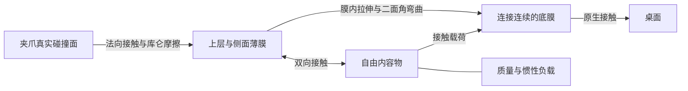
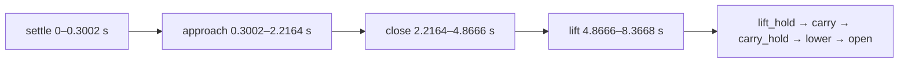
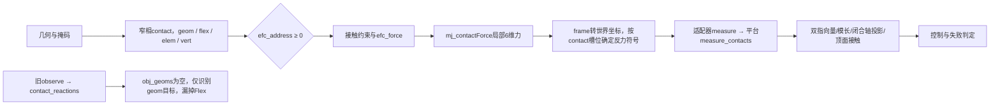

# 既有双膜片袋的纯接触包裹模型

最近更新时间为2026-11-16 14:07（Asia/Taipei）。首轮测试在用户要求停止后交付报告，随后按要求追加YAM录像及穿透修复。已建立MuJoCo/MJWarp4.0.1原型，整体物理验收尚未通过。

最大实际完成短窗口检查的规模为8192环境，9216环境在CUDA Graph执行实例创建阶段显存不足。原生接触捕获与完整机械臂抓取尚未验证成功，默认25 μs步长的角动量检查超出首轮1%标准。修复后YAM已实际执行到lift，因双侧指尖接触丢失超过50 ms而grasp_fail。

**后续几何复核（用户指出录像画面穿透）**发现此前接触距离没有覆盖全部膜面几何相交。初始膜面采样切入盒子1.2539 mm，40个三角形相交，8个盒角均在包络外；旧0.3秒静置状态采样相交深度达4.1559 mm。原支撑力数值仅保留为力读数记录，几何防穿透通过结论撤回。8192环境速度对应旧初始化工作负载。旧录像已停止。后续已修复初态、反力刷新及box专用碰撞漏检，当前YAM结果与视频见文末。

## Phase 0 审计与本轮计划

2026-11-15，机器 ubun。环境为 MuJoCo 3.17.0、MJWarp 3.17.0、Warp 1.19.0，RTX 5090 32 GB。

### 现有结构

- `bag_sim/geometry/kraft.npz` 保存 vertices、faces、panel_ids、masses_kg 和 uv。原网格为 413 顶点、792 三角形，袋口有 32 条边界边。
- 已存的 `kraft_coarse_35.npz` 为 200 顶点、396 三角形、594 条边。每边相邻两面，无边界或非流形边。上下膜、两侧折边和端封复用物理顶点。原文件 SHA-256 为 `ce77e774d7a01061815c207202613e420e1985da3382fb96a91ce2464de93604`。
- 本轮直接加载上述封闭网格，保持顶点编号、三角形和 panel_ids。几何尺寸变化只缩放这份参考材料坐标。初始化复用 `wrap.wrap_generic`，包裹后的坐标写入状态，材料参考边长和参考面积独立保留。
- 历史 `mj_loose._flex_xml` 使用 dim=2、elastic2d=both、discrete。其输入为包裹后的点，编译器因而把包裹构型当作参考态。历史选定版本为 Et=1000 N/m、D=0.00135 N·m、半径5 mm、刚体步长0.8 ms。
- 历史 `pinch=True` 会预建上层膜 connect，F7 在条件满足时激活。新入口采用纯原生接触，袋与夹爪、袋与内容物之间均没有 attachment、weld 或虚拟张力绳。
- 原碰撞掩码已禁止内容物直接接触桌面及指尖。保留这一力传递结构。新模型的内容物单刚体或三段关节均独立于膜运动。
- 旧 GPU 数据中 1024 环境达到0.59355抓取/s，但穿透17.47 mm，未通过历史验收。不能沿用这项速度作为新模型结果。

### 安装版本功能核对

已读取实际安装的 `mujoco_warp/_src/io.py`、`types.py`、`passive.py`、`forward.py`。`put_model(batch_sizes=...)` 仅接受声明为批量字段的参数。`flex_vert0`、`flexedge_length0`、`flex_stiffness`、`flex_bending`、`flex_damping`、`flex_friction` 为共享字段。

本轮使用原生2D膜弹性与接触，膜尺寸、膜材料和内容物结构按配置分组编译并缓存。组内reset仅更新状态及实际支持批量的质量、惯量、刚度、阻尼、摩擦。不会声称膜参考几何可逐环境修改。CPU材料回调不会自动在GPU执行，压缩律在原生slide关节广义力上分别以NumPy和Warp实现。关节上的反力通过同一多体动力学系统传回父体。

原生Flex仍标为实验性功能，实际能力以本轮最小实验为准。[上游功能说明](https://github.com/google-deepmind/mujoco_warp) · [功能跟踪](https://github.com/google-deepmind/mujoco_warp/issues/1362)。3.17曲参考弯曲修复复用项目已归档的同一实现，并保留其上游来源。[上游修复](https://github.com/google-deepmind/mujoco/commit/afa16414ca62075676e24a3003a8825cc4da0d26)

### 执行顺序与通过标准

先完成单刚体CPU入口和支撑，再加三段与压缩，接入共享YAM抓取，最后做GPU批量与随机化。所有进入结论的运行持 `flock /tmp/claude-gpu.lock`，结果写 `test/runs/2026-11-15/bag/physical-parcel-<run-id>/`，保留源码和配置。

| 检查 | 配置与重复数 | 本轮标准 |
| --- | --- | --- |
| 1 拓扑与参考态 | 默认存档网格，1次 | 封闭定向、正面积、正质量、原拓扑不变，参考边长与初始化坐标分开 |
| 2 六向接触 | box/capsule/sphere，六方向各1次 | 原生Flex接触、接触端反力非零，记录穿透与膜邻域响应 |
| 3 底膜支撑 | 单刚体，1次 | 无裸物桌面接触，稳态支持力与总重误差≤5%，接触穿透≤1 mm |
| 4 提拉诊断 | 实际膜节点区域加载，1次 | 记录膜张紧、载荷与支撑变化。理想锚点明确记诊断，真实捕获另验 |
| 5 松紧对照 | 相同内容物，参考材料尺寸两组各1次 | 记录参考面积、边长、质量、初始应力、张紧与载荷，禁止只改状态冒充松弛 |
| 6 柔性与压缩 | 三档K各1次，压缩加载卸载1次 | 质量惯量一致，记录下垂、频率、耗散，压缩律与实际关节力一致 |
| 7 捕获滑移 | 共享YAM平台纯接触试次 | 逐项记录空抓、捕获、承重、滑移、脱落，未出现的状态明确未验证 |
| 8 收支 | 无外部接触自由运动与耗散各1次 | 记录线/角动量与机械能，纯内力情形相对漂移≤1%，无非有限值 |
| 9 GPU | 1/32/128/512环境，各3次计时 | 报告物理步耗时、环境步/s、接触、迭代、显存、独立参数及原始overflow。失败批次不计有效吞吐 |

CPU入口不通过时先保留最小复现并修复。GPU功能不支持时提供实际异常和源码证据，保留CPU可运行实现。标准变化需在此说明理由并告知用户。

## 本轮结果

### 3.17 入口与失败诊断

`physical-parcel-entry-r1` 的100次有效惯性求解预算触顶，原始warning计数11。增加到300次后，`entry-r2` 的0.3秒原生膜运行warning为0，末态桌面支持3.1520 N、预期总重3.1950 N、接触穿透0.3812 mm，内容物与桌面直接接触0。

在无重力、无接触的参考构型上，修正曲参考系数后的原生弯曲仍有最大0.6490 N被动力，包裹初态最大273.99 N。原始证据为 `physical-parcel-entry-r2/native_bending_diagnostic.json`。改用现有 `bag_model.dihedrals` 的能量梯度后参考态内力为0，但其显式积分在0.4 ms失败，0.3秒支撑为0、峰值穿透482.79 mm。最高单铰链线性频率约82061 rad/s，原步长未解析这一模态。失败数据保留 `physical-parcel-cpu-r1/`，不作为通过结果。六向探针入口还暴露了固定法向筛选没有候选三角形的实现问题，后续检查因此中止。

### MuJoCo 4 迁移计划

用户在实施中询问迁移MuJoCo 4。本轮转向隔离的MuJoCo/MJWarp 4.0.1入口，固定现有网格与力传递结构。4.0修正2D弹性常数，4.0.1进一步修复稀疏Newton因子分解问题。新环境使用 `.venv-physical-parcel`，依赖记录在 `envs/physical-parcel-requirements.txt`，安装范围限于本项目。

先在相同参考网格上核对4.0.1原生膜的无载参考力，再决定保留原生隐式弯曲或使用已验证的替代。材料目标按SI参数重新核对，旧ν=0.3不满足官方旧行为精确换算的ν<0.25条件，禁止声称简单换版本即可保持原响应。随后沿用上表标准完成最小物理原型和批量检查。[4.0迁移说明](https://mujoco.readthedocs.io/en/4.0.0/changelog.html) · [4.0.1修复](https://github.com/google-deepmind/mujoco/releases/tag/4.0.1)

### 用户追加的容量测试计划

用户要求测试最多可开多少环境。在1/32/128/512基础上增加1024、2048、4096，依据实际显存占用继续逼近容量边界。各档使用已静置CPU状态、独立质量/惯量/摩擦参数，50物理步、3次重复，保留原始overflow及非有限值。显存不足或不满足数值检查的档位记失败，并在相邻成功档位之间缩小间隔。报告最大实际通过数量和测试分辨率，吞吐与长期物理验收分别列出。

8192环境已完成三次，峰值采样显存29400 MiB，9032.73环境步/s，原始overflow为0、全有限，实际质量/摩擦联合参数逐环境唯一且与GPU采样值一致。下一档9216，随后按256环境间隔逼近显存边界。

早期1024/4096记录中的独立性失败是检查实现错误。独立随机采样允许float32质量偶然重复，原检查要求所有质量值互异。现改为验证实际质量、内容物摩擦及桌面摩擦的联合参数与逐环境采样对应，并核对联合参数互异。8192档通过修正检查，旧误判记录保留。

## 实际实现与参数

### 模型入口

| 文件 | 职责 |
| --- | --- |
| [physical_parcel.py](../../bag_sim/physical_parcel.py) | 现有几何加载、参考态与当前态、三类内容物、CPU材料力、接触观测 |
| [physical_parcel_gpu.py](../../bag_sim/physical_parcel_gpu.py) | 固定参考材料组的GPU批量、逐环境参数、CUDA Graph与数值诊断 |
| [physical_parcel_checks.py](physical_parcel_checks.py) | 拓扑、六向接触、支撑、提拉、松紧、柔性、收支与材料夹具 |
| [physical_parcel_benchmark.py](physical_parcel_benchmark.py) | GPU规模、独立参数、显存、计时和逐核profiling |
| [physical_parcel_yam.py](physical_parcel_yam.py) | 统一YAM平台适配，原生接触，辅助连接与聚拢弹簧均为零 |
| [test_physical_parcel.py](test_physical_parcel.py) | 7项静态与力学回归检查 |

环境依赖在 [physical-parcel-requirements.txt](../../envs/physical-parcel-requirements.txt)，项目内解释器为 `.venv-physical-parcel/bin/python`。

### 力学路径



模型没有袋—内容物连接，也没有夹爪—袋膜承载连接。内容物与桌面、指尖的碰撞掩码不相容，载荷经膜传递。所有膜顶点具有正质量，膜面和接缝沿用存档拓扑。CPU与GPU都采用原生膜内弹性及接触，面外弯曲采用已有 `bag_model.dihedrals` 的解析梯度，GPU实现同一公式。

### 方程与单位

各向同性材料入口 `material_parameters(E,t,rho,nu)` 同时计算

\[
S=Et,\qquad D=\frac{Et^3}{12(1-\nu^2)},\qquad \rho_A=\rho t.
\]

S的单位为N/m，D为N·m，面密度为kg/m²。按参考三角形面积的三分之一分配节点质量。参考几何缩放后重新计算边长、面积、质量及铰链几何权重，再独立生成包裹初态。仅修改初始节点位置不会改变材料参考面积。

\[
U_b=\sum_h\frac12 K_h\Delta\theta_h^2,\qquad
K_h=D\frac{3l_h^2}{A_{h,1}+A_{h,2}}s_h,
\]
\[
F_b=-\nabla_x U_b-c_h\dot\theta_h\nabla_x\theta_h,\qquad
c_h=2\zeta\sqrt{K_h I_h},\quad I_h^{-1}=\sum_i\frac{|\nabla_i\theta_h|^2}{m_i}.
\]

铰链角差用周期atan2计算。跨panel边采用原折边比例 `s_h=0.01`。弯曲力与耗散由内部广义力进入动力学，成对反作用沿同一膜面传播。

内容物B1为单自由刚体，可设置质量、主惯量和局部质心。B2为三个刚体及两处绕局部y轴的弹簧阻尼铰链，`tau=-K theta-D theta_dot`，角度范围±π/4。B3在每段下部核心与顶面接触压板之间增加局部−z向slide自由度，核心和压板质量按90%/10%分配。

\[
F_c=\max(0,k_1\delta+k_2\delta^2+c\dot\delta),\qquad \delta\ge0.
\]

压缩律施加在真实压板与其父体的slide广义力上。k1为N/m，k2为N/m²，c为N·s/m。当前压缩只覆盖局部厚度方向，三轴泡沫压缩与体积本构尚未实现。

### 本轮薄膜预设

| 参数 | 数值 |
| --- | --- |
| 存档几何 | 牛皮纸袋封闭网格，200顶点/396面/594边 |
| 参考平面尺寸 | 350×250 mm |
| 面密度与膜总质量 | 0.12 kg/m²，25.6854 g |
| 参考面积 | 0.214045 m² |
| E、t、ν | 6.6667 MPa、0.15 mm、0.3 |
| Et与D | 1000 N/m，2.06044×10⁻⁶ N·m |
| Rayleigh与铰链阻尼比 | 10⁻⁴ s，0.1 |
| 数值接触半径、摩擦 | 0.5 mm，0.45 |
| 默认步长 | 25 μs |
| Newton预算、容差、线搜索预算 | 300、10⁻⁸、50 |
| 默认内容物 | 120×80×30 mm，0.3 kg |

本轮采用与E、厚度自洽的薄膜材料预设，参数未经实物标定。历史牛皮纸D=0.00135 N·m的材料响应对照仍待完成。高D配合原0.4 ms显式弯曲曾失败，新入口增加了弯曲模态步长校验。

## 物理检查结果

| 项目 | 已完成结果 | 状态 |
| --- | --- | --- |
| 拓扑与参考态 | 原faces保持，正节点质量，neq=0，参考态最大材料内力0 | 通过 |
| 六向接触 | 18组中16组记录到反力，box左/右为0；部分前/后探针峰值穿透1.43–2.15 mm | 部分失败，布置与接触原因待定位 |
| 底膜支撑 | 支持3.197492 N，预期3.194974 N，误差0.0788%；稳定段峰值穿透0.01674 mm；裸物—桌面接触0；warning 0 | 本工况通过 |
| 膜节点提拉 | 四个真实膜节点受3.8 N渐增外力，内容物升高68.858 mm，桌面支持降至0，峰值穿透0.3039 mm | 承载诊断通过，外力夹具模式 |
| 松紧对照 | 松袋/紧袋升高68.858/72.420 mm，峰值穿透0.3039/0.4137 mm | 外力承载两组通过，夹持差异未建立 |
| 三段柔性 | K=0.8/0.08/0.008 N·m/rad，各段质量合计0.3 kg；高K记录23.256 Hz，中/低K在窗口内未解析出频率 | 质量与恢复响应通过，频率覆盖不完整 |
| 非线性压缩 | δ=4 mm时实测3.52 N，与公式一致 | 力律检查通过，后续限位参数修订未动态复验 |
| 材料捕获 | 空抓例无承载；目标例仍只有empty状态，指尖反力记录为0，未抬升 | 捕获未通过，滑移/承重/脱落未验证 |
| 线动量与耗散 | 40 ms无外接触，线动量相对漂移约1.22×10⁻¹⁵，能量2.803→0.372 mJ | 本窗口通过 |
| 角动量 | 25 μs相对漂移4.281%，6.25 μs复核为0.7301% | 默认步长未过1%标准，细步长本窗口通过 |
| 统一YAM入口 | 2 ms smoke完成，跟踪峰值0.001159 mm，辅助承载连接0 | 入口通过，完整抓取未运行 |
| 单元检查 | 7/7通过 | 覆盖拓扑、参考态、弯曲净力/力矩、质量、关节力、压缩律与材料缩放 |

松紧两组使用同一内容物、同一外力协议和同一原始拓扑。紧袋参考尺寸200×140 mm，面积0.0696642 m²、膜质量8.3597 g；松袋面积0.214045 m²、膜质量25.6854 g。按相同面密度计算质量。初始最大边应变分别2.196%和0.2985%。当前张紧起点算法在两组均于首采样25 μs触发，其区分能力尚未建立。

材料夹具采用共享平台的20×40 mm圆角指尖几何，移动边界提供外部功。当前两例都没有记录到指尖—膜反力，尚未区分夹具布置、测量问题与真实捕获失败。材料坐标迁移读数属于接触诊断，连续真实摩擦滑移尚未验证。

YAM早期两次入口失败分别来自角度单位冲突和4.0的Flex命名访问接口，已在适配器修正，第三次短入口通过。完整机械臂动作与原平台阈值保持其共享实现。

## GPU吞吐与容量

RTX 5090，机器ubun，原200顶点膜网格＋单刚体，已静置状态，25 μs步长。每档3次，每次50步，即每次仅1.25 ms仿真。计时包含原生碰撞、求解、解析弯曲力及数值诊断，编译、模型上传、reset与Graph捕获单列。

总环境步/s取三次墙钟时间的中位数计算。每批物理步耗时取三次均值。显存为若干里程点采样的整卡占用，含桌面，瞬时峰值未连续监测。

| 环境数 | 每批step平均ms | 总环境步/s | 采样显存MiB | 状态 |
| --- | --- | --- | --- | --- |
| 1 | 40.776 | 24.444 | 1748 | 短窗通过 |
| 32 | 63.637 | 500.430 | 1876 | 短窗通过 |
| 128 | 76.050 | 1698.941 | 2197 | 短窗通过 |
| 512 | 118.176 | 4308.970 | 3478 | 短窗通过 |
| 1024 | 167.994 | 6092.322 | 5237 | 数值通过，旧独立性检查误判，速度列作诊断 |
| 2048 | 296.325 | 6910.452 | 8736 | 短窗通过 |
| 4096 | 492.019 | 8323.739 | 15543 | 数值通过，旧独立性检查误判，速度列作诊断 |
| 8192 | 907.904 | 9032.730 | 29400 | 修正后的实际联合参数检查通过 |
| 9216 | — | — | — | Graph执行实例创建时显存不足 |

8192档实际内容物质量0.240012–0.359939 kg，各环境的质量与摩擦联合参数独立。末步接触数56–64/环境，Newton迭代峰值33/300，原始overflow全0，全部状态有限，接触峰值穿透0.003539 mm。

因此最大**已完成测试**规模为8192。8192与9216之间的精确容量边界尚未测定，用户已要求停止。此容量结论仅覆盖短窗单刚体批次，长时抓取、三段B2/B3、其他材料组及更大接触数的容量仍待验证。

独立性检查核对GPU实际模型数组中的质量、内容物摩擦、桌面摩擦与该环境采样的对应关系。批量reset更新质量与惯量时调用MJWarp `set_const` 刷新派生量。膜参考几何与膜材料按组共享，尺寸或材料换组时编译一次，组内reset复用模型。

### 性能瓶颈

512环境单次额外、非捕获step的逐核计时总计90.768 ms。其中稀疏分块Cholesky核72.181 ms，占79.52%；稀疏结构检测5.177 ms，符号Cholesky3.904 ms，稀疏Hessian初始化2.252 ms，有效度量稠密项装配1.541 ms。自定义弯曲核约0.0295 ms。

该次profiling定位的主要成本是约束Newton矩阵分解。捕获图的正式三次50步数据沿用上表，额外单step profiler用于定位。当前没有进行降低求解精度、关闭接触或更换网格的性能优化。[逐核数据](../runs/2026-11-15/bag/physical-parcel-mj4-gpu-profile-r1/worlds-512/profile.json)

## 实际功能覆盖与限制

| 能力 | 当前证据 |
| --- | --- |
| 2D Flex与膜内弹性 | CPU及GPU实际运行 |
| Flex与box | 内容物支撑实际运行，六向探针中的两例无反力待定位 |
| Flex与sphere/capsule | CPU六向探针已运行；GPU安装源码存在对应分支，独立GPU探针尚未运行 |
| Flex自碰撞 | CPU有实际自接触记录，GPU使用原生auto路径 |
| Flex与另一独立Flex | 安装源码有多Flex路径，独立最小实验未运行 |
| 关节弹簧和阻尼 | B2 CPU实际运行；GPU更新代码已有，B2批次未运行 |
| 非线性压缩 | CPU力律实际核对；GPU专用核已有，B3批次未运行 |
| Spatial Tendon | 安装源码存在，本模型未使用 |
| 自定义被动力 | CPU在step1/step2之间施加，GPU为批量Warp核 |
| CUDA Graph | 1至8192环境实际执行，9216创建执行实例时OOM |
| 模型参数随机化 | 质量/惯量、内容物和桌面摩擦实际验证；关节参数仅有实现 |
| 参考几何随机化 | 固定拓扑按材料/尺寸分组；逐环境膜参考字段不支持 |

原生接触与摩擦负责实际承载。永久塑性折痕、SLS记忆、撕裂拓扑、真实材料标定、多件内容物和三轴可压缩连续体尚未实现。显式弯曲的稳定性与准确性限制步长，高刚度材料需要单独验证。默认25 μs仍有已测角动量误差，6.25 μs结果只覆盖40 ms无外接触窗口。GPU有效惯性线性方程的独立残差及长期轨迹一致性尚未检查。

## 复现入口与原始数据

以下为已有执行入口，输出路径需另选新目录。用户要求停止后，本轮没有追加运行。

```sh
flock /tmp/claude-gpu.lock .venv-physical-parcel/bin/python -B \
  test/bag_model/physical_parcel_checks.py --case support --output <新目录>

flock /tmp/claude-gpu.lock .venv-physical-parcel/bin/python -B \
  test/bag_model/physical_parcel_benchmark.py --worlds 1 32 128 512 --steps 50 --repeats 3 \
  --initial-state test/runs/2026-11-16/bag/physical-parcel-mj4-face-clearance-r3/support/final_state.npz \
  --output <新目录>

flock /tmp/claude-gpu.lock .venv-physical-parcel/bin/python -B \
  -m unittest discover -s test/bag_model -p test_physical_parcel.py -v

PYTHONPATH=test/bag_model:experience:. flock /tmp/claude-gpu.lock \
  .venv-physical-parcel/bin/python -B -m yam_platform.angles \
  --backend physical_parcel_yam --dt .000025 --pinch-coeff 0 --contact-time .001 \
  --smoke-seconds .002 --output <新目录>
```

数据均在 [当日bag目录](../runs/2026-11-15/bag/)，每个 `physical-parcel-*` 目录保存该轮配置、哈希、结果或失败原因。主要证据如下。

- [支撑](../runs/2026-11-15/bag/physical-parcel-mj4-support-r1/support.json)
- [六向接触](../runs/2026-11-15/bag/physical-parcel-mj4-contacts-r2/contacts.json)
- [提拉](../runs/2026-11-15/bag/physical-parcel-mj4-pull-r1/pull.json)与[松紧对照](../runs/2026-11-15/bag/physical-parcel-mj4-slack-r1/slack.json)
- [柔性及压缩](../runs/2026-11-15/bag/physical-parcel-mj4-compliance-r1/compliance.json)
- [25 μs收支](../runs/2026-11-15/bag/physical-parcel-mj4-conservation-r1/conservation.json)与[6.25 μs复核](../runs/2026-11-15/bag/physical-parcel-mj4-conservation-refinement-r1/dt6_25us/conservation.json)
- [捕获夹具](../runs/2026-11-15/bag/physical-parcel-mj4-capture-r1/fixture/capture.json)与[YAM短入口](../runs/2026-11-15/bag/physical-parcel-mj4-yam-entry-r3/result.json)
- [1至512测速](../runs/2026-11-15/bag/physical-parcel-mj4-gpu-batch-r1/summary.json)、[1024至4096](../runs/2026-11-15/bag/physical-parcel-mj4-gpu-capacity-r1/summary.json)、[8192](../runs/2026-11-15/bag/physical-parcel-mj4-gpu-capacity-r2/summary.json)、[9216 OOM](../runs/2026-11-15/bag/physical-parcel-mj4-gpu-capacity-r3/failure.json)

早期部分运行只记录源码哈希，后续运行同时保存source快照；YAM入口另保存共享平台源码和机器人资产指纹。各轮结论仅对应该轮记录的配置与源码。

## 用户追加的YAM录像（2026-11-15）

用户在收尾后要求观看本版YAM抓取视频。本轮录制一次真实抓取尝试，复用统一YAM平台与当前双膜片适配器，dt=25 μs、单刚体0.3 kg、bag350×250 mm、pinch_coeff=0、原10 N夹紧目标、原阶段及判据。一次连续运行至平台结果确定，完整保存qpos与关节/接触记录。该录像沿用当前原型的已知限制。

运行目录为 `test/runs/2026-11-15/bag/physical-parcel-mj4-yam-video-r1/trial/`。CPU动力学持共享锁，随后通过共享CPU Mesa渲染器回放，20fps、1倍速、整机与近景并排。编码使用本机已有FFmpeg，图像标签按本机编码能力处理。交付前核对真实停止原因、时长及视频画面。

### 几何穿透修复计划

问题来自包裹初始化只投影顶点，未约束顶点之间的三角面。先在同一存档拓扑、相同参考材料和内容物上修正初始构型，加入膜面与盒体的几何分离及角点包含检查。初态应无三角面进入盒体，8角点在封闭包络内，最大初始边应变维持≤5%。随后仅做单场景短静置，检查几何相交是否重新出现，接触距离阈值仍为1 mm。通过才重新录制一次同协议YAM尝试，失败则保留实际证据并继续定位。

静置复核r1的初态无相交，8角点均在袋内，最大初始边应变0.4861%。0.3秒内盒角始终在袋内，启动20–30 ms附近出现短暂膜面软接触重叠，16等分重心采样最大0.4372 mm，末态无相交。该轮支撑读数0或NaN来自测量刷新遗漏MuJoCo4离散有效度量与约束参考阶段。完整`step2`同状态读到3.1964 N，手工刷新把反力清零。已改用`mj_forwardSkip(..., mjSTAGE_VEL, ...)`完成加速度阶段，保留自定义被动力且不推进状态。这项修复也进入YAM采样刷新。[4.0.1前向流水源码](https://github.com/google-deepmind/mujoco/blob/4.0.1/src/engine/engine_forward.c)

复核r2沿用一次0.3秒静置、10 ms几何采样与1 mm接触预算。初态仍要求零几何相交、8角点全部在袋内、应变≤5%。动态同时记录相交数量、角点包含和几何深度，几何深度用逐步内缩盒体的分离轴相交二分给出上界，避免有限采样漏掉尖窄区域。动态通过要求几何深度上界≤1 mm、盒角始终在袋内、支撑误差≤5%、原生接触距离≤1 mm、无警告与裸物—桌面接触。该几何门槛加入本模型YAM健康检查，超限会保留轨迹并停止。

### 修复后录像计划（2026-11-16 13:40，Asia/Taipei）

用户要求继续。机器ubun，静置复核r2已通过，支撑3.20014 N、平衡误差0.1618%，10 ms采样几何深度上界最大0.5264 mm，8角点均在袋内，末态零相交、无警告，10项单元检查通过。运行一次YAM，路径为 `test/runs/2026-11-16/bag/physical-parcel-mj4-yam-video-r2/`，其余机械臂协议、dt、夹紧目标与物理配置沿用上轮计划。运行到共享平台给出结果或几何健康检查停止，随后回放实际轨迹。若抓取失败，视频和报告保留失败原因。

启动命令如下。

```sh
PYTHONPATH=test/bag_model:experience:. flock /tmp/claude-gpu.lock \
  .venv-physical-parcel/bin/python -u -B \
  test/runs/2026-11-16/bag/physical-parcel-mj4-yam-video-r2/record.py
```

### 受压相交定位与同形凸体检查计划（2026-11-16）

修复后YAM r2在approach、2.220025秒触发几何停止。13面相交，深度上界3.81558 mm，所有膜顶点仍在盒外，8盒角仍在袋内。原生接触最大距离仅0.2621 mm，当前候选点未覆盖膜面实际相交。4.0.1 `boxTriangle` 专用碰撞路径检查膜顶点与盒角到三角面的距离，缺少完整边—面穿越处理。[上游源码](https://github.com/google-deepmind/mujoco/blob/4.0.1/src/engine/engine_collision_flex.c#L51)

先对同一失败qpos做一次静态碰撞对照，保持盒体形状、质量、惯量与全部膜节点，比较原生box与八顶点同形凸mesh的碰撞候选，检查原始漏碰面是否补全。只有同形表面一致且漏碰面产生有效反力，才将内容物接触切到原生通用凸碰撞路径，再做一次0.3秒静置与一次共享YAM录像。相交阈值、机器人动作和膜参考网格沿用原值。

同形凸mesh静态对照完成，原box漏掉相交面113与224，凸mesh对13个相交面均生成接触，最大原生穿透读数5.0883 mm。编译后的nq均615，几何旋转后的实际盒体尺寸一致。内容物与压板现使用八顶点同形凸mesh，形状、显式质量/惯量、膜拓扑与材料保持该配置定义。新回归检查盒体尺寸与“全部膜顶点在盒外、三角面穿盒”的接触。一开始该小夹具缺少flexcomp名称，修正后11/11通过。

凸mesh静置r3一次0.3秒通过，10 ms采样全程零膜面相交、零角点外露，支撑3.20137 N，误差0.2001%，原生接触启动峰值0.2562 mm、警告0。新录像r3采用同一配置，墙钟上限设7200秒，允许CPU完整执行单次协议，仿真上限仍30秒。动力学不以录像墙钟时间作吞吐结论。目录为 `test/runs/2026-11-16/bag/physical-parcel-mj4-yam-video-r3/`，启动同r2命令替换路径为r3。

### 最终录像结果（2026-11-16，ubun）

凸mesh YAM r3于仿真4.46855秒、lift阶段结束，结果为`grasp_fail`，原因为双侧指尖接触丢失超过50 ms，内容物留在桌面。墙钟729.29秒，224次20 ms采样，膜面—内容物几何相交和角点外露均0。原生全接触穿透峰值0.25624 mm、平均夹紧力滤波峰值0.84081 N、最大跟踪误差6.88243 mm。指尖实际单侧法向力采样峰值分别1.23506 N与0.57642 N。本轮未实现稳定摩擦承载。

[真实尝试视频](../runs/2026-11-16/bag/physical-parcel-mj4-yam-video-r3/yam-attempt.mp4)为CPU MuJoCo4.0.1轨迹，Mesa llvmpipe回放，20fps、90帧、4.5秒、1倍速、1280×480双视角。源状态间隔20 ms，画面线性插值。已完整解码并查看首帧和合爪末帧。本机已有编码器缺少drawtext，专用入口省略共享通用3D标签。膜透明度为模型定义的0.8。

穿透来自两处缺陷。旧包裹初始化遗漏三角面约束，受压时box—triangle专用碰撞又漏掉边—面穿越。修复采用三角面分离初始化和同形八顶点凸mesh盒体接触，新增几何检查与碰撞回归。11项单元检查通过，凸mesh静置r3通过。动态结论限于采样时刻和这一配置。当前凸mesh版本的GPU吞吐/容量、其他材料与长期抓取尚未复验，旧8192环境数据对应旧构型和box路径。

- [最终结果与阶段](../runs/2026-11-16/bag/physical-parcel-mj4-yam-video-r3/trial/result.json) · [视频检查](../runs/2026-11-16/bag/physical-parcel-mj4-yam-video-r3/video-verification.json)
- [原生box失败录像](../runs/2026-11-16/bag/physical-parcel-mj4-yam-video-r2/yam-attempt.mp4) · [同状态碰撞对照](../runs/2026-11-16/bag/physical-parcel-mj4-yam-video-r2/collider-diagnosis.json)
- [凸mesh静置结果](../runs/2026-11-16/bag/physical-parcel-mj4-face-clearance-r3/support.json) · [11项单元日志](../runs/2026-11-16/bag/physical-parcel-mj4-yam-video-r2/unit-checks.log)

录像入口如下，正式运行使用新的输出目录。

```sh
.venv-physical-parcel/bin/python -B test/bag_model/render_physical_parcel_video.py \
  <YAM运行目录> <新MP4路径> --ffmpeg <本机已有FFmpeg绝对路径>
```

## 同版袋子实际抓起录像计划（2026-11-16）

用户明确要求观看同形凸mesh盒体接触、原双膜片袋在YAM中抓起后的物理效果。本轮先对r3闭合末态做一次静态诊断，比较原box指尖核心与同形凸mesh指尖核心的接触覆盖和实际法向反力，另记录真实接触面间距。盒体使用已修复的同形凸mesh，膜参数与0.3 kg内容物采用r3配置。

若指尖也存在box—triangle漏碰，在本模型适配器的编译入口使用同形凸mesh接触，复核同状态接触与几何尺寸。随后先运行一个完整YAM抓取，目标为内容物离桌≥50 mm、支撑<0.05 N，保存抬升、保持及后续动作的真实轨迹，几何1 mm门槛及原平台判定继续记录。若中心顶抓无法聚拢材料，适配器通过共享平台已有接近接口选择空余膜或封边的实际抓取点，再运行一次，记录所选位置与姿态。材料刚度、质量与摩擦不按结果修改。所有正式动力学持共享锁，源记录、轨迹与视频写入2026-11-16的bag运行目录。

静态指尖对照中，两种核心碰撞形状的反力与真实接触面间距一致，未发现指尖核心漏碰。r3闭合末指令约0、实际指间距3.5436 mm，随后接触快速消失。中心顶抓未建立承重夹持。接下来采用同袋、同盒、同材料的15 cm高窄支撑摆放，YAM从前侧向下30°接近，闭合轴包含竖直分量，夹住上下膜及其内部盒体。支撑台面70×50 mm，地面也参与膜接触，支撑读数合计二者。适配器提供grasp_face/front与support_height，动作复用共享平台的approach接口，先确认初始IK和几何，再运行一次完整动作。通过录像以支撑离开与内容物离桌高度判定，失败则定位实际原因。

15 cm支撑、前侧30°初始位置误差0.0226 mm，姿态误差32.0876°，按原1°标准记不可达。先静态扫描四个侧面方位yaw=0/90/180/270°与向下pitch=0/30°，每组一次，仅确认IK可达性。侧抓通过适配器的grasp_face=side接入，yaw控制所选侧面，tilt控制接近俯角。动态抓取采用其中可达且闭合轴能覆盖盒体厚度的姿态。

静态8姿态中，右侧yaw90°、向下30°可达，初始位置误差0.002071 mm、姿态误差0.000125°、初始膜面相交0。其他7组按原IK阈值记不可达。采用该姿态运行一次完整动作，目录 `test/runs/2026-11-16/bag/physical-parcel-mj4-yam-raised-side-r1/`。新增初始整体抬高、支撑尺寸、IK与参数边界回归，执行后再启动录像。该配置包含15 cm支撑摆放和右侧30°接近，视频会注明。

窄支撑首轮入口已开始，随后在approach早段主动停止，将新增支撑也设置为同尺寸八顶点凸mesh，完整覆盖膜面绕支撑棱边的接触。增加支撑—膜的独立几何深度记录，1 mm门槛同时覆盖内容物与支撑。r1保留停止记录，修订后的同姿态录像进入raised-side-r2。此调整属于新增支撑几何的完整接触配置，支撑尺寸仍为70×50×150 mm。

raised-side-r2完成至lift_hold、6.65005秒，因剩余支撑而grasp_fail。膜—内容物及膜—支撑几何检查持续有效，指尖—膜原生接触峰值1.2655 mm超出1 mm预算。夹紧滤波峰值0.8851 N，实际抓到空余膜，尚未完成离支撑悬挂。下一步仅调整同模型抓取姿态，静态检查yaw30/45/60°、俯角0°、支撑高0.15/0.22 m共6组，各一次，寻找夹爪近水平接近、闭合方向竖直的可达姿态，以直接夹住盒体上下的膜面。选择后记录实际配置再运行。

水平接近的6组初始远位姿均未通过原IK标准。下一组静态检查采用距盒体表面30 mm起始、抓取点高于盒体中面6 mm的实际位置。6 mm用于使40 mm初始开口的下指接近30 mm盒体底膜，以在盒体边缘建立接触。检查yaw30/45/60/90°与pitch0/30°，支撑高0.15 m，各一次。适配器新增side_start_distance、side_height_offset记录起始距离和面上高度偏移，原公共接近、闭合及抬升动作通过既有接口执行。

30 mm近起始、6 mm高偏置时，yaw30/60/90°的30°接近可达。yaw90°的水平接近接近边界但仍未通过（3.5155 mm、1.1064°），继续按同一标准检查更近起始20/10 mm及支撑高0.18 m的近邻位置，按顺序找到首个可达水平姿态后停止静态搜索，再运行一次。该调整用于实际上下夹住盒体表面的膜层。

水平近起始首个配置已可达，停止继续搜索。采用支撑150 mm、yaw90°、pitch0°、距盒面20 mm起始、面上中面+6 mm，初始位置误差0.006681 mm、姿态误差0.000367°。通过该真实位姿先让下指接近底膜，再使用原共享动作闭合并抬升。录像为raised-side-r3，新增起始距离与目标位置回归后运行。若能完全离支撑稳定悬挂即交付实际物理效果，另报告是否达到本轮额外50 mm高度指标和平台结果。

近起始raised-side-r3在接近阶段记录指尖—膜原生接触重叠1.8333 mm，主动停止并保留读数。当前对本模型YAM编译入口的两个指尖box核心采用同尺寸八顶点凸mesh，完整覆盖膜面边—面接触；指尖核心和圆角的solimp从平台默认0.99提高到0.999，接触时间常数仍1 ms，用于降低数值接触重叠。共享动作、有限驱动力和摩擦由平台提供。新增指尖接触类型与阻抗回归，raised-side-r4沿用同一近位姿运行。该次指尖接触数值调整与录像结果均单列。

### 近起始初态复核与减回弹计划

raised-side-r4实际提起并搬运，最大内容物抬升158.9 mm；支撑<0.05 N且抬升≥50 mm的连续窗口2.54秒。最终落点偏离目标，平台结果grasp_fail。进一步逐帧复核发现最大24.6555 mm膜—机械臂非指接触出现在首帧，涉及yam_geom_19；此前初态健康检查仅覆盖内容物与支撑，遗漏整机初始重叠。此近起始录像保留为诊断，不作为合格物理演示。原生全程最大穿透24.6587 mm，跟踪212.664 mm，均记录。

用户另指出袋子过于Q弹。先修复初态重叠，再把弯曲阻尼比0.1调到0.6、膜Rayleigh 1e-4调到5e-4秒，作为减回弹工程配置。准备阶段仅让同一袋子与盒体在150 mm支撑上真实静置0.5秒，保留原材料参考态和静置后的qpos/qvel，再引入张开的YAM。准备入口复用同一parcel_world、初始化和内部力；机器人动作继续由统一平台执行。新增整机初态非指穿透≤1 mm检查，checkpoint参数/维度/有限性检查及回归。机械臂所有碰撞部件接触时间常数设为本模型1 ms、solimp0.999，记录该数值设置。

通过准备与初态整机检查后运行一次8.5秒抬升演示，目标为内容物离支撑并抬高50 mm、记录真实悬挂。该窗口用于用户要求的抬升效果，完整搬运放下另按实际阶段标注。准备及演示各一次，均持共享锁，原始结果按新运行目录记录。阻尼配置仅表达当前原型的耗散调整，塑性折痕仍需独立本构。

减回弹准备r1静置0.5秒通过，膜—盒体和膜—支撑几何相交均0。水平近位姿引入整机后仍有20.4739 mm非指重叠，被新增初态检查拒绝。定位部件为link_6的半径30 mm腕部胶囊，水平低位姿与空余膜相交。改用已有可达的右侧向下30°、30 mm近起始、+6 mm面高偏置，静态核对准备后整机接触，再启动演示。

30°近起始30 mm准备后位姿的腕部碰撞已消除，但张开指尖仍切入膜7.5975 mm，初始法向反力9.95 N。初态检查扩展为全部膜接触≤1 mm，覆盖指尖、自接触及非指部件。按50/70/100 mm起始距离顺序寻找首个无初始重叠且可达的30°姿态，各一次，找到后停止，防止初始穿透驱动膜弹跳。

新增全部初态接触检查后，原抬高场景单元夹具也暴露6.9388 mm初始指尖相交。该夹具提高侧面抓取点12 mm以取得无相交的初始姿态，保留原维度/状态检查并增加初始接触≤1 mm断言；另有近水平原坏位姿被拒绝的回归。准备后far100 mm、yaw60°/tilt30°已通过整机初态检查，原生最大重叠0.002808 mm、非指0、法向夹紧力0。yaw30°同距离不可达，按原阈值保留失败。

## 最外缘封口版本（2026-11-16）

### 本轮计划

用户要求封口位于最边缘，并观看视频。基于原350×250 mm袋的正反面网格，去掉内折侧褶和厚端盖，将正反膜的完整最外轮廓合并成共享节点封边。四角先翻转局部对角线，避免合并产生四面共边。参考态两片膜平铺，装物形态独立初始化。新增几何资产及可复现生成入口，原模型仍有独立入口。

机器ubun，MuJoCo4.0.1 CPU。一次网格及力学回归，一次0.5秒静置准备，10 ms几何采样。要求封边全部位于材料外轮廓、闭合且一致定向、正面积及正质量、初始应变≤5%、内容物零相交且8角在袋内。动态准备仍要求膜—盒体/支撑几何深度≤1 mm、无角外露、无警告。通过后接入共享YAM平台，采用减回弹参数0.6弯曲阻尼及5e-4秒Rayleigh，检查整机初态全部膜接触≤1 mm。用户已授权本次抬升35 cm，新增共享lift_height配置，默认25 cm，本次35 cm并按0.1 m/s保持速度。验收阈值沿用此前值。

先验证新网格是否允许100 μs步长的显式弯曲条件及短静置，失败则沿用25 μs并记录。准备通过后录制一次连续抓取至抬升保持或平台停止，目标仍为内容物离支撑≥50 mm、总支撑<0.05 N。输出1倍速双视角视频，保留平台实际判定与接触限制。若抓起失败，定位直接原因后在同一主题记录修复与下一次配置。结果放 `test/runs/2026-11-16/bag/physical-parcel-edge-sealed-*/`。

### 几何与首轮结果

新袋142节点、280三角面、420边，完整封边34个共享节点，Euler数2、边界边0、所有边恰有2面且一致定向。参考面积0.175 m²、膜质量21 g，初始最大边应变0.8262%，内容物零相交、8角在袋内。100 μs通过显式弯曲条件，0.5秒静置50次采样的膜—盒体/支撑几何相交均0。16项回归通过。新增断言首轮因对Python列表使用abs而报错，改成np.abs后通过，首次日志保留。

YAM r1采用yaw60°、pitch30°、100 mm起始、+6 mm偏置，初始IK位置0.0000494 mm、角度0.0000156°，全膜初始接触峰值0.002457 mm、非指0。运行4.6412秒进入lift后失去指尖接触而grasp_fail。全程原生接触峰值0.22875 mm、非指0、几何相交0、警告0，未抓起。接触与轨迹表明下指先压到盒外的空余膜，闭合时向上离开，双指未夹住内容物或聚拢膜。

### 抓取位置修订计划

采用水平侧向接近，使上下指从封边两侧进入盒体边缘。先静态检查yaw90°/60°、起始60/40 mm共4组，每组一次，顺序找到首个IK可达且全部初始膜接触≤1 mm的姿态即停止。沿用150 mm支撑、0.5秒准备态、0.6弯曲阻尼、100 μs及35 cm抬升，原15 mm接触后插入量和10 N控制不变。通过后运行一次连续YAM，记录全部接触与原几何门槛，失败则保留实际视频。另6组pitch45/60/75°的静态探索均可达，仅探索入口，不构成动态结论。

四组水平远起始均按原IK标准不可达，位置误差7.13–224.27 mm，未运行动态。接着检查yaw90°、pitch15°、40 mm起始、中面0偏置一次。小俯角用于给腕部留出高度，同时让下指从膜下方进入；通过原初态标准后再运行同一共享抓取。

15°/40 mm入口因初始膜接触4.5171 mm被拒绝。依次检查同姿态60/80/100 mm起始，各一次，首个同时满足原IK及1 mm接触预算后停止搜索。

60 mm起始已通过，停止其余搜索。初始IK位置0.0004456 mm、角度0.0000832°，全膜初始接触0.002457 mm、非指0。动态r2使用该配置，仿真窗口10秒，覆盖本次35 cm抬升及后续实际阶段。复现入口如下。

```sh
.venv-physical-parcel/bin/python -B bag_sim/make_edge_sealed_geometry.py
PYTHONPATH=test/bag_model:experience:. flock /tmp/claude-gpu.lock \
  .venv-physical-parcel/bin/python -B -m unittest discover \
  -s test/bag_model -p test_physical_parcel.py -v
PYTHONPATH=test/bag_model:experience:. flock /tmp/claude-gpu.lock \
  .venv-physical-parcel/bin/python -u -B test/bag_model/prepare_physical_parcel.py \
  --output <新的准备目录> --seconds .5 \
  --model-options '{"geometry":"geometry/kraft_edge_sealed_35.npz","dt":0.0001,"support_height":0.15,"bend_damping_ratio":0.6,"rayleigh":0.0005}'
PYTHONPATH=test/bag_model:experience:. flock /tmp/claude-gpu.lock \
  .venv-physical-parcel/bin/python -u -B test/bag_model/record_physical_parcel.py \
  --config test/runs/2026-11-16/bag/physical-parcel-edge-sealed-checks-r1/low-pitch-yam-config.json \
  --output <新的录像运行目录>
```

配置中的initial_state须对应上述准备输出。实际已保存的准备和源码快照在 `physical-parcel-edge-sealed-preparation-r1/`，录像r2在 `physical-parcel-edge-sealed-yam-r2/`。共享CLI检查确认 `--lift-height` 可用，默认0.25 m，0/负数/NaN/Inf在创建输出前拒绝。首次从experience目录使用根目录相对解释器路径报找不到文件，回到根目录后检查通过。

### 降低夹持中面计划

r2于6.2972秒lift接触丢失，夹紧滤波峰值5.594 N、原生穿透峰值1.2890 mm、非指0.0947 mm，接触预算超限。内容物只被短暂提动，随后连袋滑落，未达到50 mm目标。准备态在x≈-0.15 m处上下膜高度约175/149 mm，中面约162 mm，而r2闭合中点约175 mm，下指进入上下膜之间，夹持偏高。

下一次只把侧抓高度偏移从0改为-12 mm，yaw90°/pitch15°/60 mm起始沿用r2。静态初态通过原标准后运行一次同协议，检查两膜是否同时夹入。其余物理及35 cm抬升配置沿用，原生1 mm预算仍记录，失败不计为合格抓起。

-12 mm/60 mm起始因2.4145 mm初始膜接触被拒绝。把起始退到80 mm再检查一次，其余配置相同。

80 mm入口通过，r3连续运行5.1829秒后lift接触丢失，夹紧滤波峰值2.065 N、原生穿透1.7490 mm、非指0.0627 mm，未通过抓起及接触预算。下一配置使用已探索可达的yaw90°/pitch60°、100 mm起始、中面0偏置，使接触后的15 mm插入包含更大竖直位移并从两侧聚拢上膜。正式复核初态一次并运行一次，材料、控制与判据沿用。该轮用于完成实际视频并记录当前平台下的抓取限制。

r4正式入口通过，6.0275秒lift接触丢失，grasp_fail。夹紧滤波峰值3.6562 N、原生接触0.48915 mm、非指0、跟踪10.628 mm。未抓起，轨迹与结果保留；后续采用下述用户授权的压紧余量。

### 共享闭合限制发现

共享protocol将闭合指令gap裁剪到[0,45] mm，Yam.command本来允许单轨目标-5 mm，机器人资产的关节与控制范围也均允许到-5 mm。薄膜很薄时，目标截在零位限制了实际预紧力。资产kp=2000 N/m、驱动力范围±100 N，负位移仍受原有范围约束。用户已收到最外缘封口版r2实际视频及滑脱说明，并被询问是否授权本次使用已有的零位后5 mm行程。依据AGENTS.md共享负责范围，相关闭合限制的修改等待明确授权；封口模型及已授权35 cm抬升已实现。

## 袋子与内部物体随机化录像（2026-11-16）

### 本轮计划

用户已明确授权本次使用单轨零位后5 mm压紧行程，随后要求袋子与内部物体共同随机化，并补充顶面搓起录像。用户要求减少测试，因此本轮仅录两次，各配置一次，进行录制必需的0.5秒准备与入口健康检查，随后沿用运行中的20 ms几何检查。无额外角度扫描、测速或扩大测试矩阵。

种子20261116。两组独立均匀采样袋长0.32–0.38 m、宽0.23–0.27 m、E 4–10 MPa、厚0.1–0.2 mm、密度700–1000 kg/m³、摩擦0.35–0.65、弯曲阻尼0.4–0.8、Rayleigh 0.3–0.8 ms。Et、D、面密度从E/厚度/密度关联计算。内容物尺寸长0.10–0.145 m、宽0.065–0.095 m、高0.02–0.04 m，质量0.12–0.35 kg，弯曲铰链0.03–0.15 N·m/rad。组1为刚体侧抓yaw90°/pitch15°、80 mm起始；组2为三段可弯曲物体、共享顶面搓起动作。内容物类型为预先选择的两种演示，其他参数随机采样，参数是工程预设。

两组均用最外缘封口网格、150 mm支撑、dt100 μs、35 cm抬升、单轨5 mm压紧余量、10 N反馈目标及原驱动力。共享新增gripper_overtravel默认0，仅本次配置取0.005 m，校验既有驱动范围，闭合阶段到达负位移下限或原有稳定/超时条件后抬升。每条轨迹最多10秒，按实际完成阶段报告，保持原几何1 mm门槛。目标为交付两次真实视频，画面标明袋和内容物参数、实际最大抬升及结果。抓起指标仍为离支撑≥50 mm且支撑<0.05 N，失败如实标明。先保存原始视频，再导出带参数说明的各段及连续对比视频，CPU Mesa、20fps、1倍速，并完整解码检查。

运行目录 `test/runs/2026-11-16/bag/physical-parcel-edge-sealed-randomized-r1/`，机器ubun。使用已有Pillow环境编排、标字，动力学及回放均调用现有MuJoCo环境入口，整体持共享锁。

### 随机化录像结果（20:16更新）

两次录制于20:04–20:13完成。组1最高抬升210.32 mm，内容物离支撑≥50 mm且支撑<0.05 N的连续窗口7.2401–9.9801秒，共2.74秒。10秒窗口结束时处于carry，平台判定incomplete。原生穿透峰值1.19721 mm超出1 mm预算，跟踪误差峰值153.841 mm，整体物理验收仍未通过。组2顶面搓起尝试于5.0333秒lift因指尖接触丢失结束，判定grasp_fail，最高内容物抬升0.01984 mm，无悬挂窗口，原生穿透峰值0.12149 mm、跟踪9.7973 mm。

两组20 ms采样的膜—盒体/支撑几何深度均0，内容物角点外露0，原生警告0，源码快照哈希全部匹配。各组0.5秒准备均通过。按照用户减少测试的要求，本轮完成两次录制后结束。材料参数为工程预设，内容物类型按两种演示指定。

| 实际参数 | 侧抓刚体 | 顶面搓起、三段可弯曲体 |
| --- | --- | --- |
| 袋长×宽 | 33.26×23.86 cm | 33.47×25.08 cm |
| E、厚度、密度 | 6.427 MPa，193.04 μm，851.27 kg/m³ | 7.368 MPa，155.77 μm，949.72 kg/m³ |
| Et、D | 1240.71 N/m，4.2340e-6 N·m | 1147.70 N/m，约2.550e-6 N·m |
| 摩擦、弯曲阻尼、Rayleigh | 0.4465，0.4053，0.3944 ms | 0.5620，0.4897，0.5174 ms |
| 内容物长×宽×高、质量 | 10.03×8.06×3.26 cm，348.04 g | 12.06×6.87×2.93 cm，167.11 g |
| 弯曲铰链 | 刚体 | 0.05734 N·m/rad |

各段视频和连续视频均为CPU真实轨迹回放、20fps、1倍速、1280×600，含参数及实际结果说明。完整连续视频约15.15秒，已完整解码，检查侧抓悬挂帧和顶抓末帧。原始1280×480双视角录像、20 ms源状态、源码、配置、准备与接触记录保留。视频为源状态线性插值，未重算动力学。

- [连续视频](../runs/2026-11-16/bag/physical-parcel-edge-sealed-randomized-r1/randomized-bag-and-contents.mp4)
- [侧抓单段](../runs/2026-11-16/bag/physical-parcel-edge-sealed-randomized-r1/case-1-side/side-randomized.mp4) · [顶面搓起尝试](../runs/2026-11-16/bag/physical-parcel-edge-sealed-randomized-r1/case-2-top/top-randomized.mp4)
- [参数与种子](../runs/2026-11-16/bag/physical-parcel-edge-sealed-randomized-r1/cases.json) · [结果](../runs/2026-11-16/bag/physical-parcel-edge-sealed-randomized-r1/summary.json) · [检查记录](../runs/2026-11-16/bag/physical-parcel-edge-sealed-randomized-r1/verification.json)

复现需使用新输出目录，命令如下。

```sh
PYTHONPATH=test/bag_model:experience:. flock /tmp/claude-gpu.lock \
  /home/ubuntu/Dev/Projects/real2sim/previews/newton-official-bag/.venv/bin/python -u -B \
  test/bag_model/randomized_physical_parcel_video.py \
  --output <新的随机化录像目录> --seed 20261116 \
  --ffmpeg /home/ubuntu/Dev/Projects/real2sim/previews/newton-official-bag/.venv/lib/python3.11/site-packages/imageio_ffmpeg/binaries/ffmpeg-linux-x86_64-v7.0.2
```

## 按袋型分类的视频修订（2026-11-16）

### 本轮计划

用户要求移除画面参数，按纸袋、塑料薄膜袋、气泡信封袋分类。塑料薄膜袋复用刚完成的两条真实轨迹，仅从无字原片重新标袋型；纸袋与气泡信封袋各补录一次侧抓。两次新配置继续随机化袋尺寸、摩擦、阻尼及内容物尺寸/质量，气泡袋采用可压缩内容物。复用现有kraft/pe/bubble材料档案，纸袋为高膜刚度与高弯曲刚度，气泡袋为较厚等效壁及已有cushion_contact接触律和气泡纹理，完整封口拓扑沿用最外缘版本。气泡壁为未标定的等效缓冲模型。

只做两次所需0.5秒准备与最多8秒录像，dt200 μs已通过这两种网格的弯曲分辨入口；沿用几何1 mm健康检查及用户授权的35 cm抬升、单轨5 mm闭合余量。若失败，保存失败画面和结果。最终类别标题无参数数字，仍标实际抓取结果，并包含塑料薄膜袋顶面搓起尝试。输出 `physical-parcel-category-video-r1/`，机器ubun，CPU运行持共享锁。新增两种入口已编译，使用已有纹理资源。

### 本轮结果（20:33更新）

新增纸袋和气泡信封各一次准备、一次录像，均完成，无新增角度扫描。纸袋最高抬升21.92 cm，8秒窗口止于lift，incomplete；原生接触峰值1.6076 mm超出1 mm预算。气泡信封于4.4786秒lift指尖接触丢失，grasp_fail，未抓起，原生接触峰值0.8305 mm。两组膜—内容物/支撑的20 ms采样几何深度0、角点外露0、警告0。材料为弹性壳工程预设，气泡壁采用已有等效黏性缓冲接触律，其力—压缩关系尚未标定。

塑料薄膜袋两段复用上轮原始轨迹及无字原片，保持实际结果。四段现已统一只标袋型、抓取方式和结果，无参数数值。连续视频约27.75秒，1280×534、20fps、1倍速，各段与连续视频完整解码通过，已检查纸袋悬挂帧和气泡信封抓取帧。用户要求现有视频时已先交付三个已完成片段，随后交付三类连续视频。

[三类连续视频](../runs/2026-11-16/bag/physical-parcel-category-video-r1/randomized-bag-and-contents.mp4) · [配置和复用来源](../runs/2026-11-16/bag/physical-parcel-category-video-r1/cases.json) · [结果](../runs/2026-11-16/bag/physical-parcel-category-video-r1/summary.json) · [检查记录](../runs/2026-11-16/bag/physical-parcel-category-video-r1/verification.json)

复现分类版使用同一录像入口，增加 `--reuse-film-run test/runs/2026-11-16/bag/physical-parcel-edge-sealed-randomized-r1`，输出指向新目录。当前入口默认生成分类标题。原数值标题版的入口源码已保存在该轮 `driver_source.py`。代码与结果已本机保存，GitHub推送因现有凭据助手路径失效而受阻。


## 顶面搓起三档袋参数录像（2026-11-16）

### 本轮计划

用户指定在YAM中从顶面搓起，录制不同袋参数的物理效果。机器ubun，MuJoCo4.0.1 CPU，输出 `test/runs/2026-11-16/bag/physical-parcel-top-parameters-r1/`。薄软/中等/厚硬三档分别为E=4/7/10 MPa、厚度100/150/200 μm，密度850 kg/m³，Et、D和面密度关联计算；其余采用共同配置，袋334.70×250.84 mm、三段可弯曲内容物120.59×68.68×29.32 mm、167.11 g、铰链0.05734 N·m/rad、袋摩擦0.55、弯曲阻尼0.6、Rayleigh0.5 ms。三档都是工程预设。

每档一次0.5秒准备、一次共享YAM顶面接近与合爪搓起，连续录制至平台结果或18秒窗口。yaw/tilt均0°、dt100 μs、150 mm支撑、10 N夹紧目标、单轨5 mm余量、抬升行程35 cm，pinch_coeff=0。沿用现有几何1 mm与角点包含检查、原平台动作和判定。正式动力学持共享锁。运行命令、配置、源码快照及机器人资产指纹随结果保存。

交付标准为三档均有实际顶抓轨迹和1倍速参数视频，另给同步近景对照，20fps，完整解码且抽帧检查。抓起指标为内容物抬升≥50 mm且总支撑<0.05 N，完整搬运另按平台outcome记录。抓起或物理预算未通过时保留实际结果与视频，说明限制；录制技术失败则修复入口后在新目录重跑，不降低判据。

### 本轮结果

r1三档分别在5.0393/5.0294/5.0321秒、lift阶段因指尖接触丢失而停止，未达到50 mm抓起标准。原始轨迹与短录像保留于r1，随后按用户要求补录完整动作。

### 完整流程补录计划

用户追加要求完整流程。r1三档在仿真约5.03秒起抬时均失去指尖接触，原平台提前结束。补录r2复用各档r1的0.5秒准备态、材料及动作参数，每档一次完整动作。共享平台新增显式 `complete_motion=True` 录像选项，闭合后的抓取失败保留首次原判定与时间，继续原有lift/carry/lower/open目标；失败后的lower走到原目标高度，避免桌上物体的支撑读数使空手下降提前结束。数值、几何、挤压和预算停止按原值执行。默认关闭，原入口采用原停止流程。每档要求 `motion_completed=true` 且阶段覆盖settle/approach/close/lift/lift_hold/carry/carry_hold/lower/open，完整视频与同步对照均完整解码。失败时刻在视频中标注。输出 `physical-parcel-top-parameters-r2/`，窗口18秒。


### 完整流程补录结果

完成于2026-11-16 20:50 CST，机器ubun。三档均以 `complete_motion=True` 完成settle、approach、close、lift、lift_hold、carry、carry_hold、lower、open九个阶段，`motion_completed=true`。三组均在起抬时失去指尖接触，最终结果保留 `grasp_fail`，后续为空手动作。

| 档位 | 首次失败/s | 完整仿真/s | 内容物最高抬升/mm | 原生穿透峰值/mm | 夹紧滤波峰值/N |
| --- | --- | --- | --- | --- | --- |
| 薄软 | 5.0393 | 12.8758 | 0.000678 | 0.132806 | 0.732 |
| 中等 | 5.0294 | 12.8650 | 0.011549 | 0.097825 | 0.680 |
| 厚硬 | 5.0321 | 12.8678 | 0.019546 | 0.066169 | 0.721 |

三档各一次，均未出现满足抬升≥50 mm且支撑<0.05 N的采样。采样中的膜—内容物与膜—支撑几何深度均0、内容物角点外露0、非指穿透0、数值警告0，状态有限。机械臂跟踪峰值169.40/169.70/170.25 mm，接近下压力峰值35.35/31.71/31.10 N，实际夹紧滤波峰值约0.68–0.73 N，原10 N控制目标未建立稳定夹持。完整动作录制通过，顶面搓起未通过。工程材料预设未经实物标定，单次演示不构成重复性或物理验收。

三档使用相同平台、适配器和材料源码指纹，逐文件快照哈希检查通过。新增选项默认False已核对，原默认停止分支保留。三段参数视频为1280×640、20fps，片长12.95/12.90/12.90秒；同步近景对照为1920×720、259帧、12.95秒、1倍速，末尾定格最多0.05秒。全部四段完整解码通过，核对顶面接近、搓合、松爪抽帧，以及失败时刻的红色提示。源状态间隔20 ms，视频由共享Mesa llvmpipe回放并插值。

可从仓库根目录按下式复现单档，其他档位替换目录名；每档完整命令见commands.json，输出应选新目录。

```sh
PYTHONPATH=test/bag_model:experience:. flock /tmp/claude-gpu.lock \
  .venv-physical-parcel/bin/python -u -B test/bag_model/record_physical_parcel.py \
  --config test/runs/2026-11-16/bag/physical-parcel-top-parameters-r2/thin-soft/config.json \
  --output test/runs/2026-11-16/bag/physical-parcel-top-parameters-replay/thin-soft/recording
```

[完整对照视频](../runs/2026-11-16/bag/physical-parcel-top-parameters-r2/top-grasp-parameter-comparison.mp4) · [配置与入口](../runs/2026-11-16/bag/physical-parcel-top-parameters-r2/manifest.json) · [结果](../runs/2026-11-16/bag/physical-parcel-top-parameters-r2/summary.json) · [视频核对](../runs/2026-11-16/bag/physical-parcel-top-parameters-r2/video-verification.json) · [任务检查](../../reports/physical-parcel-top-parameter-video-test.md)

## 建模基线确认（2026-11-16 21:20，Asia/Taipei）

用户明确决定采用当前袋子建模。确定的基线为MuJoCo4.0.1最外缘封口双膜片、142节点/280三角面、独立参考构型、原生膜面伸缩与接触、自定义弯曲及耗散，同形凸网格盒体接触。纸袋、塑料薄膜袋、气泡信封袋通过预设区分，内容物支持刚体、三段弯曲和可压缩模式，参数可随机化。后续建模开发以该方案为基础，入口与状态已写入 `bag_sim/README.md` 首节。

本次为建模路线确认与文档更新。物理验证继续按已有结果记录，侧抓接触超预算、顶面与气泡抓取失败、材料及等效缓冲未标定仍为当前限制。检查仅核对文档引用和差异格式，结果见任务检查报告。


## Rub-to-Pinch Phase 0 / E1（2026-11-16，ubun）

### 本轮计划（运行前）

本轮只审计现有动作与接触路径，并运行E1；不改拓扑、材料、摩擦、共享动作及求解标准，不进入E2/E3。源码起点ac0a963a。最新142顶点/280面外缘封口基线与说明指定的200顶点/396面历史模型分别保留。

1. 核对共享YAM阶段、有限驱动、指尖几何/掩码与两套力观测路径；对已存失败轨迹抽样重算contact/约束/指尖投影。
2. E1使用完整真实Flex包裹、原内容物和重力，单个共享20×40 mm圆角指尖的等效mocap碰撞体，保留原生自碰撞与零人工连接；核心采用现有适配器的同形凸mesh。先短入口，再悬空→缓慢下降→小幅压入→保持→离开；同一初态做关闭指尖碰撞负对照。两个存档网格各一次确定性运行，不作统计重复性结论。
3. 记录每个物理步原始接触对、efc_address、dim、dist、法向/切向力及世界反力；按采样记录节点位移、指尖位姿/速度、约束残差与warning。记录当前安装MuJoCo/MJWarp源码对应位置。若发现形状或观测差异，仅增加一个有针对性的最小对照。
4. 通过标准：悬空和离开末段无指尖有效接触/力（数值零1e-9 N）；压入/保持有原生Flex接触、有效约束及>1 mN压向反作用；接触力映射与独立body反力在1e-6 N内一致；无非有限值/原生warning，原生穿透≤已有1 mm预算。残差原值记录，不发明新的物理阈值。关闭碰撞时无该指尖接触。
5. E1通过也仅说明法向接触链通过；失败时停在接触根因。E2、预褶皱夹持、承载、GPU长程与完整搓动均不作本轮成功结论。正式动力学持flock /tmp/claude-gpu.lock，结果按运行日期写test/runs/YYYY-MM-DD/bag/rub-contact-e1-r1。

### Phase 0：已确认的代码与存档证据

本轮重读当前源码，并对三档顶抓中medium的644帧MJB/qpos做**无积分的运动学与膜面几何复算**。平台、机械臂、接触观测、包裹四个源码指纹均与存档相同；这不是重跑动力学。原始力取该轮trace.json，不能由仅存qpos伪造速度或重求解原力。



现实现中Press并入approach，首次接触后50→10 mm/s；下压15 mm或总向上反力20 N进入close。没有独立Rub/横移阶段，也没有起抬前独立Hold；close中的两指内移本身可能产生切向搓动，不能据缺少阶段名判定材料完全不运动。close以两指平均闭合轴投影力为反馈，目标10 N，5 ms滤波；夹紧9.5 N稳定50 ms、8 s超时或到最小开度任一条件即可起抬。驱动是完整YAM有限执行器/关节位置控制和10 ms IK更新，不是直接设置膜节点或绑定材料。

| 对象 | contype | conaffinity | 说明 |
| --- | --- | --- | --- |
| 膜 | 2 | 15 | dim2，auto自碰撞；膜摩擦0.55，priority0（已存medium） |
| 两指核心/圆角 | 4 | 3 | 核心同形凸mesh，圆角capsule；摩擦0.8，priority1 |
| 内容物 | 8 | 2 | 同形凸mesh；禁止直接碰指尖/桌面 |
| 支撑/桌面 | 1 | 2 | 可以碰膜与指尖 |

过滤按`(typeA & affinityB) OR (typeB & affinityA)`：膜—指、膜—物、膜—桌允许；物—指、物—桌禁止；左右指尖彼此禁止（4&3=0）。priority使指尖—膜采用指尖摩擦，不能把膜0.55误当作两者混合后的滑动系数。无原生sensor（nsensor=0）。



**确定的问题及影响范围：**

- 旧`Yam.observe()/contact_reactions()`只匹配obj_geoms，适配器继承的obj_geoms为空，Flex还使用geom=-1；因此这条路径会漏读膜力。它**不是当前protocol.run()的控制反馈路径**，不能用它解释最新顶抓失败。未修改这条未使用的共享路径。
- 最新失败存档在close中有真实非零指尖向量：左右模长峰值25.3567/5.66076 N，闭合轴投影峰值1.82737/2.74745 N。法向下压力与夹紧投影是不同量，不能将低grip_N直接写成无接触。
- 用户先前录像配置允许单轨5 mm超行程，最小指令开度−10 mm；实际close末端编码开度约−7.01 mm，lift最小约−10.00 mm。按编译后凸mesh的真实世界顶点与OBB分离轴复算，close有19帧核心体积交叠，lift有175帧交叠；不是仅编码器零点偏移。指尖之间无碰撞，无法阻止穿越。此项为**确定的非物理夹具接触缺口**，会破坏后续真实材料夹持解释；它不能单独证明材料聚拢失败的唯一原因。
- 当前动作并未单独测量“切向搓动距离/材料迁移/褶皱”，起抬可由最小开度触发，缺少材料捕获证据。这是流程与验收的缺口，不是已证实的MJWarp碰撞故障。

**待验证：**当前E1的法向接触生成、有效约束、反力映射；六向历史box零力是否在当前凸mesh入口仍复现；粗网格下材料是否可聚拢；GPU与CPU接触差异。当前安装MuJoCo/MJWarp4.0.1、Warp1.19.0，独立项目环境由envs/physical-parcel-requirements.txt恢复，未修改共享旧环境。已读安装源码`mujoco_warp/_src/collision_flex.py`的掩码、box_triangle、凸mesh候选和过滤分支，`support.py:contact_force_fn`的efc地址/摩擦锥解码与世界变换。源码存在不代表GPU该工况已通过；本轮不以其推断GPU正确或失败。原生contact sensor归属分支未用于本场景，不给未经最小实验证明的sensor缺陷结论。

证据：[运动学与掩码](../runs/2026-11-16/bag/rub-contact-e1-r1/audit-surface/summary.json)、[逐帧几何与速度](../runs/2026-11-16/bag/rub-contact-e1-r1/audit-surface/geometry.json)。E1正在按共享锁排队；CPU暴露的d.contact仅覆盖导出的窄相候选（包含可能未入约束的contact），不能声称记录了内部未暴露的全部broadphase配对。

### E1本轮状态与停止位置

无GPU的短入口在`cpu-entry/`完成：10步准备＋10步悬空，neq=0、warning0、指尖窄相候选0，记录/接口可运行。该入口未持GPU锁，按项目约定只作入口检查，不给接触物理结论。正式E1未开始：共享锁持续由另一YAM/GPU套件持有，且后续已有等待任务；未中断它们。已询问用户是否授权本次纯CPU并行例外，尚无回复。为避免在交付后意外启动重复入口，取消了本会话唯一排队的smoke（PID42822），未启动任何后台E1动力学。

E1完整动作代码及四组命令已落盘，压入、保持、退出、关闭碰撞对照均未验证；因此本轮不进入材料/网格/求解器调整，也不运行E2/E3或给完整抓取结论。接触失败的唯一动力学根因仍待E1证据，本轮确定的是观测路径差异与指尖穿越的代码/几何原因。

[任务检查报告](../../reports/rub-contact-e1-test.md) · [正式E1待执行命令](../runs/2026-11-16/bag/rub-contact-e1-r1/planned-commands.json)。


## 薄层满面内容物／叠衣外形视频（2026-11-19，ubun）

### 本轮计划（运行前）

用户要求搭建袋内内容物接近袋子长宽、厚度很薄、类似叠衣包装的场景，并提供抓取视频。沿用最外缘封口双膜片142节点/280面，不生成新网格；袋350×250 mm、内容物330×230×8 mm、200 g，四周各留10 mm封边；长宽覆盖94.3%/92.0%。以既有三段可弯曲内容物、铰链0.08 N·m/rad近似叠衣外形，不声称织物层间摩擦或真实布料本构。膜采用现有PE预设、摩擦0.45、弯曲阻尼0.6、Rayleigh0.5 ms。

只做一次初始化/短入口、一次0.5 s静置准备、一次共享YAM顶抓完整录像。dt100 μs、支撑150 mm、10 N原夹紧目标、250 mm起抬、pinch_coeff=0，无辅助连接。采用平台默认零超行程，避免沿用已知会造成两指交叠的5 mm配置；未修改共享动作代码与阈值。完整录像选项complete_motion=True保留首次抓取失败后继续原空手动作，数值/几何停止仍保留。仿真窗口18 s，墙钟预算1800 s。

标准：现有初始化应无三角面穿内容物，8角点在包络内、初始最大边应变≤5%；静置无warning/非有限值且按原1 mm几何预算检查。抓起仍以内容物升高≥50 mm且支撑<0.05 N记录，最终搬运按原平台outcome，不把夹爪闭合或complete_motion作为成功证据。视频采用实际轨迹、CPU Mesa双视角、20 fps、1倍速，完整解码和抽帧检查。一次样例只作为演示，不作重复成功率。

若初始化失败，先定位袋口/封边/粗网格限制，保留失败配置，不放宽穿透门槛；若抓取失败则输出真实失败视频与原因，不扫摩擦或材料求成功。正式动力学持flock /tmp/claude-gpu.lock，输出test/runs/2026-11-19/bag/folded-clothes-flat-r1。

### 初始化失败与6 mm配置计划（录像前）

8 mm初始包覆被原检查拒绝：60个面切入内容物，全部邻接共享封边，4个盒角不在包络内；排除重复的共享节点z投影仍不能解决膜面跨盒角。只处理初始化：对三角形与盒顶/底XY投影交集的顶点、盒角、边交点施加线性高度约束，封边保持参考轮廓/中面；底片完成包覆后整体平移至桌面上方，取消初始化循环内阻止底片包覆的临时地板。所有这些投影仅生成初态，物理步内无额外约束。原网格拓扑、材料和接触保持，未调整验收标准。

修正后的8 mm配置仍有最大7.486%初始边应变，超过原5%门槛，保留失败日志与原配置，未进入动力学。用户未指定厚度具体数值，针对“很薄”改用6 mm、长宽仍330×230 mm，输出独立运行folded-clothes-6mm-r1。该厚度变化用于可表示的合法初态，不作为提高抓取成功率的材料调参；其余配置与一次准备/一次录像/检查标准沿用本轮计划。新增回归应覆盖原200节点、外缘封口142节点及近满面薄层构型，若基线失败先修初始化再录像。

### 同包裹侧缘夹取补录计划（侧抓运行前）

顶面主录像已进入lift，双指接触力消失而支撑仍约2.06 N，完整空手动作继续录制。为给用户展示该扁平包裹的另一实际抓法，补录一次侧缘夹取：复用完全相同的0.5 s准备态、袋/内容物参数和原共享协议，grasp_face=side、yaw90°、下倾15°、80 mm起始距离；零超行程，complete_motion=False，失败按平台默认提前停止。只运行这一姿态一次，不扫角度/摩擦，不因失败更换成功标准；其余预算和几何检查保持。侧抓与顶抓结果分别记录。


### 薄层包裹本轮结果与视频

完成时间2026-11-19T21:12:18.206819+08:00，机器ubun，CPU MuJoCo4.0.1；准备、两次动力学、回归与CPU Mesa回放均实际完成。

| 指标 | 顶面夹取 | 侧缘夹取 |
| --- | --- | --- |
| 实际仿真时长/s | 10.9525 | 12.8647 |
| 内容物最大升高/mm | 0.066628 | 175.967850 |
| 升高≥50 mm且支撑<0.05 N | 0采样 | 119采样，最长连续采样跨度2.20 s |
| 夹紧滤波峰值/N | 0.103532 | 10.890876 |
| 原生接触穿透峰值/mm | 0.054278 | 1.223258 |
| 膜—物/支撑独立几何相交深度/mm | 0 / 0 | 0 / 0 |
| warning / 非有限状态 | 0 / 无 | 0 / 无 |
| 跟踪峰值/mm | 40.685 | 166.430 |
| 平台最终结果 | grasp_fail，4.66 s起抬丢失接触 | grasp_fail，最终COM未进入目标方框 |

两段都完成原动作直到open，无材料绑定、虚拟聚拢弹簧或节点外力。顶抓下压反作用峰值0.41418 N，夹紧反馈约0.10353 N，未形成承载。侧抓真实提起175.97 mm并搬运，但最终落位未达标；原生接触峰值1.22326 mm超过1 mm预算，整体物理验收未通过。不能把已提起等同完整搬运成功。

最终初始化修复仅在盒体投影触及共享封边邻面时开启增强路径；常规200节点及142节点小内容物初始化与d65a6d5d逐位相同；6 mm录像初态与最终代码也逐位相同。最终17项回归通过，未重跑历史提拉/动量/全GPU验收。详见compatibility.json和regression-final.log。用户随后明确要求CPU并释放GPU，本会话已无GPU计算进程与共享锁，后续处理只用CPU。

视频为1280×560、20fps、双视角、1倍速。顶抓220帧/11.00 s，侧抓258帧/12.90 s，合并478帧/23.90 s；全部完整解码，核对顶面闭合/空手起抬及侧抓提起/松爪帧。源状态20 ms，回放插值，不重新积分。

[顶面视频](../runs/2026-11-19/bag/folded-clothes-6mm-r1/top-grasp.mp4) · [侧缘视频](../runs/2026-11-19/bag/folded-clothes-6mm-r1/side-grasp.mp4) · [连续视频](../runs/2026-11-19/bag/folded-clothes-6mm-r1/folded-clothes-grasp.mp4) · [任务检查](../../reports/folded-clothes-grasp-test.md)。


## 当前薄层整袋表面搓动与褶皱诊断（2026-11-19，CPU）

### 本轮计划（运行前）

用户要求直接测试当前袋面搓动是否起皱。使用刚录制的350×250 mm PE袋、330×230×6 mm三段薄层内容物、原142节点/280面、100 μs步长及同一0.5 s准备态，所有材料/膜—物摩擦/自碰撞保持。按用户明确要求，纯CPU运行，不占GPU锁。RSS Stage1已完成原生接触正负对照，证明mj_contactForce与膜DOF的Jᵀλ一致；本轮仍对当前整袋实际接触再次核对，刚体cfrc_ext不用于Flex反力。

这是材料接触诊断，使用共享YAM 20×40 mm圆角指尖的平移滑轨，向求解器提供真实指尖速度；不另建机械臂抓取协议。两指中心起始在袋中心x±30 mm，各维持0.5 N向下加载，沿x向中心搓动；没有膜节点锚定、attachment、weld或直接节点外力。对照每组一次：仅按压（0 mm，μ=.8）、每指搓5 mm（μ=.8）、每指搓10 mm（μ=.8）、每指搓10 mm（μ=0）。

各组悬空20 ms→受控下压400 ms→保持50 ms→搓动400 ms→卸载100 ms→放松100 ms。进入搓动前，末30 ms每指平均压力须在0.4–0.6 N且有有效接触，Jᵀλ反力误差<1 μN；达不到则止于法向加载问题，不把之后的零聚拢解释为材料不会起皱。几何/数值预算沿用1 mm、无warning/非有限值。原始接触、局部节点、指尖位姿与速度、材料标记迁移、行长/弦长、平面压缩与同面铰链夹角均记录。

褶皱判断与整袋平移/普通压凹区分：同一材料行去除端点连线后，新出现的正向局部凸起相对初态增加≥0.5 mm，并相对仅按压对照有同向增量；同时检查材料行的弧长—弦长增量≥0.25 mm及相邻同片面法向角变化≥10°。这是本轮诊断用的可见粗尺度凸起规则，不替代物理验收；高度阈值为两倍接触半径，避免把接触厚度噪声当褶皱。附上零摩擦对照、实际力和目检，不从阈值单独断言真实薄膜正确。

若观察到起皱且压力/几何检查通过，仅对10 mm名义工况增加一次50 μs对照，核对形态和关键量。若没有起皱，报告本工况未出现可解析褶皱，保留网格35 mm无法排除毫米级褶皱的限制；不改材料或网格来求成功。输出flat-bag-surface-rub-r1。

### 受控下压时长修正（横搓前）

首个仅按压对照在400 ms下压＋50 ms保持后未达到压力门槛（每指均值0.08494/0.083996 N），按计划停止，未进行搓动。原始contact与膜DOF Jᵀλ一致，误差2.78e-17 N；不是零接触或反力漏读。当前初态在两指位置的膜面约168.6 mm，内容物上表面约156.1 mm，存在约12.5 mm实际几何间隙，短行程仍主要压平悬空膜面。

因此调整诊断控制而非材料：下压最长1.0 s，位置导纳增益0.05 m/(N·s)、速度上限仍20 mm/s；行程安全上限20 mm，原1 mm接触/独立几何停止条件保持。压力目标0.5 N/指、±20%压力门槛、400 ms搓动和位移不变。原首轮记录保留press-only/，修正后先跑press-only-loaded/；验证加载通过后再跑5 mm、10 mm和零摩擦工况。此更改不进入共享YAM动作代码。

加载控制复测通过：保持末段每指反力约0.45 N、反力映射误差2.22e-16 N，峰值原生穿透0.0743 mm，无几何相交/警告。该复测的100 ms卸载只抬高2 mm，尚有约0.323 N残余压力，不能解释为无载恢复。因此正式四组均改为600 ms完整退回原悬空高度再上方1 mm，随后放松100 ms；按压到搓动的时序和参数不变，末态实际接触力单独记录。只按压基线同步重跑到完整退出，不以未卸载的旧记录判断折叠保持。

### 4 N总下压力对照计划（运行前）

0.5 N/指四组完成且均通过实际加载/几何/数值检查。10 mm有摩擦工况每指实际切向摩擦约0.36–0.38 N，仍无新正向凸起，接触区三角形最小主应变仍为正。为区分加载过轻与当前膜面未聚拢，再做每指2 N（总4 N，小于共享平台20 N下压停止量级）的仅按压、搓10 mm、零摩擦搓10 mm各一次；材料、摩擦名义值和网格不变，原±20%压力门槛、1 mm预算和所有诊断规则不变。此为受控载荷对照，不进行材料或网格求成功扫描；本轮止于0.5/2 N两档。

2 N首轮在原高导纳增益0.05 m/(N·s)下接触硬内容物后出现力振荡：有摩擦末30 ms均值1.142/0.952 N，零摩擦为4.163/4.096 N；三组均在loaded门槛停止，未横搓，不能用作2 N起皱结论。数值和1 mm穿透检查均通过。降低控制增益到0.01 m/(N·s)，下压时间延长到1.5 s，100 ms目标力斜坡及20 mm/s速度上限保持，目标压力和原±20%门槛不变。先只复测仅按压加载；通过才执行2 N横搓对照，不改物理材料或求解器。

降低增益的2 N仅按压试验虽然通过原末段平均值门槛，但原始瞬时力仍在0.47–4.28 N波动，不能作为恒压起皱对照。因此该记录只保留为控制诊断，不进入恒压结论。追加现有YAM同量级5 ms力反馈低通，仅用于控制输入，所有原始力保留；增益0.01与1.5 s下压不变。加强加载质量检查：末30 ms每指至少90%采样需落在原±20%压力带内，原平均值和几何/数值标准均保持。已完成的0.5 N工况也按该更严格检查复核，不放宽任何物理标准。先复测2 N仅按压，再决定横搓。

### 表面搓动本轮结果（2026-11-19T21:44:41.681995+08:00）

**在当前近满面薄层包裹、原142节点/35 mm网格及本轮两档压力下，搓动区未形成新的明显褶皱。** 接触、下压力和切向摩擦成立，但未形成显著材料聚拢；不等于其他余料/网格/载荷下不能起皱。

| 有效工况 | 搓动阶段每指平均下压反力/N | 每指平均摩擦力/N | 材料节点相对内容物的x位移范围/mm | 最小主材料应变 | 新折脊 |
| --- | --- | --- | --- | --- | --- |
| 0.5 N/指、搓5 mm、μ=.8 | .525 / .514 | .366 / .359 | −.148～+.152 | +.250% | 未形成 |
| 0.5 N/指、搓10 mm、μ=.8 | .500 / .528 | .364 / .383 | −.141～+.136 | +.234% | 未形成 |
| 0.5 N/指、搓10 mm、设定μ=0 | .506 / .511 | 约5 μN | −.126～+.126 | +.449% | 未形成 |
| 2 N/指、搓10 mm、μ=.8 | 1.976 / 1.950 | 1.135 / 1.130 | −.222～+.217 | −.0527% | 未形成 |
| 2 N/指、搓10 mm、设定μ=0 | 1.993 / 2.004 | 约20 μN | −.152～+.154 | +.456% | 未形成 |

两档仅按压对照同样主要形成压凹。所有有效对照末段压力带内比例均100%，7组均完成真实退出，末态指尖接触力为0。原生约束反力映射最大误差1.99e-15 N，最大原生穿透0.1363 mm，独立膜—物/支撑几何深度0，warning0、全有限。名义μ=0的触点保留求解器约1e-5的摩擦下限，微牛级切向力已按实际记录，不伪称精确数学零。

沿同一材料行的全局端点弦高在搓动阶段均不产生正峰（处于压凹）；另外核对相邻节点的局部凸起：0.5 N搓10 mm约0.107 mm，2 N搓10 mm约0.178 mm，均小于0.5 mm诊断规则且没有形成明显折脊。2 N有极小局部压缩，但搓动后的行弧长—弦长相对加载末态反而减少约0.036 mm，未显示向夹持区堆积。不能把原有约0.68 mm初始鼓起或单纯压凹的弧长增加算成搓动成皱。

精确接触滑移距离的探索性后处理采用入步速度，存在高频速度/接触切换混叠，已标记不采信；本轮材料运动结论采用实际节点位置，不给未经验证的黏滑阈值或精确滑移积分。

**限制：**接触区实际单元约35 mm，20 mm指尖跨的三角形很少，不能据本轮结果排除真实薄膜的毫米级褶皱；未加密网格、未扫描材料、未做GPU/真实衣物验证。因没有出现满足本轮规则的褶皱，未触发计划中的半步长成皱复核。下一个需要区分的问题是余料/预张力、膜—物限制与网格对聚拢的主导作用，本轮未把其中任何一项宣称唯一根因。

[0.5 N/指对照视频](../runs/2026-11-19/bag/flat-bag-surface-rub-r1/surface-rub-05N.mp4) · [2 N/指对照视频](../runs/2026-11-19/bag/flat-bag-surface-rub-r1/surface-rub-2N.mp4) · [完整定量表](../runs/2026-11-19/bag/flat-bag-surface-rub-r1/results.json) · [任务检查](../../reports/surface-rub-test.md)。两段均CPU llvmpipe、1280×580/25fps、5倍慢放，非物理几何增强，未新增夹持绑定。
