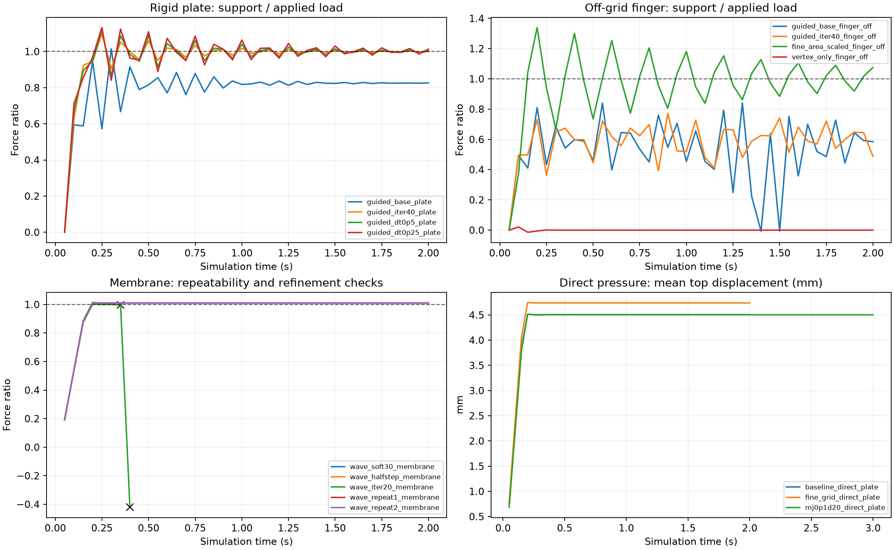

# 第一项：接触传力基准报告

会话日期：2026-11-02（Asia/Taipei）。所有代码与产物均在 `test/contact_transfer/`。业务模型、原始资产和交接文档未修改。

## 决策

**当前 Newton 1.6.1 配置不通过完整场景的平台验收，暂不进入内容物本构扩展和装袋整合。** 这是本机版本、指定模型与下列测试范围内的结论，不是对整个 Newton 项目的能力否定。

四面体直接受压能正确承载；刚体全表面接触下，平均反力有时正确，但局部残差和持续振动不通过。仅顶点接触会漏掉网格间隙内的小工具。膜—四面体在固定配置下3次通过，但步长减半、增加迭代后的复核失稳，因此尚未通过数值收敛验收。

MuJoCo 3.17 备选的同网格、同 Neo-Hookean 体积力实现，压板和偏置小手指可以通过；节点正上方手指出现倒置，膜片测试也未完成，所以也没有获得“完整场景已验证”的结论。MuJoCo 的 GPU 批量路径本轮没有重新验证。

## 方法与验收

软块 300×250×50 mm、0.3 kg，Lamé μ=1500 Pa、λ=1000 Pa；基准网格 12×10×4 单元，715 个节点、2400 个四面体。细网格 24×20×8 单元，4725 个节点、19200 个四面体。底层固定，关闭重力，0.2 秒平滑施加已知载荷；压板 19.62 N，小手指 2 N。正式刚体对照使用无驱动、无轴向阻尼的竖直移动副，避免自由工具翻倒混淆传力。

独立 float64 能量导数计算材料节点力和底部支撑反力；刚体接触力用当前接触记录和求解器本构重算；几何穿透通过 deformed top triangles 的竖直射线检查。直接压力用三角形形函数积分，保持合力和力矩，**不假定均布压力与刚性压头产生相同位移**。

最后 0.5 s：支撑反力误差≤5%，压头反力误差≤5%，四面体活动节点残差范数之和≤载荷5%；下陷漂移≤0.05 mm，软体和工具速度≤1 mm/s；采样中无倒置、界面几何穿透≤0.05 mm。每50 ms采样；步长、迭代和网格对照另行判断。提前失败的运行没有稳态，其末段均值不应当作静态误差。

## 核心数据

| 运行 | 支撑反力误差 | 材料残差/载荷 | 最大节点速度均值 mm/s | 结论 |
|---|---:|---:|---:|---|
| [baseline_direct_plate](results/baseline_direct_plate.json) | 0.103% | 0.105% | 0.013 | 单次通过 |
| [guided_base_plate](results/guided_base_plate.json) | 17.426% | 7.272% | 27.768 | 未通过 |
| [guided_iter40_plate](results/guided_iter40_plate.json) | 0.044% | 5.401% | 35.099 | 未通过 |
| [guided_dt0p5_plate](results/guided_dt0p5_plate.json) | 0.119% | 9.872% | 35.445 | 未通过 |
| [guided_dt0p25_plate](results/guided_dt0p25_plate.json) | 0.148% | 19.923% | 32.495 | 未通过 |
| [guided_base_finger](results/guided_base_finger.json) | 0.087% | 2.647% | 4.875 | 未通过 |
| [guided_base_finger_off](results/guided_base_finger_off.json) | 41.910% | 90.935% | 467.819 | 未通过 |
| [fine_area_scaled_plate](results/fine_area_scaled_plate.json) | 30.885% | 9.727% | 27.621 | 未通过 |
| [fine_area_scaled_finger_off](results/fine_area_scaled_finger_off.json) | 1.260% | 11.549% | 102.737 | 未通过 |
| [wave_soft30_membrane](results/wave_soft30_membrane.json) | 0.966% | 0.157% | 0.167 | 单次通过 |
| [wave_halfstep_membrane](results/wave_halfstep_membrane.json) | 19.971% | 3.578% | 484.922 | 提前失败 |
| [wave_iter20_membrane](results/wave_iter20_membrane.json) | 35.222% | 10.672% | 5784.213 | 提前失败 |
| [wave_repeat1_membrane](results/wave_repeat1_membrane.json) | 0.956% | 0.153% | 0.184 | 单次通过 |
| [wave_repeat2_membrane](results/wave_repeat2_membrane.json) | 0.966% | 0.155% | 0.167 | 单次通过 |
| [long5s_plate](results/long5s_plate.json) | 14.203% | 31.417% | 40.851 | 未通过 |
| [long5s_finger_off](results/long5s_finger_off.json) | 40.865% | 132.567% | 486.214 | 未通过 |
| [mj0p1d20_plate](results/mj0p1d20_plate.json) | 0.004% | 0.004% | 0.132 | 单次通过 |
| [mj0p1d20_finger](results/mj0p1d20_finger.json) | 16.132% | 954.978% | 5802.217 | 提前失败 |
| [mj0p1d20_finger_off](results/mj0p1d20_finger_off.json) | 0.000% | 0.001% | 0.001 | 单次通过 |
| [mj0p1d20_membrane](results/mj0p1d20_membrane.json) | 0.201% | 3.456% | 472.112 | 提前失败 |



## 已缩小的问题范围

1. 直接受压：Newton 粗网格下陷 4.50566 mm，MuJoCo 同网格为 4.50302 mm。两者静态形变接近，说明当前问题不能简单归结为四面体完全不承力。Newton 细网格直接受压为 4.73830 mm，较粗网格变化 5.16%，尚不能声称达到5%的网格收敛。

2. 刚体接触：独立增加迭代（1 ms，10→40）和固定40次迭代下减小子步（1→0.5→0.25 ms），没有让全部场景通过。增加全局阻尼、增大接触阻尼、关闭 tile、SDF 体素1.5→0.5 mm、网格加密也没有给出可接受的通用配置。细网格还做了接触 ke/kd 按名义顶面节点面积缩放至1/4的对照，仍未通过。载荷传至材料的平均值、瞬时接触力和局部平衡必须同时检查。

3. 网格间隙：关闭全表面接触后，偏置20 mm手指穿过25 mm节点间隙，不能靠关闭该功能解决振动。将接触刚度降到30 N/m也会让小工具穿过；这不是可接受的修复。

4. 膜片：接触刚度3000→30 N/m、子步0.1 ms、10次迭代时，固定配置3/3次通过，反力误差约1%，下陷4.417–4.426 mm；0.05 ms以及20次迭代复核失稳。这组配置值得保留，但还不能据此宣称随数值精度收敛。

5. k_start：本机 SolverVBD 默认 beta=0，源码把 rigid_contact_k_start_value 设为 -1，实际直接使用材料刚度；改1e12不能解释或修复此问题。GPU轨迹有差异，不能把两次轨迹差异当作该无效参数的因果效应。

以上只把故障缩小到当前接触路径及其数值稳定/收敛问题；还没有定位到可确认的单一求解器缺陷，也没有用调软实体材料来掩盖它。

## 下一步边界

继续第一项问题修复时，优先保留“偏置小手指”这个最小复现，检查全表面接触点/法线/重心坐标随子步的变化以及耦合迭代残差；先把该场景和压板同时做稳。若转MuJoCo，应先解决本报告中节点上手指的倒置和膜片稳定性，并重新验收。当前证据不足以批准整套模型迁移或进入第二项。

## 复现与原始记录

测量工具单元校验：`test_metrics.py`，包括能量差分梯度、压力合力/力矩、变形表面射线。

快速复现（约数分钟，预期返回非零，因为包含应当检出的失败）：

```bash
python3 /home/ubuntu/Dev/Projects/random/test/contact_transfer/run_suite.py --group quick
```

完整复现：将 `quick` 改为 `all`。脚本使用每条JSON保存的解释器和配置，结果加 `replay_` 前缀，原始数据保留。所有具体命令在 `MANIFEST.json`。运行不自动安装依赖、不修改生产模型。

Newton环境为本机1.6.1 / Warp1.18；MuJoCo环境为3.17。Newton JSON记录了求解器源码SHA-256。耗时含建模、编译缓存、graph捕获及CPU测量；有CPU/GPU对照任务交错执行，不能把这些 wall_s 当作严格吞吐基准。

MuJoCo备选使用相同NH体积弹性力，但采用20/s节点阻尼、显式体积力、原生接触，没有实现Newton的四面体粘性项；膜片使用MuJoCo原生StVK拉伸，Newton膜片是NH。因此只用其检验接口传力，不能直接比较膜片位移或宣称两后端完全等价。

几何检查限定当前平压场景；50 ms采样不能证明两个采样点之间绝无瞬时倒置或穿透。物性均为设定值，未做实物标定。本轮未测试完整袋子、夹爪提起或GPU批量环境。

早期 `baseline_*` 和 `iter40_*` 含自由刚体的探索运行，正式结论使用 `guided_*` 及之后运行；`baseline_direct_plate` 没有工具，不受这一区别影响。v2修正“静止”判定，加入工具速度，原始trace未改动。

## 全部运行

| 记录 | dt ms | 迭代 | ke N/m | 完成 | 通过 |
|---|---:|---:|---:|---|---|
| [baseline_direct_plate](results/baseline_direct_plate.json) | 1.667 | 10 | 3000.0 | True | True |
| [baseline_finger](results/baseline_finger.json) | 1.667 | 10 | 3000.0 | True | False |
| [baseline_finger_off](results/baseline_finger_off.json) | 1.667 | 10 | 3000.0 | True | False |
| [baseline_membrane](results/baseline_membrane.json) | 1.667 | 10 | 3000.0 | True | False |
| [baseline_plate](results/baseline_plate.json) | 1.667 | 10 | 3000.0 | True | False |
| [drag20_finger](results/drag20_finger.json) | 1 | 10 | 3000.0 | True | False |
| [drag20_finger_off](results/drag20_finger_off.json) | 1 | 10 | 3000.0 | True | False |
| [drag20_plate](results/drag20_plate.json) | 1 | 10 | 3000.0 | True | False |
| [fine_area_scaled_finger_off](results/fine_area_scaled_finger_off.json) | 1 | 10 | 750.0 | True | False |
| [fine_area_scaled_plate](results/fine_area_scaled_plate.json) | 1 | 10 | 750.0 | True | False |
| [fine_grid_direct_plate](results/fine_grid_direct_plate.json) | 1 | 10 | 3000.0 | True | True |
| [fine_grid_finger_off](results/fine_grid_finger_off.json) | 1 | 10 | 3000.0 | True | False |
| [fine_grid_plate](results/fine_grid_plate.json) | 1 | 10 | 3000.0 | True | False |
| [guided_base_finger](results/guided_base_finger.json) | 1 | 10 | 3000.0 | True | False |
| [guided_base_finger_off](results/guided_base_finger_off.json) | 1 | 10 | 3000.0 | True | False |
| [guided_base_membrane](results/guided_base_membrane.json) | 1 | 10 | 3000.0 | False | False |
| [guided_base_plate](results/guided_base_plate.json) | 1 | 10 | 3000.0 | True | False |
| [guided_dt0p25_finger](results/guided_dt0p25_finger.json) | 0.25 | 40 | 3000.0 | True | False |
| [guided_dt0p25_finger_off](results/guided_dt0p25_finger_off.json) | 0.25 | 40 | 3000.0 | True | False |
| [guided_dt0p25_membrane](results/guided_dt0p25_membrane.json) | 0.25 | 40 | 3000.0 | False | False |
| [guided_dt0p25_plate](results/guided_dt0p25_plate.json) | 0.25 | 40 | 3000.0 | True | False |
| [guided_dt0p5_finger](results/guided_dt0p5_finger.json) | 0.5 | 40 | 3000.0 | True | False |
| [guided_dt0p5_finger_off](results/guided_dt0p5_finger_off.json) | 0.5 | 40 | 3000.0 | True | False |
| [guided_dt0p5_membrane](results/guided_dt0p5_membrane.json) | 0.5 | 40 | 3000.0 | False | False |
| [guided_dt0p5_plate](results/guided_dt0p5_plate.json) | 0.5 | 40 | 3000.0 | True | False |
| [guided_iter40_finger_off](results/guided_iter40_finger_off.json) | 1 | 40 | 3000.0 | True | False |
| [guided_iter40_plate](results/guided_iter40_plate.json) | 1 | 40 | 3000.0 | True | False |
| [iter40_finger](results/iter40_finger.json) | 1.667 | 40 | 3000.0 | True | False |
| [iter40_finger_off](results/iter40_finger_off.json) | 1.667 | 40 | 3000.0 | True | False |
| [iter40_plate](results/iter40_plate.json) | 1.667 | 40 | 3000.0 | True | False |
| [kd30_finger_off](results/kd30_finger_off.json) | 1 | 10 | 3000.0 | True | False |
| [kstart_high_plate](results/kstart_high_plate.json) | 1 | 10 | 3000.0 | True | False |
| [long5s_finger_off](results/long5s_finger_off.json) | 1 | 10 | 3000.0 | True | False |
| [long5s_plate](results/long5s_plate.json) | 1 | 10 | 3000.0 | True | False |
| [mj0p1d20_direct_plate](results/mj0p1d20_direct_plate.json) | 0.1 | — | 原生约束 | True | True |
| [mj0p1d20_finger](results/mj0p1d20_finger.json) | 0.1 | — | 原生约束 | False | False |
| [mj0p1d20_finger_off](results/mj0p1d20_finger_off.json) | 0.1 | — | 原生约束 | True | True |
| [mj0p1d20_membrane](results/mj0p1d20_membrane.json) | 0.1 | — | 原生约束 | False | False |
| [mj0p1d20_plate](results/mj0p1d20_plate.json) | 0.1 | — | 原生约束 | True | True |
| [mj0p2_direct_plate](results/mj0p2_direct_plate.json) | 0.2 | — | 原生约束 | True | False |
| [mj0p2_finger](results/mj0p2_finger.json) | 0.2 | — | 原生约束 | False | False |
| [mj0p2_finger_off](results/mj0p2_finger_off.json) | 0.2 | — | 原生约束 | True | False |
| [mj0p2_plate](results/mj0p2_plate.json) | 0.2 | — | 原生约束 | True | False |
| [no_tile_finger_off](results/no_tile_finger_off.json) | 1 | 10 | 3000.0 | True | False |
| [sdf0p5_finger_off](results/sdf0p5_finger_off.json) | 1 | 10 | 3000.0 | True | False |
| [soft300_finger](results/soft300_finger.json) | 1 | 10 | 300.0 | True | False |
| [soft300_finger_off](results/soft300_finger_off.json) | 1 | 10 | 300.0 | True | False |
| [soft300_plate](results/soft300_plate.json) | 1 | 10 | 300.0 | True | False |
| [soft30_finger](results/soft30_finger.json) | 1 | 10 | 30.0 | True | False |
| [soft30_finger_off](results/soft30_finger_off.json) | 1 | 10 | 30.0 | True | False |
| [soft30_plate](results/soft30_plate.json) | 1 | 10 | 30.0 | True | False |
| [vertex_only_finger_off](results/vertex_only_finger_off.json) | 1 | 10 | 3000.0 | True | False |
| [wave_default_membrane](results/wave_default_membrane.json) | 0.1 | 10 | 3000.0 | True | False |
| [wave_halfstep_membrane](results/wave_halfstep_membrane.json) | 0.05 | 10 | 30.0 | False | False |
| [wave_iter20_membrane](results/wave_iter20_membrane.json) | 0.1 | 20 | 30.0 | False | False |
| [wave_repeat1_membrane](results/wave_repeat1_membrane.json) | 0.1 | 10 | 30.0 | True | True |
| [wave_repeat2_membrane](results/wave_repeat2_membrane.json) | 0.1 | 10 | 30.0 | True | True |
| [wave_soft30_membrane](results/wave_soft30_membrane.json) | 0.1 | 10 | 30.0 | True | True |
