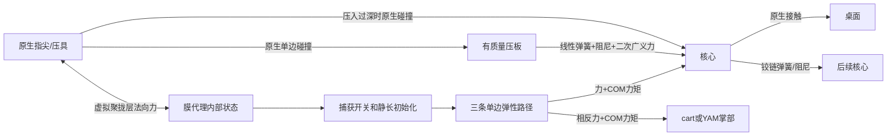

# MJWarp 随机包裹物理审查

## 本轮计划 2026-11-14

审查对象为运行前保存指纹的 `contents/parcel/` 及 YAM 适配器。本轮只新增审计工具、数据、参考计算与报告，不修改被审查的模型或随机范围。机器 ubun，正式 GPU 运行使用 flock。

- 独立审查 12 类实验，先查方程与因果关系，再看动态行为。所有受控参数覆盖均保存原 κ、实际 κ 和动作，不将诊断条件混作默认随机分布。
- 静置每原型 8 环境，运行 2 s，检查速度、穿透、关节状态和质量。GPU batch 对照 N=1/64/512/2048，同 seed/episode=0，逐环境复用同一 κ，并检查 reset/capture。
- 内容物用独立 CPU 静力参考与 GPU 原生动力学快照核对。端点载荷和自重分别定义，目标下垂相对误差 <10% 为响应命中门槛；准静态压缩目标为单压板 20 N，另查真实压具的核心接触旁路。压板质量比例 1%/10%/30% 为诊断消融，非模型修复。
- dt=0.25/0.5/1 ms，比较原始时间序列、受力、滑移、能量与求解残差。连续位移最大差 <5 mm、力峰差 <10% 为本轮筛查门槛，存在分支结果变化直接记录，不用均值掩盖。
- 力/力矩恒等式容差 1e-5 N / N·m。绳与压缩弹性力通过独立势能梯度核对。无耗散条件的相对能量误差筛查线 1%，并报告其随 dt 的变化；明确区分数值误差和结构性功率残差。
- Module A 攻击包括零预算、错误区域、无位移输入、接触消失、开闭循环和代理自维持。Module B 对照独立分段线性求根器，检查无根、多根、零法向、破坏与脱落。
- 参数覆盖每拓扑至少512，统计响应可达性与参数退化；失败样例保存 seed、κ、动作、源码位置、时序及最小复现。

通过时给出声明范围内 PASS/CONDITIONAL PASS。发现结构性反例时给出 FAIL、严重度和最小修复设计，模型源码保持原样。覆盖不足项记 NOT VERIFIED。完整 GPU 机器人抓取继续只走共享 YAM 平台，本轮材料隔离测试不另建机器人执行器。

## A. Executive Summary

**总体判定为 FAIL，针对本轮冻结的原始实现。** 内容物刚体质量、原生铰链、单边弹性绳及其双向力矩有可保留的基础；局部捕获的接触因果关系、聚拢代理的功量闭合、滑移求根和部分压缩响应参数存在已复现的问题。

本轮没有修改模型方程或随机范围。所有变化均在审计工具、受控测试边界及输出中。审查期间其他会话提交了侧向入口并修改工作区模型，新增 `film.py/film_config.json`。因此报告**不对这些后续改动出具通过结论**。本轮力学实验的 `model.py` 指纹统一为 `fde3941a9cef6e0b3eae6f4b0933823097626d45340c13746594989504ca95bb`，`kernels.py` 为 `019b5dc20c4613f9975063016ee2b309d6b665d4eb9e54e1eea966f8b636e982`。两者对应 d5765a3 时的物理实现，后续入口提交未改变这些力学方程。

可复现基准源码位于 [冻结源文件](../../../runs/2026-11-14/bag/parcel-physics-audit-kernels-r2/source/)。审计入口通过 `common.py` 将该快照装入本进程的导入表，完全不替换工作区文件。工作区已经变化后再次运行 `kernel_audit.py`，与原审计 `summary.json` 逐项相同，记录在 `parcel-physics-audit-frozen-replay`。

主要结论如下。

1. **存在明显物理错误。** 原 GPU 接触采集没有限定接触对象，裸桌面法向载荷可被材料聚拢使用；代理储能随聚拢量增加，却没有对应的功率闭合。
2. **Module A 可以建立没有相应材料接触依据的连接。** 已保存裸桌面接触输入触发捕获、接触丢失后代理自供法向、相同顶面只改变区域标签即捕获的反例。尚未证明这些反例能稳定搬运整个包裹。
3. **Module B 的弹性部分成立，完整模块不通过。** 三路径没有重复施加三倍重量，`F_drive=ΣT_i` 与共享释放坐标一致。二分法缺少单调性与根包围保证，1 ms 反例错误地完全滑脱；零法向时粘性项仍可保留承载张力。
4. **随机化确实改变一部分物理响应，但响应标签不完全可信。** 512 件柔性批次具有512个不同质量和压缩参数，指定压具动作下目标压缩深度与实测深度相关系数0.981。220/512的20 N目标深度却超过核心几何接触限制；刚性拓扑的多项柔性随机字段完全不进入动力学。
5. **优先修复接触与材料归属、代理能量闭合、滑移求根。** 在这些问题解决前，当前抓取成功率不能支持 sim-to-real 结论。

本轮7项旧行为测试仍全部通过，说明原测试覆盖不足。详细数值见 [汇总数据](../../../runs/2026-11-14/bag/parcel-physics-audit-analysis-r2/audit_summary.json)，图见 [物理审计曲线](../../../runs/2026-11-14/bag/parcel-physics-audit-analysis-r2/physics-audit.png)。

## B. Physical Model Reconstruction

### 拓扑、质量和力传递

刚性批次是一个free根体与一个无相对自由度的压板体。柔性批次是一个free根体、两个各含X/Y/Z三转动关节的后续刚体，每段再有一个局部z向压板slide。柔性内容物共6+6+3=15个广义速度自由度；GPU材料夹具另有cart三平移与双指slide，共5个自由度。相邻核心之间有碰撞排除，父子核心/压板接触由原生过滤处理。

每段质量为 `M*w_i`，核心90%、压板10%。质量和按盒体算出的正定惯量实际写入原生模型，随后调用 `set_const`。核心碰撞尺寸为 `(0.98 L/n,W,0.8 H)`，压板为 `(0.98 L/n,W,0.2 H)`，压板中心在核心上方 `0.5 H`。惯量计算使用长度 `L/n`，与碰撞长度有2%的尺寸差异，属于近似，并非完全按碰撞盒重算。核心和压板的惯性中心具有同一平移偏置，柔性批次还修正质量权重造成的长向质心偏移。

实际力路径如下。



袋体Lb/Wb/Hb包络没有进入一套独立的碰撞/限位约束，主要通过预算和承载余量间接影响结果。连续链首版允许这种降阶简化，但该名义包络本身无法证明局部材料可达。

压板的二次项是内部弹性力，与原生线性弹簧相加。它没有再次添加法向接触力。核心碰撞提前接管载荷属于另一条物理支撑路径，导致宏观压缩响应旁路。膜代理提供额外夹持反馈；聚拢期间该反馈又能被Module A作为接触依据，形成循环。

### 状态调用顺序

GPU每步清空外力，先读取上次已完成接触求解的法向载荷，然后 `step1` 更新当前位置/速度与原生被动力；夹具控制、膜代理、gap测量、材料状态与承载力依次执行，最后 `step2` 求解并积分。代理执行早于材料聚拢更新。捕获/滑移/失败状态仅在 `dynamics` 更新。

YAM使用CPU MuJoCo并调用同一Warp力核，实际管线另有不同的接触合成规则。`ParcelSim.apply` 在捕获前将代理力加到原生内容物接触载荷上，GPU `film_proxy` 却覆盖原生载荷。YAM还将实际开口速度截断到非负后传入，使核中的材料逃逸项永远得不到负向速度。不能凭“同一力核”推断两条管线物理等价。

### Physical Model Dependency Table

下表代码位置指冻结快照中的函数与行号，优先于会变动的工作区文件。

| 参数/状态 | 实际方程或原生字段 | 代码位置 | 物理响应 | 本轮验证 |
|---|---|---|---|---|
| L/W/H | geom_size、body_pos、jnt_pos | kernels.configure 128–181 | 尺寸、杆臂、接触边界 | 原生字段检查、压具 |
| M、weights | m_core=0.9Mw，m_cap=0.1Mw | configure 144–171 | 惯性、重量、下垂 | 质量误差、悬挂平衡 |
| com | body_ipos，并扣除权重的长向偏移 | configure 149–153 | 重心、力矩、角动力学 | 源码与实际质量矩阵 |
| bend_sag | k=Mg·5(L/3)²/sag | sample 82–90 | 两关节小角度端点柔度 | 独立平面静力求解 |
| twist_ratio | k_t/k_b | sample 90，configure 160–166 | 初始长轴扭转刚度 | 轴向/自由度静态检查，动态标定未验 |
| damping | c=2ζ√(k m_local a²/12) | configure 166/176 | 关节阻尼 | 符号、耗散与质量消融 |
| compression | k1=10/d20 | sample 91–97 | 单压板线性刚度 | 直接20 N与真实接触压具 |
| quadratic | k2=10/d20² | dynamics 236–239 | 非线性变硬，U2=k2d³/3 | 势能、加载/释放能量 |
| slack/slack_y | 2(λxL+λyW) | sample 78–108 | 预算长度 | 量纲、范围、区域攻击 |
| budget | 上式乘固定四区域比例 | sample 106–108 | 可聚拢上限 | 零预算、区域切换 |
| lift_slack | λx H | sample 98，dynamics 282 | 承载起始静长增量 | 单边静长阈值 |
| rope_k | T_i=k·max(l_i-rest_i-s,0) | tensions 219 | 单路径刚度 | 路径数、势能梯度、静平衡 |
| table_mu | core/cap/table原生摩擦 | configure 136–173 | 桌面摩擦 | 源码/native字段，独立摩擦标定未验 |
| normal | 双指接触载荷或代理覆盖值 | contacts 187、model.film_proxy 64 | 聚拢许可与承载容量 | 裸桌面及CPU/GPU合成对照 |
| gather/escape | de/dt=αgχv⁺(S-e)/(S+ε)−αrv_escape e/(S+ε) | dynamics 256–265 | 材料聚拢/逃逸 | 静止输入、失接触、闭合时功率 |
| efficiency/threshold | P=η(1−exp(-500(e−emin))) | dynamics 266–277 | 捕获 | 零预算与同姿态区域攻击 |
| State.rng | randf(s.rng) | dynamics 277 | 捕获随机事件 | 新事件未推进RNG反例 |
| captured/slip | fold width=min(.004+2length,.024) | model.film_proxy 72–82 | 虚拟接触跨度 | 接触自维持、能量残差 |
| mu_s/mu_d | C=μN_effηφ，μd=0.8μs | sample 100–101，dynamics 290–303 | 摩擦承载 | 独立分段线性参考 |
| slip_damping | ζ(s_new−s_old)/dt | dynamics 303 | 速率阻力 | 零法向张力及dt对照 |
| strength | max_i T_i>limit→RUPTURE | dynamics 315–319 | 单路径失效 | 失败状态清力、偏心动态破坏 |
| anchors/rest | 刚性沿长轴三点；柔性每段中心 | anchor_position 208、dynamics 282 | 悬挂力矩 | 全局力矩、偏心激励 |

## C. Component Audit

| 模块 | 判定 | 范围和依据 |
|---|---|---|
| Payload刚体质量/惯量 | CONDITIONAL PASS | 总质量一致、惯量正；压板质量与几何密度分布是未标定假设，盒惯量长度有近似 |
| 三段铰链 | CONDITIONAL PASS | 三个初始正交转轴提供3个相对转动DOF，原生树关节固定平移连接；小角度静力参考匹配。大转角Euler坐标与真实连续体扭转未验 |
| Compression弹性力律 | CONDITIONAL PASS | 单压板直接施力20 N命中，恢复力和势能符号正确；真实压具下部分目标不可达 |
| Compression整体响应 | FAIL | 软压缩原型的核心提前分担载荷，响应随机化目标不等于实际接触响应 |
| Bag Slack | CONDITIONAL PASS | 捕获后松弛时T严格为零，路径张紧可形成支撑；材料比例、直线内部锚点和λH映射待标定，完整包络约束未实现 |
| Material Engagement | FAIL | 接触对象/区域缺少对应检查，代理可自供法向，聚拢能量与事件状态存在缺口 |
| Load Transfer弹性部分 | PASS | 在本轮刚体弹性路径工况中，方向、ΣT共轭力、双端力矩和native支撑平衡通过 |
| Slip and Detachment | FAIL | 多根二分错误和零法向粘性承载已复现；失败状态的绳力清零通过 |
| Robot–Object Force Coupling | CONDITIONAL PASS | GPU夹具原生动力学中的垂直反作用、全局力矩和非零掌部力矩成立；全YAM旋转功率账及受控CPU/GPU完整机器人对照未验 |
| 真实世界定量准确性 | NOT VERIFIED | 无独立真实包裹/膜测量数据 |

## D. Mathematical Audit

### D1. 两关节下垂系数5的来源

令a=L/3，第一核心固定，两个柔性连接相距a，端点位于第一连接后2a。端点向下力F分别产生近似力矩2Fa、Fa。等刚度k时，θ1≈2Fa/k，θ2≈Fa/k，端点下垂为a(2θ1+θ2)，于是

`δ_tip=5Fa²/k`，即 `k=5Mga²/δ_target`（F=Mg）。量纲为N·m，θ以rad计。

这要求测量**最后一段远端中性轴端点**、第一段固定、外部点力为Mg。它既不是末段COM位移，也不是只有自重的下垂。均匀质量分布的小角度自重贡献约为 `1.5 Mga²/k`，额外叠加Mg端点载荷时总下垂约为 `6.5 Mga²/k`，小变形极限约比target大30%。

参考程序求解包含sin/cos及压板初始高度偏置的两角平衡方程，未调经验系数。24个L/M/target/重力工况中，数值静力与该参考的最大差约22 μm。端点单载荷的目标误差为−0.04%至−11.97%，大下垂/短包裹偏离小角度假设；同时施加自重时目标偏差为+8.30%至+29.96%。后者不能直接用来否定公式，必须先区分边界条件。

示例取L=.28 m、M=.5 kg，完整24行、所有角度与力矩见payload-r3/summary.json。

| target mm | 重力 | measured mm | 误差 | 两关节角rad | 恢复力矩N·m |
|---:|---:|---:|---:|---|---|
| 20 | 0 | 19.831 | −0.844% | .08521 / .04251 | −.91021 / −.45407 |
| 20 | 9.81 | 25.691 | +28.456% | .11339 / .04944 | −1.21124 / −.52816 |

旧 `material_checks.py` 把额外力加在末段COM，并测末段COM下垂，因此只检验了刚度单调性，不能验证上述系数5的端点定义。

### D2. 压缩势能和接触旁路

令q≤0为压板向下滑动，d=−q。内部弹性广义力为 `Qq=k1d+k2d²`，对应

`Ucomp=0.5k1d²+(k2/3)d³`。

原生线性力加自定义二次项没有重复计算。原生阻尼为 `−c qdot`，瞬时功率为 `−c qdot²≤0`。内部阻尼在释放时可产生指向核心的力，这与单边外部法向接触并不是同一个物理量，不能把内部阻尼简单当作允许外部指尖吸附。

核心顶面为核心坐标0.4H，压板顶面0.6H，外部压具下压约0.2H后会碰到核心。20 N目标深度若大于0.2H，就可能由核心接触分担载荷。该限制比±0.03 m的原生压板行程更早发生于大量软样本，不能只验证代数式 `k1d20+k2d20²=20`。

### D3. 三路径与共享释放坐标

`Urope=Σ 0.5k_i[l_i−L_i0−s]_+²`，因此 `−∂Urope/∂s=ΣT_i`。源码所有α_i都等于1，使用张力和有明确共轭意义，不应任意平均。路径数量增加会增加相同位移下的总刚度，但静态位移会重新平衡，总支撑力仍等于Mg。实际测试没有发现“三条绳导致三倍重量”。每路径材料强度和刚度若被解释为整个袋子的参数，则仍需按路径定义和材料份额重新校准。

每条力为 `Fbody=−T u`，`Fgrip=+T u`。两端在各自COM的力矩为 `r×F`，因此关于同一世界原点的总力矩 `Σ(τ_COM+x_COM×F)` 为零。实际注入的非零掌部力矩与全局零力矩可同时成立。本轮势能有限差分与测得的笛卡尔力最大差5.1e−6 N。

### D4. 滑移方程和多根

源码实际求解

`R(s)=Σ k_i[li−L0i−s]_+−μd N_eff η clip((captured−s)/.005,0,1)−ζ(s−sold)/dt=0`。

在fade区间，导数为 `−Σ_active k_i+μdN_effη/.005−ζ/dt`，可以为正。24次二分不能弥补未包围根或非单调的问题。

最小反例采用k_i=400 N/m、三个初始extension均38/1200 m、captured=.008 m、sold=0、动态容量30 N、静态容量37.5 N、ζ=2 N·s/m、dt=.001 s。κ中的刚度、摩擦和单路径strength均在原范围内，法向载荷为受控输入。初始每路径12.667 N低于15 N的最低材料强度，因此此反例不依赖人为放宽破坏限值。

此时

- 0≤s≤3 mm时，`R=8−3200s`，稳定根为2.5 mm。
- 3≤s≤8 mm时，`R=−10+2800s`，另一个根为3.5714 mm。
- R(0)=8 N、R(8 mm)=12.4 N，端点同号。GPU第一次中点4 mm的残差为正，随后错误地收敛到8 mm边界并DETACHMENT。

独立参考枚举路径激活阈值和fade阈值处的分段线性根，得到上述两个根。dt=0.25/0.5 ms时GPU分别给出0.869565/1.538461 mm，匹配各自离散参考；1 ms的状态变化来自求根错误，不能仅归因于时间离散的正常误差。

ζ项本身是耗散的，但它使N_eff=0时仍有非零张力。一次零法向更新后三路径张力和为9.231 N，之后在固定几何下衰减。该数学模型包含独立于夹持法向的粘性抓持通路，必须解释或移除，不能把全部承载都归给库仑摩擦。

### D5. 聚拢代理的功量缺口

两个对称指尖的单边代理弹性能为

`Ufilm=Σ 0.5 kn[a(e)−q_i]_+²`，其中 `a(e)=min(.002+e,.012)`。

在未饱和且接触激活时，`dUfilm/dt = Σ(−Ni qdot_i)+Σ Ni edot`。当前手指力只包含第一项对应的普通法向弹簧/阻尼，第二项没有共轭阻力、功预算或其他被跟踪的能源。

冻结手指、仅按API默认gather_speed更新时，一步最大代理储能增加0.462 mJ，而机械位移功为0。为排除“输入速度与运动不一致”这一解释，又测试每指实际闭合速度0.01 m/s、gather_speed=.02 m/s、dt=.5 ms的隔离代理。第一环境U从0.022500增至0.022821 J，固定材料长度下的正常闭合功为0.150 mJ，额外储能约0.171 mJ；全32环境最大额外储能0.174 mJ，而法向阻尼耗散仅0.0002 mJ。此处没有原生切向摩擦接触可用来解释额外功。

这表明将该代理解释为被动薄膜时缺少能量闭合。其等效宽度4–24 mm可以是折层/局部可夹材料的经验接触尺度，但不能自动当作真实膜厚，也不能免除功量约束。

## E. Numerical Audit

### API和更新时序

安装版本为MuJoCo/MJWarp 3.17.0、Warp1.19.0。逐环境质量、惯量、几何等确实写入受支持的batch字段，并调用 `set_const` 更新派生量。当前步的绳几何在 `step1` 后计算，外力每步清零。接触反馈来自上一已完成的求解，存在一步延迟；这在方法上可以采用显式反馈，但必须验证接触切换处的行为。

`graph()` 的warmup使clock从0变1，CUDA capture本身在该测量中没有再执行一个物理步。reset清空mode、绳力、xfrc和qfrc通过。所有正式实验使用GPU锁；本轮没有提供新的吞吐数字。

### 三个步长的实测结果

同κ、同压具控制，8环境，每项2 s。力峰为每步记录的最大约束行力，穿透为最大负约束位置，力平衡监测量为 `Ma−qfrc_smooth−qfrc_constraint`。

| dt ms | 最大约束行力N | 最大负位置mm | 最大广义力平衡监测量 | 释放末单压板压缩mm |
|---:|---:|---:|---:|---:|
| 0.25 | 6.975 | 0.261 | 0.00407 | 0.07273 |
| 0.5 | 7.358 | 0.283 | 0.00414 | 0.07273 |
| 1.0 | 6.954 | 0.326 | 0.00672 | 0.07273 |

该基线压缩动作没有出现分支失稳，力峰差小于10%。该监测量不是完整KKT证书，不能把它称为所有约束已精确满足。不能由这组静稳结果推断前述多根滑移或抓取能量可靠。

### 能量与CPU/GPU对照

另建只用于隔离检验的无重力、无接触、无行程止挡材料夹具，保留原始质量、惯量、关节刚度和二次压缩力。初始弯曲角0.1/−0.05 rad、单压板压缩5 mm，初始能量约0.1047605 J；原生能量API加自定义二次压缩势能，记录KE、GPE、关节弹能、线性/二次压缩弹能、阻尼耗散、外功。该诊断的零阻尼设置超出原随机阻尼范围，目的是检查闭合机械系统的离散误差，不表示默认阻尼工况已出现相同漂移。

| dt ms | GPU无阻尼0.1 s末能量误差 | GPU最大绝对能量误差 | matched CPU/GPU最大qpos差 |
|---:|---:|---:|---:|
| .25 | +2.236% | 10.307% | 6.67e−7 |
| .5 | −1.966% | 24.461% | 1.03e−6 |
| 1 | +74.309% | 81.780% | 3.52e−7 |

同边界同力律的CPU/GPU总能量最大差不超过6.6e−7 J，说明主要误差来自该刚度/时间步长下的离散积分，而非GPU批次独有的质量更新错误。减小dt改善峰值误差，但本轮三个dt都未满足1%的能量筛查线。阻尼c=.1诊断在计入估计耗散后，末端余额分别为+1.83%、+3.79%、+27.14%。完整默认阻尼和真实接触条件下的功量账仍需另外验证。

### Batch一致性与随机化

相同κ、episode=0，原生产GPU步进N=1/64/512/2048运行1.2 s。相对N=1的最大qpos差不超过1.50e−8，批内最大差2.40e−8。六类静置各8环境，平移末速度最大2.66e−6 m/s、总质量误差不超过1.20e−7 kg、静置最大负位置约0.211 mm，均有限。

512个柔性混合样本在2 s指定压具动作下产生不同压缩响应，相关系数0.981只适用于该规定动作，并不构成20 N响应命中证据。220个目标深度超过0.2H，占所有样本43.0%，占其中256个软压缩样本85.9%。刚性拓扑中bend、twist、damping、compression、quadratic、weights对该批次内容物动力学不生效，不能把这些字段的数值差异计作实际柔性覆盖。

RNG的跨环境种子不同，但反复新闭合事件中`s.rng`从未推进。本轮32环境第一次捕获21个，20次仅翻转事件位、无真实运动后仍为相同21个；有效采样前后RNG变化数为0。这是源码/随机语义问题，不是发现了“无限重试提升概率”。单次闭合内不重采样的旧测试并不能排除该问题。

## F. Experimental Evidence

### 本轮12项覆盖和限制

| 实验 | 实际执行 | 结果和适用范围 |
|---|---|---|
| 1 Static Equilibrium | 6原型×8环境×2 s，GPU | 所测静置稳定、质量一致；不代表加载全域稳定 |
| 2 Bending Response | 3组L/M×4目标×2重力，CPU独立参考 | 小角度端点定义成立；自重和COM测法必须区分，末端角度/恢复力矩/误差已保存 |
| 3 Compression Response | 2原型×3压板质量比例，直接20 N加载/释放；另2速度真实压具 | 单压板力律通过；软原型核心接触旁路FAIL |
| 4 Slack Activation | 受控extension −10/0/5/10 mm力核；1/2/3路径8 s悬挂 | 松弛/零extension不承载，正extension传拉力；多slack实际提起起始时刻矩阵未验 |
| 5 Eccentric Suspension | 单侧路径8 s，GPU；力矩/势能梯度 | 峰值力矩1.072 N·m，出现转动与部分破坏，未达全体静平衡。不能用最终均值断言静态偏心姿态正确 |
| 6 Engagement Feasibility | 32环境零预算/区域/静止/代理攻击，裸桌面native输入；YAM两例区域对照 | 已发现假连接机制；未证明无材料时稳定搬运整个物体 |
| 7 Contact Force Consistency | 独立全局力/力矩、势能梯度、native掌部反力 | 所测弹性路径通过；GPU与YAM接触合成不等价 |
| 8 Slip and Detachment | 三dt、多根独立参考、零N、失败状态清力 | 多根错误脱落FAIL；失败状态绳力清零PASS；新破坏触发量化/概率标定未验 |
| 9 Energy Consistency | CPU和GPU独立闭合弹簧、代理储能、耗散与外功 | 代理结构性功量缺口FAIL；离散能量误差超筛查线 |
| 10 Timestep Convergence | dt=.25/.5/1 ms，GPU压具/能量与同κCPU参考 | 温和压缩基线近似一致；滑移分支和弹性能量不满足整体收敛要求 |
| 11 Randomization Coverage | 柔性512+刚性512参数/原生字段，柔性2 s动作 | 有实际响应差异，同时存在目标不可达和刚性字段无效的问题；未完成全范围反例穷举 |
| 12 GPU Batch Consistency | N=1/64/512/2048，同κ、episode0 | 本工况差异约1e−8；主动抓取/不同episode布局一致性未验 |

### 关键数值和样例

- 总力恒等式最大误差为0 N，全局力矩最大残差4.01e−8 N·m。非零掌部力矩样例约`(-0.1637,0.2979,0.0177)` N·m。
- 0.4 kg物体的1/2/3路径平均支撑力为3.923994/3.923999/3.924010 N，重量3.924 N。最大相对平衡误差2.50e−6。扣除夹具自重的native掌部控制反力同样约3.924 N。
- 单侧路径试验中，3/8因动态张力超过各自材料强度而破坏；其余仍在摆动，不能称为已达静平衡。早期含桌面支撑的末态不用于自由悬挂结论。
- 零预算攻击为0/32捕获，e严格为0，这一保护成立。相同刚性满装顶面几何/法向输入，region=0时0/32捕获，region=1时20/32捕获，区域标签没有改变实际抓取点。
- 静止q/qvel、仅给`.04 m/s`聚拢速度输入时25/32形成捕获。真实接触丢失0.5 s、speed=0时聚拢量仍为2 mm；随后只由代理提供约20 N/指即可21/32捕获，手掌在内容物核心上方约110 mm。
- 裸桌面实际native接触仅为`table-left/right`，各指约8.802 N，内容物geom没有参与；力核最终生成6.141 mm捕获连接。该测试冻结测得的输入进行本构攻击，绝非完整动态抓取成功实验。
- YAM刚性满装seed7，真实初始包裹和顶面位置相同。region0在闭合末以材料不足失败；region1在t=4.531 s进入ENGAGED，捕获3.059 mm，随后lift失夹。两例都没有完成任务。这个对照验证错误区域会打开本不应使用的材料连接，未验证稳定假抓取。
- 易弯单压板20 N目标2.619 mm，真实压具同样达到；软压缩目标20.083 mm，真实压具只到16.831 mm，其中核心承担4.596 N、压板承担15.404 N。直接对压板施20 N则能达到20.083 mm。0.2/1 s加载速度的稳态结果相同。
- 压板质量1%/10%/30%时，易弯小信号实测频率为326.98/103.92/60.02 Hz；软样本118.06/37.52/21.67 Hz。总质量固定、惯量随质量正确缩放。静态响应相同，动态频率明显改变，说明10%选择需要材料动态标定。

### 可复现命令

从仓库根目录运行，输出必须选新目录。下面各审计入口默认加载冻结快照，也可显式设置 `PARCEL_AUDIT_MODEL_SNAPSHOT` 为上述source目录。所有κ覆盖、边界修改和原始数据均在各运行的metadata、NPZ、源码快照中保存。

```sh
flock /tmp/claude-gpu.lock /home/ubuntu/Dev/Envs/mjwarp/bin/python test/content_model/parcel/physics_audit/kernel_audit.py --output test/runs/2026-11-14/bag/audit-kernels-new
flock /tmp/claude-gpu.lock /home/ubuntu/Dev/Envs/mjwarp/bin/python test/content_model/parcel/physics_audit/consistency_audit.py --output test/runs/2026-11-14/bag/audit-consistency-new
flock /tmp/claude-gpu.lock /home/ubuntu/Dev/Envs/mjwarp/bin/python test/content_model/parcel/physics_audit/payload_audit.py --output test/runs/2026-11-14/bag/audit-payload-new
flock /tmp/claude-gpu.lock /home/ubuntu/Dev/Envs/mjwarp/bin/python test/content_model/parcel/physics_audit/gpu_energy_audit.py --output test/runs/2026-11-14/bag/audit-energy-new
flock /tmp/claude-gpu.lock /home/ubuntu/Dev/Envs/mjwarp/bin/python test/content_model/parcel/physics_audit/batch_audit.py --output test/runs/2026-11-14/bag/audit-batch-new
flock /tmp/claude-gpu.lock /home/ubuntu/Dev/Envs/mjwarp/bin/python test/content_model/parcel/physics_audit/suspension_audit.py --output test/runs/2026-11-14/bag/audit-suspension-new
flock /tmp/claude-gpu.lock /home/ubuntu/Dev/Envs/mjwarp/bin/python test/content_model/parcel/physics_audit/yam_region_probe.py --region 1 --output test/runs/2026-11-14/bag/audit-yam-region-new
```

第一个命令即可复现裸桌面捕获、错误区域、静止聚拢、零法向承载和三步长滑移反例；`multiroot-.001.npz`的实际文件名含完整浮点值`multiroot-0.001.npz`。`summary.json`以字段名区分案例。第二个命令复现代理功量和RNG/CPU-GPU接触合成问题。YAM重现驱动冻结模型和适配器，使用checkout的公共平台，平台版本/资产指纹由原runner记录；本轮已执行其20 ms入口检查。原始完整两例运行使用当时的公共平台源码，保存在各YAM结果目录。

正式输出均位于 `test/runs/2026-11-14/bag/parcel-physics-audit-*`。主要证据为 `kernels-r2`、`consistency-r3`、`payload-r3`、`gpu-energy-r2`、`batch-r1`、`suspension-r3`、`yam-region0/1`、`analysis-r2`。`frozen-replay`与`kernels-r2`汇总逐项相同。无吞吐或NaN-free结果被当作物理正确性的替代证据。

### 审计工具自身的修正

- payload-r1在CPU clone时触发simple/sameframe缓存前提错误，中止；修复为审计夹具以`simple=false`编译，不改模型源码。
- clamp根体后显式保持原父子接触排除，防止夹具把压板锁在核心上。
- payload-r2的压具状态被`mj_setConst`重置，导致未接触；其零载荷结果无效。r3保留qpos并forward后重跑。
- 无耗散能量夹具显式关闭碰撞/行程止挡，避免将接触耗散误作能量不守恒；其结果与默认模型边界区分。
- suspension-r1的单侧场景落在桌上，r2仅运行时改碰撞mask未改变预编译候选；两者不用于自由悬挂。r3在编译前关闭地面接触，保留完整边界修改和动态破坏结果。
- JSON最初将结构化κ序列写为无字段名的行，后按原dtype恢复字段名，数值未改，原始结构化NPZ保留。

这些失败和修正都保留在原运行目录，未删除失败数据。

## G. Findings by Severity

### P0-01 接触/材料归属缺失，允许假连接

**Issue**　GPU `contacts`收集所有与pad相关的接触；区域budget由调用方枚举选取，缺少空间归属校验。

**Evidence**　裸桌面8.802 N/指、无内容物接触时，力核形成6.141 mm捕获。相同刚性满装顶面，区域标签从0变1使20/32捕获；YAM同位置区域1也进入ENGAGED。

**Physical Explanation**　桌面支撑不是包裹薄膜接触；远处边缘的材料预算不能由一个标签自动转移到平顶抓取点。仅检查手掌到中段距离小于L+H不能证明薄膜处于指间。

**Affected Experiments**　6、7、11，进而污染抓取成功/失败数据。

**Recommended Minimal Fix**　严格按目标geom/接触点过滤载荷，依据实际抓取位置选择区域并校验可达材料；拒绝来自桌面、其他指尖和非目标体的聚拢输入。回归必须覆盖裸桌面、远离包络、同姿态改标签、紧袋硬平顶。

**Confidence Level**　高。已证伪接触因果条件，尚未证明无材料下可持续搬运整包。

### P0-02 聚拢状态改变代理弹簧静几何而无功量闭合

**Issue**　代理的有效半宽随e增长，存在未被力或其他状态结算的 `∂U/∂e·edot`。

**Evidence**　静止一步储能增加最高0.462 mJ；采用与实际闭合相同的gather_speed后仍有最高0.174 mJ额外储能。接触丢失后e保持，代理可独立给出法向并再次支持聚拢/捕获。

**Physical Explanation**　被动材料不能在零或不足的外功下增长可释放的弹性储能。若此宽度变化代表塑性折层或材料迁移，必须有相应机械功和耗散来源。

**Affected Experiments**　6、9、10。

**Recommended Minimal Fix**　为聚拢状态定义储能/耗散与机械功预算，施加相应的共轭阻力或限制可储能增长；阻止未绑定到真实局部材料的代理自供捕获资格。用闭合/打开循环验证回馈机械功不超过输入。

**Confidence Level**　高，针对被动薄膜接触这一声明；未知外部能源不能作为当前模型中的默认解释。

### P1-01 滑移二分在多根区间错误脱落

**Issue**　未检查根包围与单调性，注释声称求最小正根而实际可能跳过该根。

**Evidence**　dt=1 ms下稳定根2.5 mm，GPU滑到8 mm并DETACHMENT，边界残差12.4 N。材料强度并未触发。

**Physical Explanation**　剩余长度退化可使残差正斜率，普通单调二分规则不成立。迭代次数增加不会解决。

**Affected Experiments**　8、10。

**Recommended Minimal Fix**　按张紧集合和容量分段阈值枚举根，定义与历史一致的稳定分支选择；无合法根时显式处理失稳/耗尽。回归覆盖两个根、无根、fade边界、三dt及静摩擦再进入。

**Confidence Level**　高，参考为独立精确分段线性解。

### P1-02 无法向载荷仍有粘性承载通路

**Issue**　ζ项与N无关，接触失去后仍能通过记忆中的捕获坐标传递拉力。

**Evidence**　N=0，单次更新后仍有9.231 N三路径张力；固定几何下之后衰减，未立即解除连接。

**Physical Explanation**　数学上这是一个耗散粘性元件，物理上却不属于声明的库仑夹持容量。若完全无接触，它的作用点无法自动固定在夹爪上。

**Affected Experiments**　7、8、9。

**Recommended Minimal Fix**　在失去有效接触时明确卸载/脱离，或使正则项服从同一接触存在条件；如果保留无N的膜弯折阻力，需单独定义和标定，不能称作摩擦承载。检查接触丢失时段的积分冲量。

**Confidence Level**　高，物理解释范围依赖接触代理定义。

### P1-03 压缩目标被核心接触旁路截断

**Issue**　代数20 N目标与实际压具响应脱节。

**Evidence**　20.083 mm目标只达到16.831 mm，核心分担4.596 N；512样本中220个目标超过0.2H几何界限。

**Physical Explanation**　真实接触并未把全部20 N送入压缩自由度，部分刚性核心已经形成并联支撑。

**Affected Experiments**　3、11。

**Recommended Minimal Fix**　在实际外表面接触和几何行程上定义κ的可达响应，修改表示后重新建立真实压具的响应映射。不能仅缩小随机范围以隐藏现有失配。

**Confidence Level**　高。

### P1-04 CPU/GPU聚拢接触合成不等价

**Issue**　GPU把原生法向覆盖为代理值，YAM捕获前做加法；YAM还截断逃逸速度。

**Evidence**　相同原生10 N/指、30 mm间隙和聚拢状态，GPU变为0/0 N，YAM管线仍为10/10 N。一步聚拢差最高0.0115 mm。

**Physical Explanation**　捕获概率、材料继续聚拢和失接触后的记忆依赖执行后端，不能视作同一物理参数下的离散误差。

**Affected Experiments**　6、10、12。

**Recommended Minimal Fix**　统一接触来源、代理合成和材料逃逸接口，分别记录native/proxy输入。相同实测接触与速度回放应给出相同e、P、状态变化。

**Confidence Level**　高；本轮为相同输入的管线对照，非完整YAM GPU回放。

### P1-05 指定时间步长不能可靠解析无耗散局部高频响应

**Issue**　在声明的dt范围内，无接触/无阻尼诊断的能量误差过大。

**Evidence**　GPU1 ms最大误差81.78%、0.5 ms为24.46%、0.25 ms为10.31%；匹配CPU同样出现，位置差约1e−6。

**Physical Explanation**　局部压缩频率与显式二次恢复力要求更严格的时间分辨率。数值没有NaN并不能证明能量和回弹可信。

**Affected Experiments**　3、9、10。

**Recommended Minimal Fix**　依据最大局部频率建立步长/积分接受范围，或采用能量一致的隐式非线性力离散。先验证无耗散和有耗散收敛，再评价默认阻尼实际接触情形。

**Confidence Level**　高；超出默认阻尼范围的诊断，不能泛化为默认所有任务都发生81.78%误差。

### P2-01 多项物理尺度仍为未经标定的现象学假设

固定材料比例、4–24 mm等效折层宽度、10%压板质量、λH承载余量、直线中心锚点路径以及独立单路径破坏阈值都具有明确单位，但并非由真实袋几何/材料唯一推导。小信号频率在质量消融中由327 Hz变为60 Hz说明质量选择会改变动态效果。应把这些作为可消融假设，不能用少数成功视频验证其真实性。信心高。

### P2-02 随机事件状态与声明不一致

有效新事件前后rng均未推进，20次零运动事件位切换仍是相同21/32成功。它可能表现为每环境固定随机阈值，不能同时声称每个新闭合事件独立重新采样。最小修复应明确是固定潜变量还是新事件随机量；若后者，将rng复制到局部、采样后显式写回，并增加新事件与同事件两类测试。没有证据证明原实现可通过无限重试把失败概率降到零。信心高。

### P2-03 测量与适用域需要收紧

YAM `com()`只按核心质量统计，忽略压板10%的质量；真实整体COM会随压板移动。三轴serial hinge在初始姿态正交，但有限转角下是Euler坐标，并非全局正交应变。没有进行大转角弯扭耦合是否符合连续内容物目标、模态阻尼和独立多件滑动验证。惯量盒长度与碰撞盒存在小差异。应定义整体COM、响应测点及小角度适用域，避免将这些指标差异写成物理响应精度。信心高。

## H. Model Validity Envelope

| 对象/任务 | 当前可支持的结论 | 当前限制 |
|---|---|---|
| 刚性满装 | 原生质量、惯量、桌面接触和刚体运动可作基础对照 | 顶面不可夹主要由预算预设，区域切换可绕过，不能宣称已验证可抓取性 |
| 刚性松装 | 单/多路径弹性悬挂可作等效吊载对照 | 缺少真实袋面可达性、包络承载几何和捕获因果保证 |
| 柔性满装 | 小角度端点弯曲响应在指定边界下接近解析参考 | 自重、COM测点与大变形映射需区分；薄膜聚拢未通过 |
| 柔性松装 | 关节弯曲与绳松弛可分别产生下垂/摆动 | 这些运动不能称作真实内容物相对袋体滑动 |
| 可压缩包裹 | 单压板非线性力律和保守弹性项可验证 | 大量真实压具目标不可达，动态质量与能量需校准 |
| 偏心抓取 | 非零力矩、转动、动态破坏可以出现 | 本轮偏心组未全部静止，缺少稳定姿态与真实包裹对照 |
| 局部薄膜捏取 | 作为待研究的现象学假设可做消融 | 接触、区域、功量存在P0问题，不能作为可靠训练真值 |
| 内部多件滑动 | NOT SUPPORTED | 无独立物件与袋面包络接触、兜底及重排机制 |

## I. Prioritized Fixes

最多五项，均为修复设计，**本轮未实施**。

1. **重建捕获的接触与材料归属条件。** 目标体接触过滤、真实局部区域、材料随动作迁移/逃逸、失去接触后的状态处理，阻止代理自授权；以裸桌面和同姿态区域攻击为第一回归门槛。
2. **闭合聚拢代理的功量账。** 明确内变量储能和耗散，使聚拢消耗的机械功可追溯。加载/打开循环、静止和真实闭合速度下都检验被动性。
3. **修复滑移离散与失接触处理。** 稳定分支/分段根求解、零N时承载解除、耗尽与破坏分开验证，覆盖三dt与临界摩擦容量。
4. **让实际接触响应与κ匹配。** 压缩核心旁路、可达行程、质量/惯量、测点和小角度弯曲定义一起检查，依据真实压具建立响应映射，保留未命中的参数。
5. **统一后端与随机事件契约，再设数值接受域。** native/proxy载荷合成、负速度逃逸、RNG写回一致；用局部频率和能量误差决定积分/步长范围。完成后再扩展GPU YAM和更多姿态。

## J. RSS 2027 Research Implications

原生分段刚体、有限转动刚度、压板内部能量和双向单边承载路径可以保留为低维动力学研究基础。上述价值来自可检查的惯性、势能、载荷与反作用关系，允许外观简陋。当前三路径的弹性机制没有被本轮证据否定。

局部材料份额、聚拢厚度和事件概率仍是经验规则。物理不可行的接触输入能够进入捕获，这会使策略学到真实系统不存在的接触通路；功量缺口又可能奖励不真实的反复闭合或回弹。使用这类结果训练/比较抓取策略前应先修复P0/P1，而不是以更多渲染或更高吞吐替代审查。

适合做消融的变量包括路径数/锚点、单一路径释放坐标、压板质量比例、材料区域比例及折层宽度映射，但消融必须在接触与功量一致的版本上解释。三种松装YAM成功以及三种满装失败，不能独立证明模型具备真实抓取可行性判别能力，因为预算和阈值已经预设了很大一部分结果。

实物验证至少需要局部材料获取与闭合位移/法向力的关系、不同包装余量下的捕获概率、捏持长度与滑移载荷、压缩加载/回弹、弯曲/扭转动态及偏心悬挂。没有这些数据，不能报告定量sim-to-real准确性、真实物流分布覆盖率或真实薄膜破坏预测。

**最终判断**　可保留为修复和物理对照实验的代码基础。冻结版本存在必须先处理的P0/P1问题，当前局部薄膜抓取行为不应作为已验证物理真值。并行会话正在修改的后续版本需要按同一反例和能量检查复审，不能自动继承本报告的通过项或失败数值。
