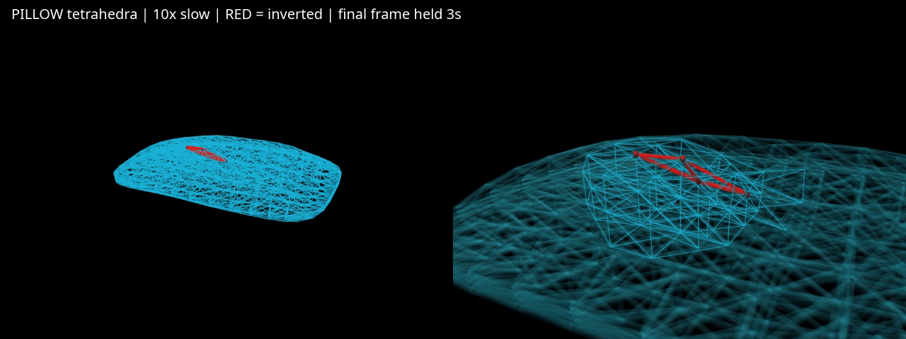

# MuJoCo 3D flex 内容物测试

运行机器：`ubun`。环境：本仓库 `.venv`，MuJoCo 3.17.0 / MJWarp 3.17.0；用户已允许使用现有环境，不安装或升级包。正式行为与速度结论分开；本轮 CPU 行为运行不作吞吐数据。

## 第 1 轮计划（2026-11-09）

**计划来源说明**：开始时已读取 `../..//AGENTS.md` 和父目录规则，`git fetch` / `git pull --ff-only` 显示已是最新，但仓库不存在本文件。用户随后授权“你放开去测试”。本节据用户原始任务重建，不另设通过阈值。用户未给出的 T1 配置沿用 [原平压基准](../contact_transfer/REPORT.md) 和 [修复报告](../contact_transfer/REPORT_repair.md)，选择与测量边界在运行前写明。

**要回答的问题**：原生 `flexcomp dim="3"` 四面体作为内容物，能否做到 Newton 四面体未做到的夹爪接触稳定、参数覆盖 κ 的响应范围、速度可用。只使用原生线性应力–应变弹性（StVK，几何非线性），不加自定义材料力、压密或塑性。

| 编号 | 配置与重复 | 通过标准（用户原文） | 对应用途与下一步 |
|---|---|---|---|
| T1 平压 | 300×250×50 mm、0.3 kg，E=3600 Pa、ν=0.2（μ=1500、λ=1000 Pa）；底层固定、无重力；压板240×200 mm加载19.62 N，YAM节点上/节点间手指加载2 N；0.2 s平滑加载、总8 s、末0.5 s判静止；粗12×10×4、细24×20×8单元；每配置1次，确定性基准 | 支撑反力误差≤5%，末段漂移≤0.05 mm、最大速度≤1 mm/s，超出碰撞厚度的穿透≤1 mm，粗细网格下陷差≤5% | 先确认接触与网格可作为内容物基座；通过才做T2；不通过按停止规则诊断 |
| T2 侧夹提起 | 易弯240×160×50 mm、0.29 kg；中心横夹10 N，提起100 mm，保持2 s；指尖分别对准节点和节点间，每配置1次 | 承重/重量0.98–1.02，下滑≤1 mm，末段最大速度≤1 mm/s | 作为真实摩擦承重的门槛；通过才做T3；不通过按停止规则诊断 |
| T3 参数覆盖 | 两个锚点（易弯同T2；易压350×250×120 mm、0.5 kg），young对数8档×poisson 0/0.3/0.45，每点各跑1次R1y、R1z、R2，使用内容物[响应测法](../content_model/README.md)；E扫范围在T1/T2通过后、正式扫描前补写 | 单调覆盖易弯R1y 0.1–2.0 N/mm、下垂0.2–0.6；易压R1y 0.03–0.5 N/mm、下垂近刚性–0.35。锁死应变附近变硬只记录 | 判断κ参数是否仍有足够表达范围；线弹性缺少压密如实记录 |
| T4 顶面捏取 | 只读加载冻结v1.3归档内pinch.py，套到flex表面顶点；connect、5 ms低通解开；按I-37只计拉离和水平分量、不计下压；pinch_coeff=1/2各1次R4与中心悬挂 | R4拉脱力/夹持力与pinch_coeff相差≤10%；中心捏起悬挂倾角≤5° | 判断既有顶面抓效果规则能否复用；不得以原v1.3的下压力模长直接冒充I-37 |
| T5 速度 | 易压锚点按v2.2顶面抓；CPU单环境实时率、28进程每秒完成抓取数；分段v1.3同机同协议CPU28进程对照；MJWarp64/256/1024仅在3D弹性实际支持时运行；另试dim=3 trilinear/quadratic | 用户未给速度硬阈值，报告实测及与分段模型比值，不自行添加 | 判断训练用途成本；所有进入结论的测速及所有GPU运行须flock /tmp/claude-gpu.lock，优先级低于G3–G5 |

**T1实现选择（运行前）**：`integrator="discrete"`、Newton、100次上限、容差1e-8、步长1 ms；原生弹性Rayleigh阻尼0.02 s；接触radius=1 mm、solref=(0.005,1)、solimp=(0.95,0.99,0.001)，无摩擦、自碰撞关闭。YAM手指直接调用`bag_sim/mj_loose.py::fingertip_xml`，20×40 mm、2 mm圆角；平压时旋转使接触面向下，仅保留竖直平移。节点上位置(0,0)；节点间位置(8⅓,8⅓) mm，粗细网格使用同一世界坐标且都不落在节点上。不同网格的相对下陷差按`abs(fine/coarse-1)`记录，三种工具分别对照。

**测量**：独立float64 StVK能量梯度求固定底层反力，只测量、不回施给仿真；与原生弹性能/活动节点力及能量差分交叉核对。末0.5 s每一步记录节点/工具最大速度，10 ms采样节点与工具位移范围；接触距离已扣除flex半径，以负距离计超出碰撞厚度的穿透，另做表面几何核查。非有限、自动重置、四面体翻转是无有效稳态的失败证据，不能填作静态通过。输出保存模型XML、配置、轨迹、终态网格和源码哈希，已有目录拒绝覆盖。

**停止规则**：T1或T2不通过，诊断限半天；solref、solimp、碰撞半径、vertcollide、步长单独试，不组合调参冒充单因素。3.17本机XML schema无vertcollide，须核查运行时是否有等价开关，不伪造此项。仍不通过则停止，不做T3–T5。任何阈值变化先写理由并告知用户。本轮不改变阈值。

### 用户调整：改为机械臂多角度抓取（2026-11-09，运行前登记）

用户最新要求：**“测试不要平压测机械臂各个角度去抓取”**。因此取消本轮平压与原T1门槛，先用完整YAM机械臂验证实际抓取。上表保留原任务来源，不把未做T1–T5写成通过。

- 两类内容物保持原锚点尺寸/质量；原生3D flex，E=10000 Pa、ν=0.2、阻尼0.02 s，初始粗网格易弯7×5×4点、易压9×7×5点，radius=1 mm、dt=1 ms。参数为未标定探索值，不能据此声称覆盖κ。
- 角度：相对物体长边水平朝向0°/45°/90°/135°；另在0°朝向下倾斜−30°/+30°。两类×6姿态，各1次；先验证0°入口，发现明确实现问题先修复，不批量重复。倾斜角是额外姿态试验，不改v2.2原来竖直下降的定义。
- 使用完整YAM六轴动力学、原生关节/执行器力矩/夹爪行程；只替换指垫接触面为用户指定的20×40 mm、2 mm圆角，保留机械臂其他碰撞。只读导入策略线机械臂工具，不修改`policy/`、`contents/segment/`或`bag_sim/`。
- 顶面抓沿用v2.2：40 mm开口、接触后10 mm/s下压最多15 mm、从首指接触起20 N下压力限、目标10 N、5 ms滤波、合拢最长8 s、提250 mm/保持0.2 s、搬运500 mm/保持0.3 s、放下并松开。类别过压阈值沿用易弯25 N、易压15 N。按v2.2报告success/grasp_fail/drop/over_squeeze/sim_fail；另列setup/compute限制，不能计成真实抓取失败。
- v1.3捏取规则只读加载并校验冻结包。原生connect连表面顶点到实际掌部，约束反力回传机械臂；不以无限力mocap替代机械臂。I-37承载只计拉离与水平分量；不加材料补偿力。规则内40 N/mm、10 mm聚拢行程的指间弹簧保留，并显式记录其贡献。每类加1次0°、pinch_coeff=0原生接触对照，避免把效果连接当成原生四面体的摩擦承重能力。
- 记录每次离桌/接触丢失、顶点翻转、穿透、末端跟踪、真实力矩峰值、连接绑定/超载事件、轨迹。CPU行为运行不报告吞吐；GPU和正式测速仍按原锁约束，但不在本轮角度试验中运行。

### 执行结果

平压短入口保留在`results/20261109_ubun_preflight/`；8 s平压在用户要求变更后主动中断，只有配置/XML，未获得有效结果，不计入验收。平压独立力测量与原生力尚未核对一致，因此其草稿源码不作为可用测量工具交付。多角度入口已完成20 ms冒烟，未作抓取结论。

### 可复用平台与正式角度矩阵补充（运行前，2026-11-09）

用户追加要求：搭好可供不同建模方案复用的流程/平台、测试速度、输出3D flex抓取视频。公共平台管理完整机械臂、指尖、角度、动作阶段、事件判定、记录与计时；模型适配器提供场景、接触目标、质心、模型失效检查与可选捏取连接。原生flex和刚体控制均已完成20 ms入口，后者仅证明替换模型无需改公共动作，不是刚体抓取验收。

- 安装高度从策略工具默认120 mm改为270 mm，抓取起点x=-250 mm、终点x=250 mm。原因：初试搬运末端IK残差110.93 mm/31.02°，不满足真实姿态执行。早期只读诊断主要检查位置残差，未同时检查全部姿态约束，不能据此声称四个水平朝向均可执行；正式矩阵的初始化失败单列，不算内容物失败，也不是全局不可达证明。
- 修复平台实现：指间弹簧由真实编码器开口计算；绑定时机回到冻结v1.3规定的合拢结束后；原生顶面接触即满足接触条件，不额外要求横向接触力；下压深度由实际指尖自首次接触后的位移计算，避免机械臂柔顺误差使指令15 mm却实际只压入约3 mm。上述是执行器适配修复，不修改3 mm最小捏取深度、5 ms释放、类别力上限或原验收阈值。
- 之前完整试跑只作诊断：易弯45°、易压0°均到达v2.2任务终点，但记录穿透分别2.016/2.921 mm，尚不能说接触可靠。视频为已保存状态的回放，标明连接开启；渲染器经核查为CPU llvmpipe，无GPU抢占。
- 新矩阵为两类×6姿态+两类0°纯接触对照，共14次，每配置一次，结果写`results/20261109_ubun_platform_r1/`。源码在每次运行开始时快照；20 ms存状态，保留原始失败。速度另运行同平台易压0°：单环境1次、28进程28次，持锁，分别报告完整evaluate数/秒、成功抓取数/秒、单环境实时率及结果组成，不把早停失败当成完整成功抓取。当前共享锁由其他线持有，未授权绕过。

### 本轮结果与用途判断（2026-11-09，机器ubun）

**平台已搭建并实际运行；当前3D flex候选未通过可靠抓取。** 公共流程、模型适配、记录、CPU测速、四面体回放可供后续模型复用。当前模型的完整成功抓取链路尚未通过，不把平台可运行写成内容物可用。

| 工作 | 已完成证据 | 对应用途/限制 |
|---|---|---|
| 统一平台 | `grasp_platform.py`、`angles.py`、`run_suite.py`；原生flex和刚体控制分别完成20 ms入口 | 后续模型只写适配器；刚体仅验证替换入口，没有硬物抓取通过结论 |
| 多角度抓取 | [14次汇总](results/20261109_ubun_platform_r1/summary.json)：4 sim_fail、5 grasp_fail、5 setup_fail | 9次进入动力学，其中4次翻转；5次未建立抓取；无成功。初始化5次未找到满足精度的解，不能解释为材料失败 |
| 捏取效果 | 冻结v1.3源码/归档哈希核对，掌部connect反作用回传；I-37实际连接符号检查2项通过 | 未执行原T4的R4系数1/2拉脱验收或≤5°悬挂验收，不能宣称效果规则已迁移验收 |
| 速度 | 下表及[持锁结果](results/20261109_ubun_cpu_speed/summary.json) | 仅为当前易压长方体失败评估的成本，不是成功抓取训练吞吐 |
| 枕头形与可视化 | [几何检查](results/20261109_ubun_pillow/bendable45/geometry_check.json)、[局部翻转视频](results/20261109_ubun_pillow/bendable45/pillow-inversion-closeup.mp4) | 真正改变三维参考网格，四面体填满枕头；红色是翻转单元，末段10倍慢放/末帧3 s，隐藏机械臂遮挡 |
| 原T1/T2/T3/T5剩余项 | T1由用户取消；原T2侧夹未运行；κ覆盖、分段v1.3同机对照、MJWarp批量、插值flex未运行 | 不能回答整个材料参数域是否可用，也不能给GPU接入结论；没有加自定义材料力补失败 |

角度矩阵逐项结果（每项1次；详细配置/轨迹/源码快照见同名trial）：

| 样本 | 类别 | 水平/倾斜角° | pinch_coeff | 结果 | 阶段 |
|---|---|---|---:|---|---|
| trial_000 | 易弯 | 0/0 | 1 | sim_fail | 合拢 |
| trial_001 | 易弯 | 45/0 | 1 | sim_fail | 合拢 |
| trial_002 | 易弯 | 90/0 | 1 | setup_fail | 初始化 |
| trial_003 | 易弯 | 135/0 | 1 | setup_fail | 初始化 |
| trial_004 | 易弯 | 0/−30 | 1 | grasp_fail | 下压超时 |
| trial_005 | 易弯 | 0/+30 | 1 | sim_fail | 合拢 |
| trial_006 | 易压 | 0/0 | 1 | grasp_fail | 合拢 |
| trial_007 | 易压 | 45/0 | 1 | grasp_fail | 合拢 |
| trial_008 | 易压 | 90/0 | 1 | setup_fail | 初始化 |
| trial_009 | 易压 | 135/0 | 1 | setup_fail | 初始化 |
| trial_010 | 易压 | 0/−30 | 1 | setup_fail | 初始化 |
| trial_011 | 易压 | 0/+30 | 1 | grasp_fail | 合拢 |
| trial_012 | 易弯 | 0/0 | 0 | sim_fail | 合拢 |
| trial_013 | 易压 | 0/0 | 0 | grasp_fail | 提起 |

矩阵之后修正了未到达的超载后弹簧释放、松开等待阶段，并移除额外质心升高门槛；完整矩阵没有重复运行。正式速度使用修正后的流程，结果仍在合拢早停。复现历史矩阵以各次保存源码为准，不能把尚未经过成功样本的末段流程称为已验收。

### CPU速度（持锁；长方体易压锚点）

命令：`flock /tmp/claude-gpu.lock .venv/bin/python -B test/flex3d/benchmark.py --output test/flex3d/results/NEW_RUN`。同一把锁覆盖两项；数值库每进程1线程，包含建模、执行、记录成本。

| 配置 | 结果组成 | 墙钟s | 完成evaluate/s | 成功抓取/s | 实时率/汇总仿真秒每墙钟秒 |
|---|---|---:|---:|---:|---:|
| CPU单环境，1次 | 1 grasp_fail，仿真11.376 s | 76.108 | 0.01314 | 0 | 0.1495 |
| CPU28进程，28次 | 28 grasp_fail，各仿真11.376 s | 154.535 | 0.18119 | 0 | 2.0612（合计） |

机器为i9-14900KF/32逻辑CPU。测速时观察到策略线3个CPU抓取进程并发，见[环境与负载说明](results/20261109_ubun_cpu_speed/context.json)：这是本次共享负载下的成本，不是独占机器吞吐上限。28次都在合拢后返回失败，不能把0.18119当作完整成功抓取数/秒。没有分段v1.3同机同平台对照，枕头形也未测速。

### 凹陷、网格与翻转诊断

早期45°演示实际接触后只下降约3.21 mm，随后由捏取连接带起；不能把视频外观当作已经压入15 mm或原生摩擦承重的证据。用户要求明确看四面体后，增加网格剖视与局部慢放；又按用户要求新增真实枕头形参考网格，保持材料和质量，不是渲染时把方块变形。

| 独立诊断 | 顶点/四面体 | 首次采样检出翻转s | 最小体积比J | 峰值下压力N | 超出碰撞厚度的采样穿透mm |
|---|---:|---:|---:|---:|---:|
| 长方体，水平网格40→20 mm，dt=1 ms | 468/1728 | 5.0410 | −0.03802 | 8.684 | 0.338 |
| 同一细网格，只有dt改0.5 ms | 468/1728 | 5.0405 | −0.03377 | 8.655 | 0.357 |
| 枕头形，dt=1 ms | 468/1728 | 5.2010 | −0.01330 | 8.297 | 0.263 |

原始记录：[细网格](results/20261109_ubun_mesh_diagnostic/bendable45_fine/result.json)、[半步长](results/20261109_ubun_mesh_diagnostic/bendable45_fine_halfstep/result.json)、[枕头](results/20261109_ubun_pillow/bendable45/result.json)。上述三次都在下压阶段翻转、捏取事件为空，排除了“connect已经拉着物体而把它拉翻”的解释。20 ms采样不能定位首次翻转到子毫秒；这里只能确认减半步长没有消除现象。

细网格[同一809号单元](results/20261109_ubun_mesh_diagnostic/bendable45_fine/tracked_tet809.json)的J在5.001/5.021/5.041 s为0.06315/0.01367/−0.03155。翻转前最小主伸长约0.01084，即某方向已压到原长约1.1%；位置在指尖下方上层网格。这是局部压扁后越过零体积的证据。[原生StVK弹性文档](https://mujoco.readthedocs.io/en/3.17.0/XMLreference.html#flex-elasticity)说明其适合有限转动与小应变；从其应变能形式可推得没有J趋零时发散的体积屏障，因此“大压缩下抗压失稳且没有压密硬化”是当前主要解释。尚未完成solref/solimp/radius独立对照，不能把所有数值接触或控制因素都排除，更不能据此否定MuJoCo全部参数域。

审计曾误用归一化`flex_vert0`作世界坐标参考，已保留标为invalid的初稿；最终[反演审计](results/20261109_ubun_mesh_diagnostic/bendable45_fine/inversion_audit.json)用静止世界坐标，J与运行时检测一致，不使用初稿数值。

枕头包络240×160×50 mm、中央厚50 mm、边缘缝口6 mm，总质量0.29 kg，初始四面体均非退化。新形状尚未做材料标定，均匀分配到顶点的质量也不等于均匀体积密度。



### 检查、交接与下一步

- 公共平台与接口：[README.md](README.md)，项目AGENTS已按用户要求登记为后续模型抓取测试入口。
- I-37连接方向/水平分量2项真实MuJoCo检查通过；32项冻结源码及归档哈希通过。播放时间、剖切、旋转、播放按钮的JS执行检查通过；当前CUA没有可用浏览器，未做真实浏览器布局验收。视频用CPU llvmpipe渲染，已检查枕头末帧红色翻转区域。
- 统一保存失败、配置、XML、源码快照、轨迹与视频；未修改内容物、袋子或策略线源码，环境未安装/升级。
- 下一步必须先使候选模型在已有力限和实际压入协议下不翻转，并修复/核查机械臂初始化与动态跟踪，再谈可靠抓取与κ覆盖。当前不进入GPU大批量训练；后续其他模型沿用本平台，不能靠另换判定流程来获得可比的“通过”。

## 分段内容物 v1.3 接入：本轮计划（2026-11-09，ubun）

用户要求查看分段内容物视频，并立即用统一平台测试。只新增模型适配器，冻结内容物和策略线只读；先短入口，再执行平台原有两类×六姿态＋两类纯接触对照，共14次、每配置1次。输出为 `test/runs/2026-11-09/contents/segmented-v13-yam-r1/`。行为运行持 `flock /tmp/claude-gpu.lock`，不将其耗时作为吞吐。

- 模型：冻结v1.3归档（SHA256 `940efb2f424e8920940687f1a313f93a09cbc64a5c81ff6df45ffc93edad415e`），易弯36段/0.29kg，易压48段/0.5kg；尺寸和平台3D flex锚点相同。使用发布版bushing、原生阻尼/限位/压密门控及Newton参考配置，模型步长0.4ms，区别于原3D flex的1ms；不冒充严格同离散器比较。
- 平台机械臂、安装、指尖、角度、下压/闭合/提起/搬运/放下流程、10N目标、类别过压力限及结果判定不改。捏取系数两类均为平台默认1，对照0；易压冻结锚点默认2并未用于本矩阵。连接锚点改接动态掌部，两端均取当前实际捏点，不移动材料。与平台原生flex一致，只计拉离与水平载荷（I-37），其余沿用冻结v1.3的5ms解除与聚拢弹簧。
- 入口核对实际模型质量、段数、bushing存在、实际步长、冻结指纹、两端连接锚点一致及反作用。正式结果同时报告原任务结局、模型越限、MuJoCo警告、穿透、非指尖接触和跟踪误差，不将任务success自动视为物理验收通过。初始化失败单列。
- 停止规则：实现异常先修入口再重试，保留失败；正式物理失败保留并继续既定角度矩阵，不调材料/门槛挑结果。单例墙钟上限沿用1800s。结束后生成至少两类代表视频，使用保存状态和CPU软件渲染，字幕标明分段v1.3和原结果；本轮不做GPU移植、训练、实物标定或κ覆盖。

### 分段模型首轮结果

完整14次均已结束：**4 success、5 grasp_fail、5 setup_fail，无进入动力学后的sim_fail，9次动力学均无MuJoCo警告**。两类0°/45°、pinch_coeff=1均完成提起、搬运和放下；90°/135°四次及易压−30°一次未通过初态IK，不解释为材料失败。易弯±30°与易压+30°未建立合格抓取；两类0°、pinch_coeff=0的纯接触对照均在提起时失夹。

| 条件（各1次） | 易弯 | 易压 |
| --- | --- | --- |
| 0° / 0°，系数1 | success | success |
| 45° / 0°，系数1 | success | success |
| 90° / 0°，系数1 | setup_fail | setup_fail |
| 135° / 0°，系数1 | setup_fail | setup_fail |
| 0° / −30°，系数1 | grasp_fail | setup_fail |
| 0° / +30°，系数1 | grasp_fail | grasp_fail |
| 0° / 0°，系数0 | grasp_fail | grasp_fail |

四个任务success的峰值穿透分别0.614/0.542/0.850/0.956mm，非指尖接触穿透0；机械臂跟踪峰值42.08/42.05/43.41/43.37mm，明显偏大。本平台原判定不自动以该峰值改判；因此这里只记录任务完成，不宣称执行跟踪、响应/连接迁移或完整物理验收通过。低速行为耗时不是吞吐；未做重复性、GPU、κ覆盖或新的冻结。

入口3项集成检查通过，覆盖两类实际质量/段数/连接数和步长、绑定不移动材料/两端世界锚点一致、真实MuJoCo连接拉离/压向/剪切的负载符号和解除；首轮测试夹具类型错误已修复，未修改物理或断言。短入口20ms无警告。源码/配置/轨迹/原始失败与[矩阵汇总](../runs/2026-11-09/contents/segmented-v13-yam-r1/matrix/summary.json)均已保留。

命令（仓库根目录，ubun）：

```sh
OPENBLAS_NUM_THREADS=1 OMP_NUM_THREADS=1 MKL_NUM_THREADS=1 flock /tmp/claude-gpu.lock .venv/bin/python -B -m unittest discover -s test/flex3d -p test_segmented.py -v
OPENBLAS_NUM_THREADS=1 OMP_NUM_THREADS=1 MKL_NUM_THREADS=1 flock /tmp/claude-gpu.lock .venv/bin/python -B test/flex3d/run_suite.py behavior --backend segmented --workers 2 --output test/runs/2026-11-09/contents/segmented-v13-yam-r1/matrix
```

任务检查：[segmented-v13-platform-test.md](../../reports/segmented-v13-platform-test.md)。下一步先核查成功样本跟踪峰值所在阶段和姿态误差，保留本轮动作/结果作为基线，不能直接把4个成功作为训练放行。

视频已完成：[易弯45°](../runs/2026-11-09/contents/segmented-v13-yam-r1/bendable-yaw45-clean.mp4)、[易压45°](../runs/2026-11-09/contents/segmented-v13-yam-r1/compressible-yaw45-clean.mp4)。均为1280×480、20fps、1倍速，318/284帧，ffprobe计数与渲染记录一致，完整ffmpeg解码通过；人工查看首帧及易压中段。只在记录状态间插值显示，不重新积分；Mesa llvmpipe已确认。初版显示因tendon几何超容量而中断，改为不显示tendon后重导，未改变轨迹，已移除无用途的中断MP4/PPM。

### κ 交互预览计划（同轮用户追加）

用户确认调节整体响应参数κ。新增 `test/content_model/parameter_ui.py` 和同名界面，调用同一冻结v1.3的映射/本构和0.4ms CPU步进，不修改模型源码。提供横向/厚度刚度、下垂比、阻尼和外载；前三项限制在该类别/分段数的冻结映射范围。调参重建并计算3s，显式显示越限及求解警告。界面材料预览分别使用边界段对向力、顶层力或固定一端的重力响应，不是新抓取执行器，也不沿用R1/R2测法去宣称响应命中。

验证范围：两类初态与三个模式入口、参数边界拒绝、真实载荷下软硬设置产生不同位移、HTTP输入/暂停/重建、JS语法及滑块/绘图契约。CPU物理检查持共享锁；界面日常运行是探索预览，不产生正式吞吐/验收。当前CUA浏览器清单为空，若仍无浏览器则明确保留浏览器视觉/真实拖动验证限制。

κ界面结果：3项CPU物理检查通过，两类×三模式均进入有限、无警告的0.1s入口；同5N下ky=0.12与1.0N/mm的1.2s真实计算，前者压缩率比后者多于2个百分点。页面与元数据HTTP200，5种非法请求400，配置重建与暂停生效；900/360px JS交互/绘图契约通过。没有浏览器可作实际布局/拖动验收。启动方式见[测试入口](../content_model/TOOLS.md)，[任务检查](../../reports/segmented-parameter-ui-test.md)。
